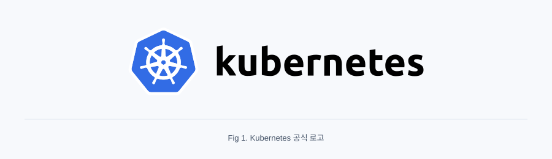
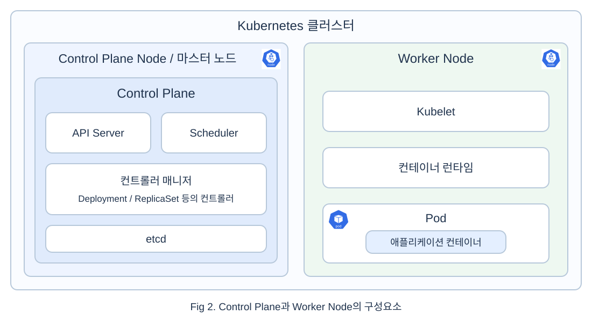
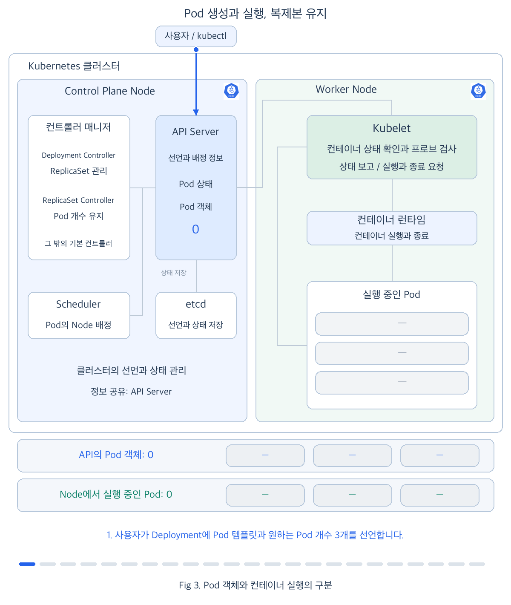
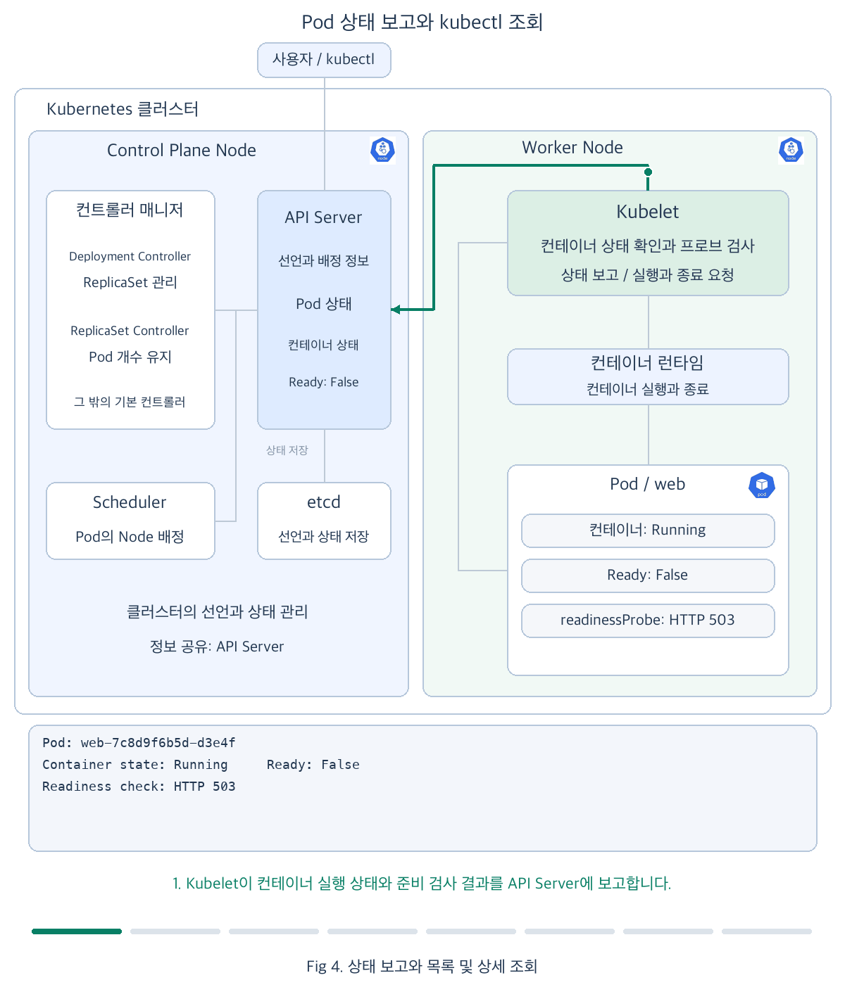
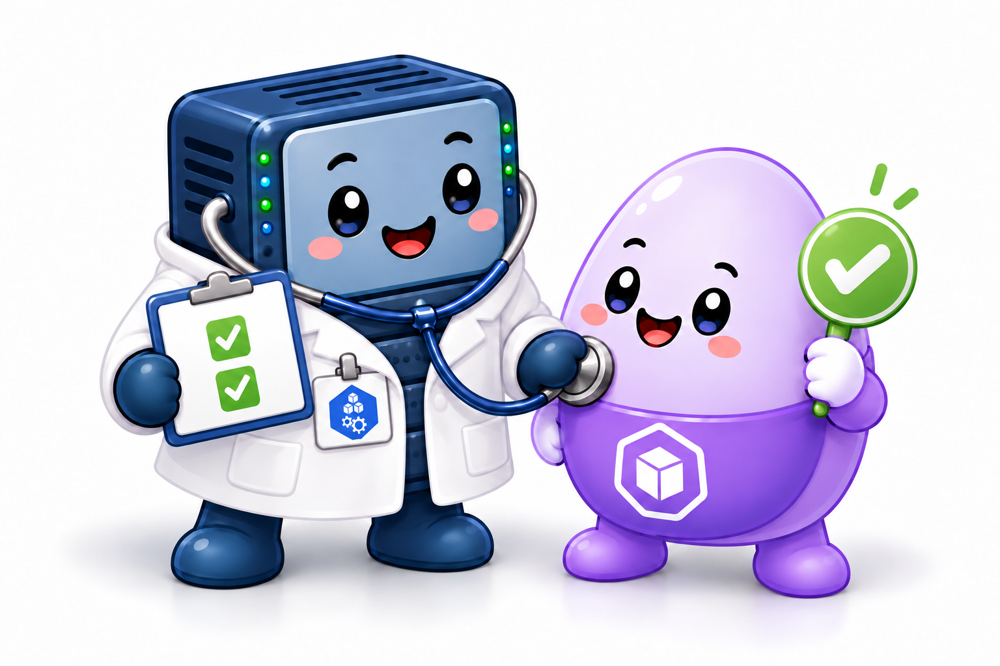
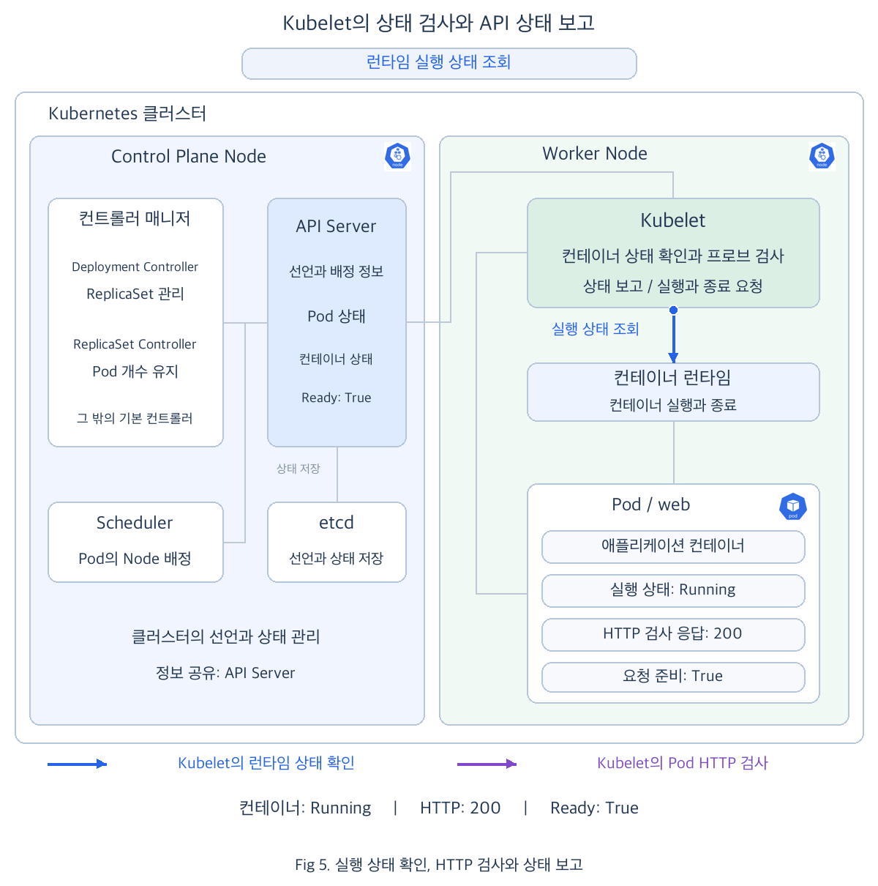
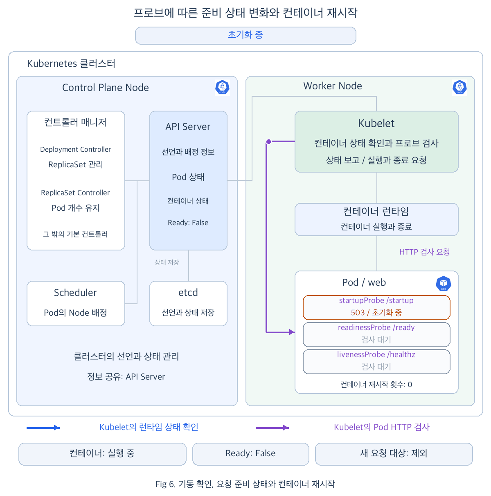

# Chap04. Pod의 실행과 상태 확인

> 16장 연재의 넷째 글입니다. Pod가 생성되어 컨테이너를 실행하는 과정과 상태를 조회하는 방법을 살펴봅니다. 이어서 시작·준비·생존 프로브가 애플리케이션 상태를 어떻게 구분하는지 확인합니다.

## 들어가며

<div align="center">



</div>

3장에서는 Deployment에 애플리케이션 이미지와 유지할 Pod 개수를 선언했습니다. 웹 서버를 세 개 실행하도록 선언했다면, 이제 궁금한 것은 그 서버들이 언제부터 요청을 받을 수 있느냐는 점입니다. 이미지를 내려받는 Pod도 있고, 컨테이너는 실행됐지만 초기 데이터를 읽느라 응답할 준비가 끝나지 않은 Pod도 있을 수 있습니다.

Kubernetes는 선언된 Pod를 실행할 Node에 배정하고, 컨테이너를 시작한 뒤에도 상태를 계속 확인합니다. 이 과정에서 컨트롤러와 Scheduler, Kubelet이 어떻게 작업을 이어 가는지 이해하면, Pod 목록에 나타나는 상태가 무엇을 의미하는지 읽을 수 있습니다.

특히 웹 서버의 프로세스가 실행 중인 것과 사용자 요청에 응답할 수 있는 것은 구분해야 합니다. 이번 글에서는 Pod가 실행되는 과정을 따라가며 이 차이를 확인하고, 애플리케이션의 준비 여부와 재시작 필요 여부를 Kubernetes에 알려 줄 검사 기준을 살펴봅니다.

## 1. Pod의 생성과 실행을 담당하는 구성 요소

Deployment에 적은 실행 구성이 실제 컨테이너가 되기까지는 여러 구성 요소의 작업이 이어집니다. 그 경로를 따라가기 위해 먼저 클러스터를 관리하는 쪽과 컨테이너를 실행하는 쪽의 역할을 구분하겠습니다.

### 1.1 클러스터 구성 요소의 위치와 역할

<div align="center">



</div>

Pod를 실행하려면 클러스터 전체의 배치를 결정하는 역할과 각 Node에서 컨테이너를 실행하는 역할이 함께 필요합니다. Fig 2의 **Control Plane**은 클러스터를 관리하는 구성 요소들의 집합으로, Control Plane Node에서 실행됩니다. 오른쪽 Worker Node에서는 배정된 Pod의 컨테이너가 실행됩니다. 각 구성 요소는 다음 역할을 맡습니다.

**Control Plane Node(마스터 노드)의 구성요소**

- **API Server**: 리소스의 생성, 조회, 변경 요청을 받고, 각 구성요소가 선언과 상태를 공유하도록 합니다.
- **컨트롤러**(Controller): 원하는 상태와 실제 상태를 비교해 차이를 줄이는 프로세스입니다. 컨트롤러 매니저(`kube-controller-manager`)가 Deployment Controller와 ReplicaSet Controller 등 여러 기본 컨트롤러를 실행합니다.
- **Scheduler**: 아직 Node를 배정받지 못한 Pod의 실행 조건을 확인하고, Pod를 실행할 Node를 선택합니다.
- **etcd**: API Server가 리소스의 선언과 상태를 저장하는 저장소입니다.

**Worker Node의 구성요소**

Worker Node에서는 배정된 Pod의 컨테이너가 실행됩니다. 이 실행을 담당하는 구성요소는 다음과 같습니다.

- **Kubelet**: 자신이 실행되는 Node에 배정된 Pod를 확인하고, 컨테이너의 실행과 상태 검사, 종료를 관리하는 에이전트입니다.
- **컨테이너 런타임**: 이미지를 준비하고 컨테이너 프로세스를 실제로 시작하거나 중지하는 소프트웨어입니다.

이 역할들을 웹 애플리케이션의 실행 과정으로 연결해 보겠습니다. 사용자가 Deployment를 선언하면 API Server가 이를 받아 etcd에 저장합니다. 컨트롤러는 API Server에서 선언을 확인하고 필요한 Pod의 생성을 요청합니다. 생성된 Pod에는 실행할 장소가 필요하므로, Scheduler가 적합한 Worker Node를 골라 배정 결과를 API Server에 기록합니다.

이제 작업은 해당 Worker Node로 이어집니다. 그 Node의 Kubelet이 API Server에서 자신에게 배정된 Pod를 확인하고 컨테이너 런타임에 실행을 요청하면, 런타임이 이미지를 준비해 컨테이너를 시작합니다. Kubelet은 이후 상태를 API Server에 보고하고, 컨트롤러는 보고된 상태를 바탕으로 원하는 Pod 개수가 유지되는지 확인합니다. 이렇게 API Server에 모인 선언과 상태가 Control Plane의 판단과 Worker Node의 실행을 연결합니다. [[1]](#ref-1)

### 1.2 Pod의 생성과 컨테이너 실행 경로

앞서 살펴본 역할 분담을 웹 Pod 세 개의 생성 과정에 적용해 보겠습니다. API에 Pod가 기록되는 시점과 Node에서 컨테이너가 실행되는 시점을 구분하면, 선언이 실제 실행으로 이어지는 경로를 더 구체적으로 볼 수 있습니다.

<div align="center">



</div>

Fig 3은 Deployment로 Pod 세 개를 실행한 뒤, Pod 하나를 삭제했을 때 복제본을 회복하는 과정입니다. 파란색 행은 API에 남아 있는 Pod 객체 수를, 초록색 행은 Worker Node에서 컨테이너가 실행 중인 Pod 수를 표시합니다. 이 예시에서는 Pod마다 컨테이너 한 개를 실행합니다.

사용자가 `kubectl apply`로 Pod 템플릿과 유지할 Pod 개수 3개를 선언합니다. API Server가 이를 받아 저장하면, 컨트롤러가 확인할 실행 기준이 마련됩니다.

이 선언을 확인한 Deployment Controller는 해당 템플릿으로 Pod 세 개를 유지할 ReplicaSet의 생성을 요청합니다. Deployment와 ReplicaSet은 API에 저장되는 리소스이며, 그 선언을 읽고 작업하는 주체가 컨트롤러입니다. 3장에서 살펴본 Namespace는 이때 생성되는 리소스에도 이어집니다. Deployment가 `default`에 있으면 그 아래의 ReplicaSet과 Pod도 `default`에 생성됩니다.

ReplicaSet이 생성되면 ReplicaSet Controller가 원하는 개수 3개와 현재 Pod 객체 수 0개를 비교합니다. 세 개가 부족하므로 API Server에 Pod A, B, C의 생성을 요청합니다. 이때 API에는 Pod 객체가 생기지만, Worker Node에서 컨테이너를 실행하려면 먼저 Node 배정이 필요합니다.

이제 Scheduler가 아직 배정되지 않은 Pod의 자원 요청량과 배치 조건을 확인하고, 실행 가능한 Node를 골라 배정 결과를 API에 기록합니다. 이 과정을 **스케줄링**(scheduling)이라고 합니다. 조건을 만족하는 Node가 없으면 Pod는 배정을 기다리며, 여러 Pod가 같은 Node에 배정될 수도 있습니다.

선택된 Node의 Kubelet이 API에서 자신에게 배정된 Pod를 확인합니다. 이어 실행 환경을 준비하고 런타임에 컨테이너 실행을 요청하면, 런타임이 이미지를 준비해 Pod A, B, C의 컨테이너를 시작합니다. 이 시점에 실행 중인 Pod 수도 세 개가 됩니다.

세 Pod가 실행 중인 상태에서 사용자가 Pod C의 삭제를 요청하면, API Server가 해당 Pod를 삭제 중으로 표시합니다. Kubelet은 API에서 이 요청을 확인한 뒤 런타임에 컨테이너 종료를 요청합니다. 런타임이 종료 절차를 수행하면 Pod C의 컨테이너가 멈추고, 실행 중인 Pod는 두 개로 줄어듭니다.

컨테이너 종료가 끝나면 Kubelet은 Pod C의 종료 상태를 보고하고 API 객체의 최종 삭제를 요청합니다. API Server가 객체를 제거하면 API에 남은 Pod 수도 두 개가 됩니다. 컨테이너가 멈추는 시점과 API에서 Pod 객체가 사라지는 시점을 구분해 볼 수 있습니다. [[2]](#ref-2)

ReplicaSet Controller는 원하는 개수 3개에 비해 유지 중인 Pod가 두 개임을 확인합니다. 부족한 한 개를 채우기 위해 같은 템플릿으로 새 Pod D의 생성을 요청합니다.

새로 생성된 Pod D도 앞서와 같은 실행 경로를 거칩니다. Scheduler가 실행 조건을 확인하고 Node를 선택해 API에 기록합니다. 해당 Node의 Kubelet이 배정 정보를 읽고 런타임에 실행을 요청하면, Pod D의 컨테이너가 시작됩니다. 이로써 실행 중인 Pod가 다시 세 개가 됩니다.

Fig 3에서는 Pod C의 종료와 제거 뒤에 Pod D의 생성이 이어집니다. 실제로는 삭제 중인 Pod를 유지할 개수에서 제외하므로 Pod C의 종료가 끝나기 전에 대체 Pod 생성이 시작될 수 있고, 각 Pod의 배정과 실행 시점도 서로 다를 수 있습니다. 따라서 같은 Deployment에서 만든 Pod라도 현재 어느 단계까지 진행됐는지 개별 상태를 확인해야 합니다.

## 2. Pod의 실행 상태와 준비 상태

앞서 Kubelet은 컨테이너를 실행한 뒤 Pod 상태를 API에 보고했습니다. 이 정보를 조회하면 컨테이너가 실행을 기다리는지, 실행 중인지, 요청을 받을 준비까지 마쳤는지 확인할 수 있습니다. 웹 Pod 세 개를 조회하며 그 차이를 살펴보겠습니다.

다음 명령과 출력은 `default` Namespace에 있는 `app: web` Label의 Pod 세 개를 비교하는 예시입니다. `kubectl`의 현재 Namespace도 `default`인 상황을 기준으로 합니다. 다른 Namespace에 배포했다면 목록 조회와 상세 조회에 같은 `-n` 옵션을 붙여 해당 Pod를 찾습니다.

<div align="center">



</div>

Fig 4는 Kubelet이 보고한 상태가 사용자의 명령 출력으로 나타나는 경로입니다. Worker Node에서 확인한 상태가 API Server에 저장되고, 사용자는 그 정보를 조회합니다.

Kubelet은 컨테이너 실행 상태와 준비 검사 결과를 API Server에 보고하고, API Server는 이를 etcd에 저장합니다. 이후 조회 명령은 이렇게 API에 반영된 상태를 읽습니다. 상태 보고는 사용자의 조회 여부와 관계없이 반복됩니다.

이 상태를 확인하려고 사용자가 `kubectl get pods -l app=web`을 실행하면 `kubectl`이 API Server에 현재 Namespace에서 `app=web`인 Pod 목록을 요청합니다. API Server가 Pod 정보를 반환하면 `kubectl`은 이를 표로 표시합니다. 사용자는 여러 Pod의 실행 상태와 준비 여부를 한 번에 비교할 수 있습니다.

목록에서 Pod의 전체 진행 단계만 따로 확인하고 싶다면, 출력할 필드로 이름과 `status.phase`를 지정합니다. `kubectl`은 응답에서 해당 값을 골라 `PHASE` 열에 표시합니다. 같은 Pod 정보에서 생명주기의 요약값을 따로 확인하는 과정입니다.

목록에서 준비되지 않은 Pod를 발견하면 `kubectl describe pod`로 그 Pod의 상세 정보와 관련 이벤트를 요청합니다. 응답에 담긴 컨테이너 상태, Pod 조건, 이벤트를 함께 읽으면 준비가 끝나지 않은 이유를 찾을 수 있습니다.

Fig 4의 Worker Node는 구성을 단순화한 것이며, 아래 출력에는 서로 다른 Node의 Pod와 배정을 기다리는 Pod를 함께 담았습니다. 먼저 목록에서 비교할 항목을 확인한 뒤, 필요한 Pod의 상세 정보로 범위를 좁혀 보겠습니다.

### 2.1 Pod 목록의 실행 상태와 준비 여부

각 Pod의 진행 상황을 비교하려면 먼저 `get pods`로 목록을 조회합니다. `-l app=web`은 해당 Label을 가진 Pod를 선택하고, `-o wide`는 Pod IP와 Node 등 추가 정보를 표시합니다.

```bash
# 웹 Pod의 준비 여부, 재시작 횟수, 실행 Node를 함께 조회
kubectl get pods -l app=web -o wide
```

```text
NAME                   READY   STATUS    RESTARTS   AGE   IP           NODE
web-7c8d9f6b5d-a1b2c    1/1     Running   0          5m    10.244.1.8   worker-1
web-7c8d9f6b5d-d3e4f    0/1     Running   0          5m    10.244.2.9   worker-2
web-7c8d9f6b5d-g5h6j    0/1     Pending   0          20s   <none>       <none>
```

위 출력은 주요 열만 발췌한 예시입니다.

- `READY`: 준비된 컨테이너 수와 전체 컨테이너 수입니다. `1/1`과 `0/1`을 비교해 요청 준비 여부를 확인합니다.
- `STATUS`: 실행 상태나 오류 이유를 요약합니다. 요청 준비 여부는 `READY`와 함께 확인합니다.
- `NODE`: 배정된 Node입니다. `<none>`이면 아직 Node를 배정받지 못했습니다.

두 번째 Pod는 `Running`이지만 `READY`가 `0/1`이므로 컨테이너 실행과 요청 준비가 서로 다른 상태임을 알 수 있습니다. 세 번째 Pod는 `NODE`가 `<none>`이므로 Node 배정을 기다리고 있습니다. Node 배정 후 이미지를 내려받는 Pod도 `Pending`일 수 있으므로, 실행 준비가 어디까지 진행됐는지는 다른 정보와 함께 판단해야 합니다. 이를 위해 Pod 전체의 진행 단계와 개별 컨테이너의 상태를 구분할 필요가 있습니다.

### 2.2 Pod 단계와 컨테이너 상태

목록에서 확인한 `Running`과 `Pending`은 Pod의 전체 진행 상황을 보여 줍니다. 이처럼 Pod 생명주기를 요약해 `status.phase`에 기록한 값을 **Pod 단계**(Pod Phase)라고 합니다. 목록의 `STATUS` 열에는 오류 이유도 표시될 수 있으므로, API에 기록된 단계가 필요하면 해당 필드를 직접 조회합니다.

```bash
# API에 기록된 각 Pod의 단계를 별도 열로 조회
kubectl get pods -l app=web -o custom-columns='NAME:.metadata.name,PHASE:.status.phase'
```

```text
NAME                   PHASE
web-7c8d9f6b5d-a1b2c    Running
web-7c8d9f6b5d-d3e4f    Running
web-7c8d9f6b5d-g5h6j    Pending
```

이 명령은 `.status.phase`를 `PHASE` 열로 조회합니다.

- `PHASE: Running`: Node에 배치되고 모든 컨테이너가 생성되었으며, 하나 이상이 실행 중이거나 시작 또는 재시작 중인 단계입니다. 두 번째 Pod처럼 요청 준비를 마치지 못한 경우도 포함됩니다.
- `PHASE: Pending`: Node 배정이나 이미지 다운로드 등 컨테이너 실행 준비를 기다리는 단계입니다.

Pod 단계는 Pod 전체의 요약이고, **컨테이너 상태**(Container State)는 개별 컨테이너의 실행 상태입니다. 컨테이너가 재시작을 기다리는 `Waiting`이어도 Pod 단계는 `Running`일 수 있습니다. 기본 목록의 `STATUS`에 표시되는 `CrashLoopBackOff`는 재시작 대기를, `Terminating`은 삭제 진행을 나타내며 Pod 단계 자체와는 구분합니다. 전체 단계의 정의는 공식 문서[[3]](#ref-3)에서 확인할 수 있습니다. 앞의 두 웹 Pod는 모두 `Running` 단계에 있으므로, 준비 여부가 다른 이유를 찾으려면 컨테이너 상태와 검사 기록까지 확인해야 합니다.

### 2.3 준비 상태와 이벤트의 상세 확인

`kubectl describe pod`는 개별 컨테이너의 상태와 준비 여부, 최근 발생한 이벤트를 함께 보여 줍니다. 목록에서 `0/1`로 나타난 두 번째 Pod를 조회해 요청을 받을 준비가 끝나지 않은 이유를 찾아보겠습니다.

```bash
# 실행 중이지만 준비되지 않은 Pod의 컨테이너 상태와 이벤트 조회
kubectl describe pod web-7c8d9f6b5d-d3e4f
```

```text
Name:         web-7c8d9f6b5d-d3e4f
Node:         worker-2/192.168.1.12
Status:       Running
Containers:
  web:
    State:          Running
    Ready:          False
    Restart Count:  0
Conditions:
  Type              Status
  PodScheduled      True
  Initialized       True
  ContainersReady   False
  Ready             False
Events:
  Type     Reason     Age                From     Message
  Warning  Unhealthy  5s (x3 over 15s)    kubelet  Readiness probe failed: HTTP probe failed with statuscode: 503
```

출력은 관련 필드만 발췌했습니다. 이 예시에서는 실행 여부, 준비 여부, 실패 원인을 함께 봅니다.

- `State: Running`과 컨테이너의 `Ready: False`: 프로세스는 실행 중이지만 요청을 받을 준비는 끝나지 않았습니다.
- `Conditions`의 `Ready: False`: Pod 전체도 요청 준비를 마치지 못했습니다. 이처럼 특정 조건의 충족 여부를 기록한 값을 **Pod 조건**(Pod Condition)이라고 합니다.
- `Events`의 `Message`: 준비 검사가 HTTP 503 응답으로 실패했음을 보여 줍니다. **이벤트**(Event)는 이런 변화와 이유를 기록하며, 여기서는 `kubelet`이 검사 실패를 보고했습니다.

이 Pod는 Node 배정이 끝났고 컨테이너도 실행 중이지만 준비 검사에 실패했습니다. 따라서 Pod를 배치하지 못했거나 컨테이너가 종료된 상황과 구분할 수 있습니다. 이벤트는 일정 시간이 지나면 사라질 수 있으므로 문제가 발생했을 때 최근 기록을 확인하는 편이 좋습니다. 여기서 원인을 읽으려면 Kubelet이 무엇을 기준으로 준비 검사를 수행했는지 이해해야 합니다.

## 3. 실행 중인 Pod의 애플리케이션 상태 검사

앞의 예시에서 웹 컨테이너는 실행 중이었지만 준비 검사에 503을 반환했습니다. Kubelet은 이 두 정보를 서로 다른 경로로 확인합니다. 컨테이너 프로세스의 실행 여부는 런타임에서 확인하고, 애플리케이션이 요청에 응답할 수 있는지는 **프로브**(Probe)라는 상태 검사 기능으로 확인합니다.

<div align="center">



</div>

위 그림에서 Node가 청진기로 Pod를 살피는 모습은, 해당 Node의 Kubelet이 Pod 안의 애플리케이션을 검사하는 역할을 나타냅니다. 점검표의 두 체크는 애플리케이션의 기동 완료와 요청 준비 여부를 구분해 확인한다는 뜻이며, Pod가 든 초록색 체크는 요청을 받을 준비가 된 상태를 표현합니다.

애플리케이션마다 준비를 마치는 조건이 다르므로, 사용자는 Pod 설정에 검사할 경로와 주기, 실패 기준을 선언합니다. Kubelet은 이 기준으로 검사한 결과에 따라 요청을 받을 준비 상태를 바꾸거나, 재시작이 필요한 컨테이너를 종료합니다.

<div align="center">



</div>

Fig 5에서 Kubelet은 파란색 경로로 컨테이너 런타임에 실행 상태를 묻고 응답을 받습니다. 런타임이 컨테이너가 실행 중이라고 알려 주면 프로세스의 실행 여부를 확인할 수 있습니다. 애플리케이션이 요청에 응답할 수 있는지는 보라색 경로로 Pod에 HTTP 검사 요청을 보내 확인합니다. 그림에서는 애플리케이션이 HTTP 200을 반환해 검사에 성공합니다. 확인한 상태는 초록색 경로를 따라 Kubelet에서 API Server로 보고되고, etcd에 저장됩니다. 두 경로의 상태 확인과 API 보고는 컨테이너가 실행되는 동안 반복됩니다.

이처럼 실행 상태 확인과 애플리케이션 검사는 서로 다른 정보를 제공합니다. HTTP 검사에서는 어떤 경로를 호출하고 어떤 결과를 준비 완료나 고장으로 볼지 애플리케이션에 맞게 정해야 합니다.

### 3.1 Pod 템플릿의 프로브 선언

이 검사 기준은 Deployment가 만들 Pod의 각 컨테이너 설정에 적습니다. 웹 애플리케이션의 기동 완료, 요청 준비 여부, 재시작 필요 여부를 구분해 선언해 보겠습니다. 다음은 Deployment의 Pod 템플릿 일부로, 애플리케이션이 8080번 포트에서 세 검사 경로를 제공합니다.

```yaml
spec:
  template:
    spec:
      containers:
      - name: web
        image: my-web:1.0
        startupProbe:  # 기동 완료 확인
          httpGet:
            path: /startup
            port: 8080
          periodSeconds: 5
          timeoutSeconds: 2
          failureThreshold: 30  # 연속 30회 실패 시 실패 판정
        readinessProbe:  # 요청 준비 여부 확인
          httpGet:
            path: /ready
            port: 8080
          periodSeconds: 5
          timeoutSeconds: 2
          failureThreshold: 3
        livenessProbe:  # 재시작 필요 여부 확인
          httpGet:
            path: /healthz
            port: 8080
          periodSeconds: 10
          timeoutSeconds: 2
          failureThreshold: 3
```

- `startupProbe`: 기동 완료를 확인하며, 성공하기 전에는 준비 검사와 생존 검사를 시작하지 않습니다.
- `readinessProbe`: 요청을 받을 준비 여부를 검사하며, 실패하면 준비 상태를 변경합니다.
- `livenessProbe`: 재시작이 필요한 고장 상태를 검사하며, 실패하면 컨테이너 종료 후 재시작 정책을 적용합니다.
- `httpGet.path`와 `httpGet.port`: Pod에 HTTP 요청을 보낼 경로와 포트입니다. 세 검사는 각각 `/startup`, `/ready`, `/healthz`와 8080번 포트를 사용합니다.
- `failureThreshold`: 실패 판정에 필요한 연속 실패 횟수입니다. 시작 검사는 30회, 나머지는 3회입니다.

검사 간격은 `periodSeconds`, 응답을 기다릴 시간은 `timeoutSeconds`로 정합니다. Kubelet은 일반적으로 Pod IP의 지정된 포트로 HTTP 검사 요청을 보내고, 200 이상 400 미만의 응답 코드를 성공으로 판단합니다. 애플리케이션은 각 검사 경로에서 기동과 준비 여부, 고장 상태에 맞는 응답을 반환하도록 구현해야 합니다. [[4]](#ref-4)

세 검사의 차이는 같은 애플리케이션이 초기화를 마치고 요청을 받다가 문제가 생기는 상황에서 드러납니다. 먼저 기동이 끝나기 전의 검사부터 살펴보겠습니다.

### 3.2 기동 완료 전의 시작 프로브

초기 데이터를 읽는 데 시간이 걸리는 애플리케이션이라면, 기동 중에 응답이 늦는 상황과 실행 후의 고장을 구분해야 합니다. **시작 프로브**(Startup Probe)는 이 초기화가 끝났는지 확인합니다. Fig 6은 같은 Pod가 초기화를 마친 뒤 요청을 처리하고, 검사 결과에 따라 준비 상태가 바뀌거나 컨테이너가 재시작되는 흐름입니다. Pod마다 컨테이너 하나를 실행하고, 준비 상태를 기준으로 새 요청을 전달하는 구성을 가정합니다.

<div align="center">



</div>

처음에는 컨테이너가 실행 중이어도 애플리케이션이 초기 데이터를 읽고 있어 준비 상태가 `False`입니다. Kubelet이 `/startup`으로 보낸 요청에 애플리케이션은 503을 반환합니다. 초기화가 끝나 200을 반환하면 시작 검사가 성공하고, 준비 검사와 생존 검사가 각각 시작됩니다. Fig 6의 검사 간격은 상태 변화를 비교하기 위해 압축했으며, 실제 검사들은 선언한 설정에 따라 독립적으로 반복됩니다.

초기화 중에는 준비 검사와 생존 검사를 기다리게 하므로, 정상적으로 기동하는 데 시간이 걸리는 애플리케이션이 생존 검사 실패로 반복 종료되는 일을 막을 수 있습니다. 시작 검사는 한 번 성공하면 해당 컨테이너 실행 동안 다시 수행하지 않습니다.

예시 설정에서는 실패 횟수가 30회에 도달하기 전까지 Kubelet이 시작 검사를 반복합니다. 30회 연속 실패하면 Kubelet이 컨테이너를 종료하고 재시작 정책을 적용합니다. Deployment의 일반적인 `Always` 정책에서는 같은 Pod 안에서 컨테이너를 다시 실행하고 시작 검사도 다시 수행합니다. 검사 주기와 실패 횟수는 애플리케이션의 정상 기동 시간을 고려해 정해야 합니다. 기동이 끝난 뒤에는 현재 요청을 처리할 수 있는지를 계속 확인해야 합니다.

### 3.3 요청 준비 여부를 확인하는 준비 프로브

시작 검사를 통과한 애플리케이션이 요청까지 처리할 수 있는지는 **준비 프로브**(Readiness Probe)로 확인합니다. Fig 6의 ‘요청 처리 중’ 장면에서는 Kubelet이 `/ready`로 보낸 요청에 애플리케이션이 200을 반환합니다. 그림 아래의 `Ready`는 `True`, 새 요청 대상은 ‘포함’으로 표시됩니다. 웹 Pod가 요청을 받을 준비를 마친 상태입니다.

이제 요청 처리에 필요한 외부 시스템과의 연결이 잠시 끊겼다고 가정해 보겠습니다. 애플리케이션은 실행 중이지만 요청을 정상 처리하기 어려워 `/ready`에서 503을 반환합니다. Fig 6의 ‘일시적인 준비 실패’ 장면처럼 실패가 한 번, 두 번 쌓이고, 예시의 실패 기준인 세 번에 도달하면 `Ready`가 `False`로 바뀝니다.

Kubelet은 이 결과를 초록색 화살표를 따라 API Server에 보고합니다. 보고된 준비 상태가 요청을 전달할 대상에 반영되면, 이 Pod는 새 요청 대상에서 ‘제외’됩니다. 여러 Pod가 같은 애플리케이션을 실행하는 구성이라면 준비된 다른 Pod가 요청을 받습니다.

이때 그림의 `/healthz`는 계속 200을 반환하고, 컨테이너 재시작 횟수도 0을 유지합니다. 컨테이너를 그대로 실행하면서 외부 시스템과의 연결이 회복되기를 기다리는 것입니다. Kubelet은 `/ready` 검사를 계속하고, 다시 200을 받으면 이 예시의 준비 상태가 `True`로 돌아옵니다. Fig 6의 ‘요청 대상으로 복귀’ 장면처럼 같은 Pod가 다시 요청을 받습니다.

준비 검사는 이렇게 요청을 잠시 받지 않으면서 회복을 기다릴 수 있게 합니다. 하지만 애플리케이션 내부의 처리가 멈춰 기다려도 회복되지 않는다면, 컨테이너를 다시 실행해야 할 수 있습니다.

### 3.4 응답 불능을 감지하는 생존 프로브

Fig 6에서는 준비 상태를 회복한 뒤 ‘애플리케이션 응답 불능’ 장면으로 이어집니다. 컨테이너는 여전히 실행 중이지만, 이번에는 `/healthz` 요청에도 응답하지 못합니다. **생존 프로브**(Liveness Probe)는 이런 상황에서 컨테이너를 재시작해야 하는지를 판단하는 검사입니다.

Kubelet이 보라색 경로로 요청을 보내도 응답이 돌아오지 않으면, 그림에 ‘응답 대기 시간 초과’가 표시됩니다. 예시 설정에서는 10초 간격으로 검사하고 2초 안에 응답이 없으면 한 번의 실패로 기록합니다. 세 번 연속 실패하면 Kubelet은 컨테이너를 종료하고 재시작 정책을 적용합니다. 그림에서는 `/ready`도 응답하지 못해 준비 검사 역시 실패하므로, 새 요청 대상에서도 제외됩니다.

이후 주황색 화살표는 Kubelet에서 컨테이너 런타임으로 향합니다. Kubelet이 종료와 재실행을 요청하면, 런타임이 `Always` 정책에 따른 요청을 처리해 같은 Pod 안에 새 컨테이너를 실행합니다. 이때 Fig 6의 Pod는 그대로 남아 있고, 안에 표시된 컨테이너 재시작 횟수만 0에서 1로 바뀝니다.

새 컨테이너도 초기화가 필요하므로 Kubelet은 `/startup`부터 다시 검사합니다. 시작 검사가 성공하면 준비 검사와 생존 검사가 각각 재개됩니다. 이어 `/ready`가 성공하면 `Ready`가 `True`로 바뀌고, 마지막 ‘요청 처리 재개’ 장면처럼 Pod가 다시 요청을 받습니다.

앞의 준비 실패에서는 컨테이너를 유지한 채 회복을 기다렸고, 여기서는 고장 난 컨테이너를 다시 실행해 회복했습니다. 이 차이에 맞춰 생존 검사에는 재시작으로 해결할 수 있는 문제를 검사하도록 기준을 정해야 합니다. 외부 데이터베이스의 일시적인 장애까지 생존 검사 실패로 처리하면, 기다리면 회복될 상황에서도 컨테이너를 반복해서 재시작할 수 있습니다.

HTTP 외에도 포트 연결 여부를 확인하는 TCP 검사와 컨테이너 안의 명령 실행 결과를 확인하는 검사를 사용할 수 있습니다. 검사 방식이 달라져도 요청을 받을 준비와 재시작 필요 여부를 구분한다는 목적은 같습니다. 이렇게 확인한 상태가 실제 장애 복구로 이어지는 과정은 다음 장에서 살펴봅니다.

## 다음 글로 넘어가기 전에

이번 글에서 다룬 내용은 이렇습니다. Deployment의 선언은 컨트롤러의 Pod 생성 요청과 Scheduler의 Node 배정을 거쳐 컨테이너 실행으로 이어집니다. 실행을 맡은 Kubelet이 상태를 API에 보고하면, 사용자는 `kubectl`로 진행 상황을 확인할 수 있습니다. 이때 실행 중인 Pod가 요청까지 받을 수 있는지 판단하려면 준비 상태를 함께 확인해야 하며, 프로브는 애플리케이션의 기동 완료와 요청 준비 여부, 재시작 필요 여부를 검사하는 기준이 됩니다.

이상을 발견했다면, 이제 애플리케이션을 어떻게 다시 동작하게 하는지 알아볼 차례입니다. 다음 글에서는 애플리케이션이 멈췄을 때와 이를 실행하던 서버에 장애가 났을 때 Kubernetes가 어떻게 복구하는지 살펴봅니다. 자동으로 복구되지 않고 실행을 기다리거나 같은 문제가 반복될 때, 원인을 찾아가는 방법도 함께 알아봅니다.

## 참고문헌

- <a id="ref-1"></a>[1] [Kubernetes 구성 요소 공식 문서](https://kubernetes.io/docs/concepts/overview/components/)
- <a id="ref-2"></a>[2] [Pod 종료 과정 공식 문서](https://kubernetes.io/docs/concepts/workloads/pods/pod-lifecycle/#pod-termination)
- <a id="ref-3"></a>[3] [Pod 단계 공식 문서](https://kubernetes.io/docs/concepts/workloads/pods/pod-lifecycle/#pod-phase)
- <a id="ref-4"></a>[4] [프로브 설정 공식 문서](https://kubernetes.io/docs/tasks/configure-pod-container/configure-liveness-readiness-startup-probes/)
