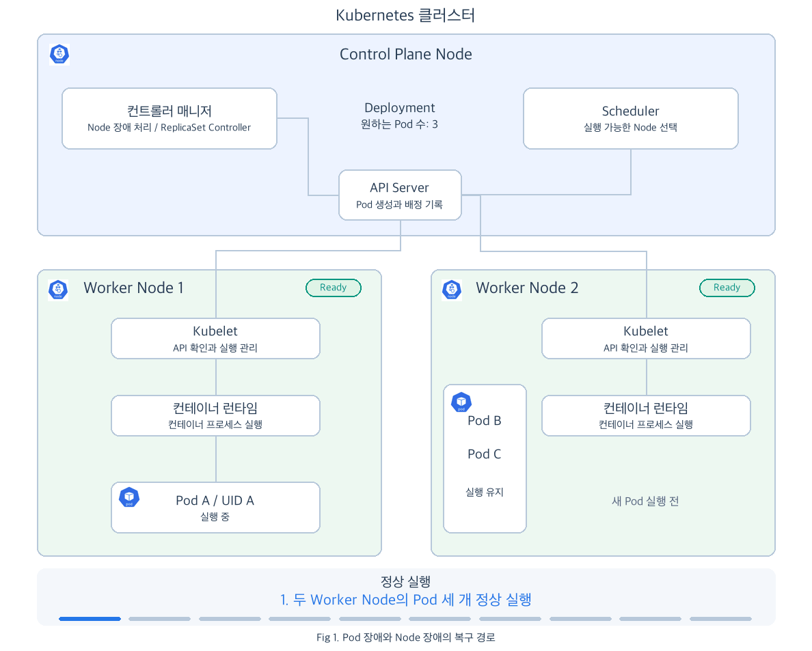
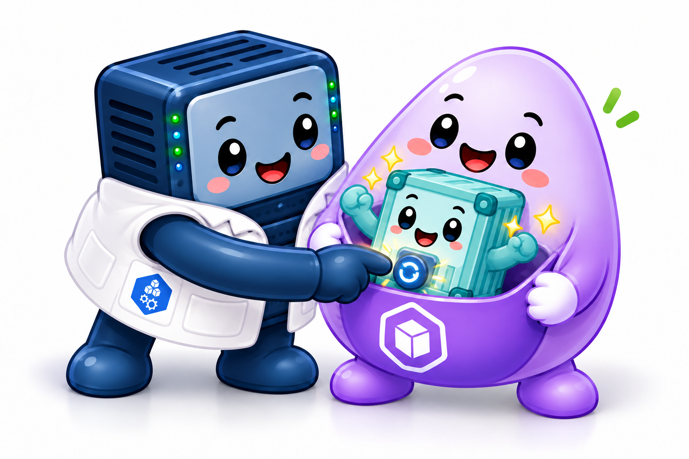
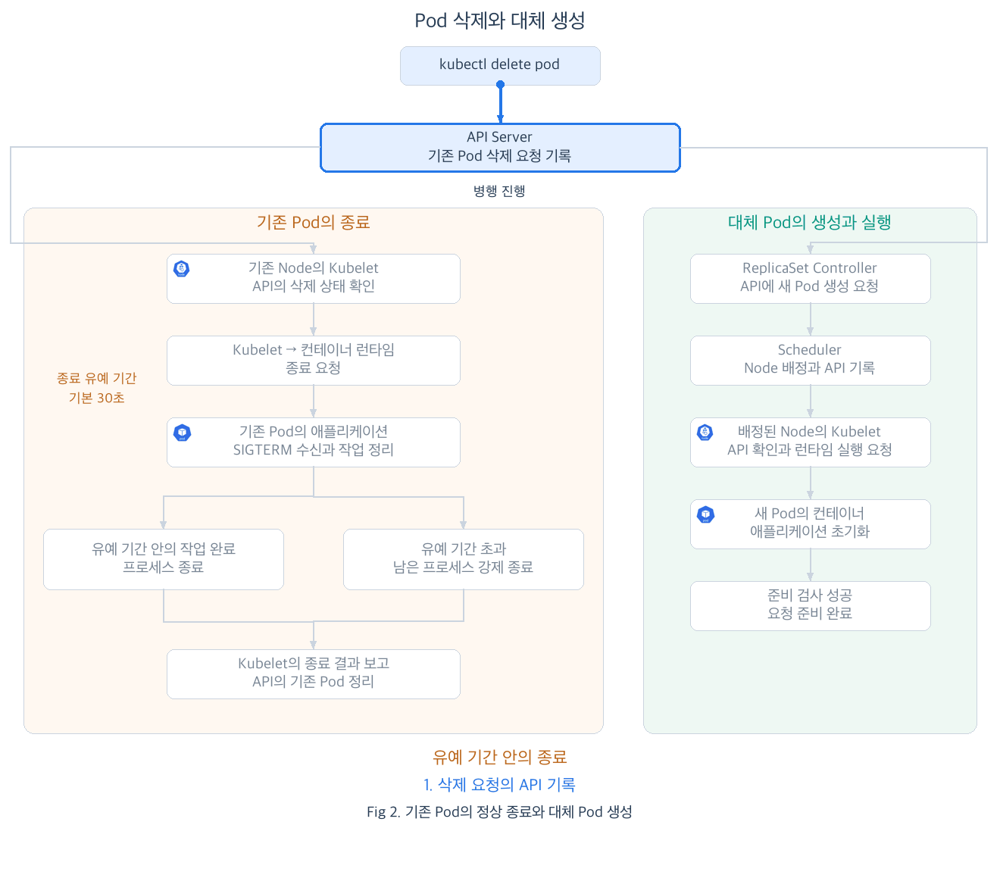
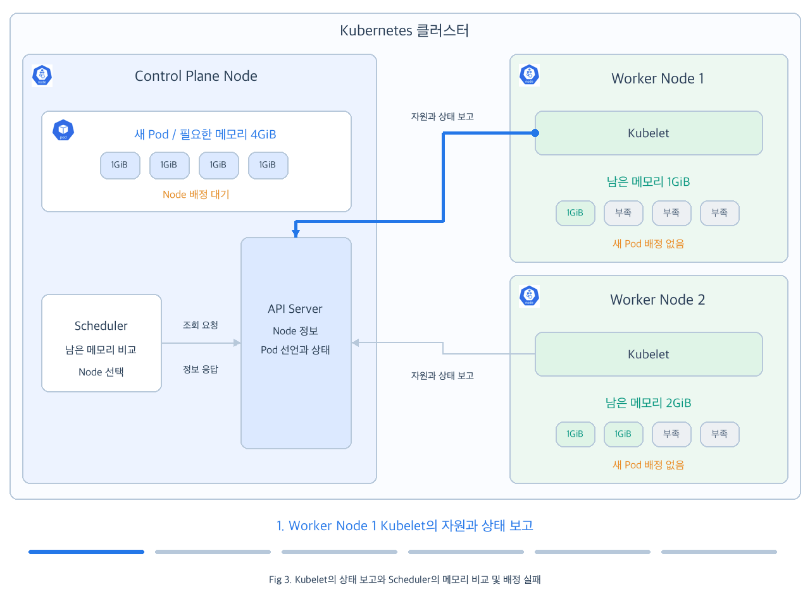

# Chap05. Pod의 장애와 자동 복구: 재시작부터 문제 진단까지

> 16장 연재의 다섯째 글입니다. Pod와 Node의 장애에 따라 달라지는 자동 복구 과정을 살펴봅니다. 이어서 Pod의 정상 종료와 상태·이벤트·로그를 이용한 장애 원인 확인 방법을 알아봅니다.

## 들어가며

<div align="center">


</div>

4장에서는 Kubelet이 컨테이너의 실행 상태와 애플리케이션의 응답을 확인하고, 필요하면 컨테이너를 다시 실행하는 과정을 살펴보았습니다. 그런데 애플리케이션을 실행하던 서버 자체가 꺼졌다면 어떻게 될까요? 그 서버의 Kubelet도 멈췄으므로, 다른 곳에서 애플리케이션을 다시 실행할 방법이 필요합니다.

장애가 발생한 위치에 따라 복구를 맡는 구성요소와 다시 실행하는 대상이 달라집니다. 같은 Pod 안에서 컨테이너를 재시작할 수도 있고, 다른 Node에 새 Pod를 만들어야 할 수도 있습니다. 이 차이를 이해하면 장애가 났을 때 Kubernetes가 무엇을 복구하고 있는지 판단할 수 있습니다.

다시 실행한 애플리케이션에서도 같은 오류가 반복될 수 있습니다. 이때는 Kubernetes가 재시도하는 동안 사용자가 원인을 찾아 수정해야 합니다. 복구가 진행되는 과정과 실행을 막는 원인을 함께 읽을 수 있어야, 애플리케이션이 다시 요청을 처리할 수 있는 상태인지 판단할 수 있습니다.

## 1. Pod의 장애와 자동 복구

4장에 이어 `default` Namespace에서 웹 애플리케이션의 Pod 세 개를 Deployment로 실행했다고 가정해 보겠습니다. 이 장의 Pod 조회와 삭제 명령도 현재 Namespace가 `default`인 상태에서 실행합니다. 같은 웹 요청 실패라도 컨테이너에 문제가 생겼는지, 이를 실행하던 Node에 문제가 생겼는지에 따라 복구 경로가 나뉩니다.

- **Pod 장애**: Node는 정상이고, Pod 안의 애플리케이션 컨테이너가 종료되거나 응답하지 못하는 상황입니다. 해당 Node의 Kubelet이 종료 상태나 생존 검사 결과를 바탕으로 컨테이너 재시작을 처리합니다.
- **Node 장애**: Pod를 실행하던 Node의 정상 동작을 확인할 수 없는 상황입니다. 장애가 지속되면 Control Plane에서 대체 Pod 생성과 다른 Node 배정을 진행합니다.

<div align="center">



</div>

Fig 1은 Pod A와 Pod B, Pod C를 두 Worker Node에 나누어 실행한 상태에서 두 장애 상황을 구분해 보여 줍니다. 첫 번째는 Pod 장애입니다. Worker Node 1의 Kubelet이 Pod A의 컨테이너 종료를 확인하고 런타임에 재실행을 요청합니다. Control Plane에 기록된 Pod A와 고유 식별자인 **UID**는 그대로 유지되며, 컨테이너 프로세스만 새로 실행됩니다.

이후 Worker Node 1 자체에 장애가 발생하면 복구 주체가 달라집니다. Control Plane이 받던 생존 신호가 끊기고 장애가 지속되면, 컨트롤러가 해당 Node의 Pod 제거를 진행합니다. ReplicaSet Controller는 줄어든 Pod 수를 채우기 위해 API Server에 새 Pod D 생성을 요청합니다. Scheduler는 `NotReady`인 Worker Node 1을 제외하고 실행 조건을 만족하는 Worker Node 2를 선택해 배정 결과를 API에 기록합니다. Worker Node 2의 Kubelet은 자신에게 배정된 Pod D를 확인하고 런타임에 컨테이너 실행을 요청합니다. Pod D는 Pod A와 별개의 Pod이므로 애플리케이션도 처음부터 실행됩니다. 실행할 Node가 달라져도 같은 ReplicaSet이 만든 대체 Pod는 기존과 같은 Namespace에 속합니다. Pod D가 준비 검사를 통과하면, Worker Node 2에서 계속 실행되던 Pod B와 Pod C에 더해 요청을 받을 수 있습니다. 이러한 복구 결과는 Pod 이름과 재시작 횟수에서도 확인할 수 있습니다.

### 1.1 같은 Pod 안의 컨테이너 재시작

컨테이너가 종료되었을 때 다시 실행할 조건은 Pod의 **재시작 정책**(restart policy)으로 정합니다. 이 장의 Deployment가 만드는 Pod는 `restartPolicy: Always`를 사용하므로, Pod를 유지하는 동안 Kubelet은 종료된 컨테이너를 종료 이유와 관계없이 다시 실행합니다. 4장에서 살펴본 생존 검사 실패로 컨테이너를 종료한 경우에도 이 정책을 적용합니다. [[1]](#ref-1)

<div align="center">



</div>

위 그림에서 Node가 Pod 주머니 안의 Container를 다시 가동하는 모습은, Kubelet이 컨테이너 런타임에 재시작을 요청하는 역할을 나타냅니다. Pod는 그대로 유지되고 그 안의 컨테이너가 다시 실행되므로, 다음 조회 예시에서도 Pod 이름과 함께 컨테이너의 재시작 횟수를 확인합니다.

```bash
# 재시작 이후 Pod 이름, 준비 상태, 재시작 횟수 확인
kubectl get pod web-7c8d9f6b5d-a1b2c
```

```text
NAME                   READY   STATUS    RESTARTS      AGE
web-7c8d9f6b5d-a1b2c    1/1     Running   1 (20s ago)   8m
```

- `NAME`: 재시작 전과 같은 Pod 이름을 유지합니다.
- `RESTARTS: 1`: 같은 Pod 안의 컨테이너가 한 차례 재시작했습니다.
- `READY: 1/1`: 다시 실행된 컨테이너가 요청 준비를 마쳤습니다.

새 컨테이너는 초기화와 외부 연결을 다시 수행하므로 준비 상태를 회복하기까지 시간이 걸릴 수 있습니다. 준비 검사만 실패했다면 컨테이너를 유지한 채 회복을 기다리므로, 준비 여부와 재시작 횟수를 함께 읽어야 합니다. 이러한 재시작은 해당 Node의 Kubelet과 런타임이 동작할 때 가능합니다.

### 1.2 Node 장애에 따른 대체 Pod 실행

Worker Node 한 대가 꺼지면 해당 Node의 Kubelet도 컨테이너를 재시작할 수 없습니다. Control Plane은 Node가 보내는 상태와 주기적인 생존 신호를 확인합니다. 일시적인 통신 장애와 지속되는 장애를 구분하기 위해, 신호가 끊긴 뒤 장애 판단과 Pod 제거까지 대기 과정을 거칩니다. Node는 클러스터 전체의 리소스이므로 Namespace를 선택할 필요 없이 다음 명령으로 상태를 조회합니다.

```bash
# Node 장애 상황에서 실행 가능한 Node 확인
kubectl get nodes
```

```text
NAME       STATUS     ROLES    AGE   VERSION
worker-1   NotReady   <none>   10d   v1.34.0
worker-2   Ready      <none>   10d   v1.34.0
```

- `worker-1`의 `NotReady`: Control Plane이 이 Node의 정상 동작을 확인하지 못하고 있습니다.
- `worker-2`의 `Ready`: 새 Pod를 배정할 후보가 될 수 있습니다. 실제 배정에는 자원과 다른 실행 조건도 충족해야 합니다.

통신만 끊어진 경우에는 기존 Node에서 컨테이너 프로세스가 계속 실행 중일 수도 있습니다. 따라서 `NotReady`는 Control Plane에서 정상 동작을 확인할 수 없다는 의미로 읽어야 합니다.

장애가 지속되면 Fig 1의 대체 Pod 생성 과정으로 이어집니다. 이때 다른 Node가 `Ready` 상태여도 새 Pod를 실행할 자원이 충분해야 배정할 수 있습니다. 자원이 부족하면 새 Pod는 `Pending` 상태로 기다립니다. 여러 Pod를 서로 다른 Node에 배치하고 여유 자원을 확보해 두면, 남은 Pod가 요청을 처리하는 동안 대체 Pod를 실행할 수 있습니다. [[2]](#ref-2)

Node를 중단하지 않고 이 대체 생성 과정을 확인하려면, Deployment가 관리하는 Pod 하나를 삭제해 Pod 수가 다시 채워지는지 관찰할 수 있습니다.

### 1.3 Pod 삭제와 대체 생성

4장에서 살펴본 것처럼 삭제 요청은 API Server에 기록되고, 해당 Node의 Kubelet이 컨테이너 종료를 처리합니다. 그동안 ReplicaSet Controller는 새 Pod를 생성해 원하는 Pod 수를 유지합니다. 다음은 학습용 Deployment의 Pod 하나를 삭제한 뒤 목록을 조회하는 예시입니다.

```bash
# 학습용 Deployment의 Pod 하나를 삭제해 대체 Pod 생성 확인
kubectl delete pod web-7c8d9f6b5d-a1b2c
kubectl get pods -l app=web
```

```text
pod "web-7c8d9f6b5d-a1b2c" deleted
NAME                   READY   STATUS              RESTARTS   AGE
web-7c8d9f6b5d-d3e4f    1/1     Running             0          10m
web-7c8d9f6b5d-g5h6j    1/1     Running             0          10m
web-7c8d9f6b5d-k7m8n    0/1     ContainerCreating   0          2s
```

출력은 다른 두 Pod가 정상 실행 중인 상황을 가정한 예시입니다.

- 기존 `a1b2c` Pod는 삭제되고 `k7m8n`으로 끝나는 새 Pod가 생성되었습니다.
- 새 Pod의 `RESTARTS: 0`: 기존 컨테이너를 재시작한 경우와 달리, 새 Pod에서 실행을 시작합니다.
- 새 Pod는 아직 `ContainerCreating`과 `0/1`이므로 요청을 처리할 준비를 마치지 않았습니다.

새 Pod에는 다른 UID가 부여되고 IP도 달라질 수 있습니다. 컨테이너 실행과 초기화, 준비 검사를 마치면 이 Pod가 요청을 받을 수 있습니다. 여기서 대체 생성의 기준은 Deployment가 유지할 Pod 수입니다. 준비 검사에 실패한 Pod도 관리 대상에 남아 있다면, 그 실패만으로 Pod를 하나 더 만들지는 않습니다.

새 Pod의 실행 준비와 기존 Pod의 종료는 병행될 수 있습니다. 이때 기존 애플리케이션이 처리하던 요청을 마무리할 수 있도록 종료 과정도 관리해야 합니다.

## 2. Pod의 정상 종료

처리 중인 웹 요청이나 파일 기록이 있는 애플리케이션이라면, 종료 전에 작업을 정리할 시간이 필요합니다. Kubernetes는 Pod를 삭제할 때 이 시간을 제공해 정상 종료를 돕습니다.

<div align="center">



</div>

Fig 2는 같은 삭제 요청에서 시작되는 두 흐름을 보여 줍니다. API Server에 삭제 요청이 기록되면, 왼쪽에서는 기존 Pod를 실행하는 Kubelet이 삭제 상태를 확인합니다. 오른쪽에서는 ReplicaSet Controller가 유지할 Pod 수를 맞추기 위해 API에 새 Pod 생성을 요청합니다.

기존 Node의 Kubelet은 컨테이너 런타임에 종료 처리를 요청합니다. 애플리케이션은 일반적으로 정상 종료를 요청하는 `SIGTERM` 신호를 받아 진행 중인 작업을 정리합니다. 이때 애플리케이션도 해당 신호를 받으면 작업을 마무리하도록 구현되어 있어야 합니다. 종료 중인 Pod를 새 요청 대상에서 제외하는 네트워크 갱신도 함께 진행됩니다.

그동안 오른쪽에서는 Scheduler가 새 Pod를 실행할 Node를 선택하고 API에 배정 결과를 기록합니다. 배정된 Node의 Kubelet이 이를 확인해 런타임에 컨테이너 실행을 요청하면, 새 애플리케이션이 초기화를 시작합니다. 이 과정은 기존 Pod의 종료가 끝나기 전에도 진행될 수 있습니다.

기존 애플리케이션이 종료 작업에 사용할 수 있는 시간을 **종료 유예 기간**이라고 합니다. `terminationGracePeriodSeconds`의 기본값은 30초입니다. Fig 2의 첫 번째 사례에서는 이 시간 안에 작업을 마치고 프로세스가 종료됩니다. Kubelet이 종료 결과를 보고하면 API에서도 기존 Pod가 정리되고, 새 Pod는 준비 검사를 통과해 요청을 받습니다. [[3]](#ref-3)

두 번째 사례에서는 기존 애플리케이션이 작업을 정리하는 동안 새 Pod가 먼저 준비 상태를 회복합니다. 이후에도 기존 프로세스가 남아 있다가 유예 기간을 넘기면 강제 종료가 진행됩니다. 정상 종료와 강제 종료는 이렇게 서로 다른 결과이며, 종료와 대체 생성의 완료 순서는 상황에 따라 달라집니다. Fig 2에서는 두 사례를 비교하기 위해 시간을 압축했습니다.

교체가 끝났다면 새 Pod가 준비 상태를 회복하고 실제 요청에 응답하는지 확인해야 합니다. 새 컨테이너가 곧바로 다시 종료되거나 실행 준비가 계속 지연된다면, 재시도만 기다리기보다 원인을 찾아야 합니다.

## 3. 상태와 로그를 통한 장애 진단

컨테이너가 시작할 때마다 필수 설정을 찾지 못해 종료된다면, 같은 설정으로 다시 실행해도 같은 오류가 발생합니다. Kubernetes가 실행을 재시도하는 동안, 사용자는 누락된 설정을 찾아 수정해야 합니다.

원인을 찾으려면 먼저 문제가 생긴 위치를 좁혀야 합니다. Pod 상태와 이벤트에서 실행 과정의 어느 부분이 막혔는지 확인하고, 컨테이너가 실행된 뒤 종료되었다면 로그에서 애플리케이션이 남긴 오류를 읽습니다. 이 과정은 컨테이너가 실행된 뒤 실패했는지, 실행 준비 단계에서 막혔는지에 따라 달라집니다. 아래 출력은 이러한 차이를 확인하기 위한 예시입니다.

### 3.1 Pod 상태 조회와 문제 대상 식별

요청이 실패하는 상황에서 Pod 목록을 조회하면, 정상적으로 요청을 받을 수 있는 Pod와 확인이 필요한 Pod를 구분할 수 있습니다. 4장에서 사용한 조회 명령으로 이번에는 준비 여부와 재시작 횟수를 함께 살펴보겠습니다. 운영용 Pod가 `prod`에 있다면 `kubectl get pods -n prod -l app=web`으로 조회하고, 이어지는 `describe`와 `logs`에도 `-n prod`를 붙입니다. 목록부터 상세 정보와 로그까지 같은 Namespace의 Pod를 따라가는 것입니다.

```bash
# 웹 Pod의 준비 상태와 컨테이너 재시작 횟수를 조회하는 예시
kubectl get pods -l app=web
```

```text
NAME                   READY   STATUS             RESTARTS   AGE
web-7c8d9f6b5d-a1b2c    0/1     CrashLoopBackOff   4          4m
web-7c8d9f6b5d-d3e4f    1/1     Running            0          4m
web-7c8d9f6b5d-g5h6j    1/1     Running            0          4m
```

다른 두 Pod는 요청 준비를 마쳤지만, 첫 번째 Pod는 다음 항목에서 문제가 드러납니다.

- 첫 번째 Pod의 `CrashLoopBackOff`: 컨테이너가 반복 실패하여 다음 재시작을 기다리고 있습니다.
- 첫 번째 Pod의 `RESTARTS: 4`: 컨테이너가 네 차례 재시작했습니다.
- 첫 번째 Pod의 `READY: 0/1`: 현재 요청을 처리할 준비가 된 컨테이너가 없습니다.

반복해서 종료되는 컨테이너에는 **백오프**(backoff), 즉 재시도 사이의 대기 시간이 적용됩니다. 첫 번째 Pod는 재시작을 반복해도 준비 상태를 회복하지 못하고 있으므로, 직전 실행이 종료된 이유를 확인해야 합니다. [[1]](#ref-1)

### 3.2 컨테이너 반복 종료의 원인 확인

`kubectl describe pod`로 첫 번째 Pod의 상세 정보를 조회하면, 현재의 재시작 대기 상태와 직전 컨테이너의 종료 기록을 함께 볼 수 있습니다.

```bash
# 반복 종료되는 컨테이너의 종료 이유와 최근 이벤트를 확인하는 예시
kubectl describe pod web-7c8d9f6b5d-a1b2c
```

```text
Containers:
  web:
    State:          Waiting
      Reason:       CrashLoopBackOff
    Last State:     Terminated
      Reason:       Error
      Exit Code:    1
    Ready:          False
    Restart Count:  4
Events:
  Type     Reason   Message
  Warning  BackOff  Back-off restarting failed container web in pod ...
```

컨테이너 상태와 이벤트에서 종료 직전과 현재 상황을 연결할 수 있습니다.

- `State: Waiting`과 `Reason: CrashLoopBackOff`: 현재 컨테이너는 다음 재시작을 기다리고 있습니다.
- `Last State: Terminated`와 `Exit Code: 1`: 직전 실행이 오류로 종료되었습니다.
- `BackOff` 이벤트: 반복 실패에 따른 재시작 대기가 적용되고 있습니다.

직전 실행이 종료 코드 1로 실패했으므로, 당시 애플리케이션이 남긴 로그에서 구체적인 원인을 찾아보겠습니다. `--previous`는 직전에 종료된 컨테이너의 로그를 요청하고, `-c web`은 조회할 컨테이너를 지정합니다. [[4]](#ref-4)

```bash
# 직전에 종료된 웹 컨테이너의 오류 로그를 조회하는 예시
kubectl logs web-7c8d9f6b5d-a1b2c -c web --previous
```

```text
ERROR: required environment variable DATABASE_HOST is missing
```

로그에는 필수 환경 변수 `DATABASE_HOST`가 없다는 오류가 남아 있습니다. Deployment의 Pod 템플릿에서 이 값을 전달하도록 수정한 뒤, 새 Pod가 준비 상태를 회복하는지 확인해야 합니다. 이렇게 종료 기록에서 로그로 확인 범위를 좁히면 반복 장애의 원인과 수정할 설정을 연결할 수 있습니다.

### 3.3 메모리 부족에 따른 Pod 배정 실패

앞의 사례와 달리, 실행할 Node를 배정받지 못한 Pod는 애플리케이션 로그가 생기기 전부터 막혀 있습니다. Pod가 `Pending`에 오래 머문다면 먼저 Node 배정 여부를 확인해야 합니다.

이번에는 새 Pod 하나의 컨테이너가 메모리 4GiB를 요청한 별도의 상황을 가정해 보겠습니다. 다른 실행 조건은 충족하지만, Worker Node 1에는 새 Pod에 배정할 메모리가 1GiB, Worker Node 2에는 2GiB만 남아 있습니다.

새 Pod는 필요한 메모리 4GiB를 한 Node에서 확보해야 합니다. 두 Node 모두 이 요청량을 충족하지 못하므로 Pod는 배정을 기다립니다. 그림의 ‘남은 메모리’는 순간적인 사용량이 아니라, 시스템 몫과 기존 Pod들의 요청량을 제외하고 새 Pod에 배정할 수 있는 양입니다.

<div align="center">



</div>

Fig 3에서 각 Node의 Kubelet은 Node의 자원과 상태를 API Server에 보고합니다. Scheduler는 API Server에서 Node 정보와 Pod 선언을 확인하고, 기존 Pod들의 요청량을 반영해 남은 메모리를 계산합니다. 이 보고와 배정 판단은 각각 반복되므로, 그림처럼 두 Node의 보고가 차례로 끝나야만 Scheduler가 동작하는 것은 아닙니다.

Scheduler가 조건에 맞는 Node를 찾지 못하면 배정 실패를 API에 기록합니다. 이 사례에서는 배정된 Node가 없어 Kubelet의 컨테이너 실행도 시작되지 않고, Pod는 `Pending`에 머무릅니다.

이때 `kubectl get pod`로 조회하면 실행을 기다리는 상태와 Node 배정 여부를 함께 확인할 수 있습니다.

```bash
# 실행을 기다리는 Pod의 상태와 Node 배정 여부 확인
kubectl get pod web-7c8d9f6b5d-g5h6j -o wide
```

```text
NAME                   READY   STATUS    RESTARTS   AGE   IP       NODE
web-7c8d9f6b5d-g5h6j    0/1     Pending   0          2m    <none>   <none>
```

- `STATUS: Pending`: 컨테이너 실행 준비를 마치지 못했습니다.
- `NODE: <none>`: Scheduler가 이 Pod를 실행할 Node를 아직 배정하지 못했습니다.

상세 정보를 조회하면 배정을 막은 이유를 확인할 수 있습니다.

```bash
# Pod의 메모리 요청량 및 배정 실패 이벤트 확인
kubectl describe pod web-7c8d9f6b5d-g5h6j
```

```text
Node:         <none>
Status:       Pending
Containers:
  web:
    Requests:
      memory:  4Gi
Conditions:
  Type           Status
  PodScheduled   False
Events:
  Type     Reason            From               Message
  Warning  FailedScheduling  default-scheduler  0/2 nodes are available: 2 Insufficient memory.
```

배정 실패의 원인은 요청량과 이벤트 메시지에서 드러납니다.

- `Requests.memory: 4Gi`: 컨테이너가 메모리 4GiB를 요청했습니다.
- `FailedScheduling` 이벤트의 `2 Insufficient memory`: 두 Node 모두 요청한 메모리를 확보할 수 없어 배정에 실패했습니다.

이 문제를 해결하려면 애플리케이션에 필요한 메모리 요청량을 검토해 과도한 설정을 수정하거나, 요청량을 충족하는 Node를 확보해야 합니다. 같은 요청량으로 Pod를 삭제하고 다시 만들어도 배정 실패는 반복됩니다. [[5]](#ref-5)

Node 배정을 마친 뒤에도 이미지 이름의 오타나 이미지 저장소 접근 실패로 컨테이너를 시작하지 못할 수 있습니다. 이 경우 Pod 단계는 `Pending`이지만 `kubectl get pods`의 `STATUS`에는 `ErrImagePull`이나 `ImagePullBackOff`가 표시될 수 있습니다. `kubectl describe pod`의 이벤트에서 이미지 다운로드 실패 메시지를 확인하고, 이미지 이름이나 접근 설정을 수정해야 합니다. 이처럼 실행이 지연되는 Pod도 Node 배정 전후에 따라 확인할 원인이 달라집니다. [[6]](#ref-6)

## 다음 글로 넘어가기 전에

이번 글에서 다룬 내용은 이렇습니다. 정상 동작하는 Node에서는 Kubelet이 같은 Pod 안의 컨테이너를 재시작하지만, Node 장애가 지속되면 컨트롤러가 대체 Pod를 만들고 Scheduler가 다른 Node를 선택합니다. Pod를 삭제할 때는 종료 유예 기간 동안 애플리케이션이 작업을 정리할 수 있습니다. 자동 복구가 반복되어도 원인이 사라지지 않으면 상태와 이벤트, 이전 컨테이너 로그를 연결해 수정할 대상을 찾아야 합니다.

복구 과정에서 새 Pod가 만들어지면 주소도 바뀔 수 있습니다. 다른 애플리케이션이 바뀐 주소를 매번 확인해야 한다면 통신을 이어가기 어렵습니다. 다음 글에서는 Service를 통해 Pod가 교체되어도 같은 이름과 주소로 애플리케이션에 요청을 보내는 방법을 살펴봅니다.

## 참고문헌

- <a id="ref-1"></a>[1] [컨테이너 재시작 정책과 반복 실패 공식 문서](https://kubernetes.io/docs/concepts/workloads/pods/pod-lifecycle/#container-restarts)
- <a id="ref-2"></a>[2] [Node 장애 처리 공식 문서](https://kubernetes.io/docs/concepts/architecture/nodes/#node-controller)
- <a id="ref-3"></a>[3] [Pod 종료 과정 공식 문서](https://kubernetes.io/docs/concepts/workloads/pods/pod-lifecycle/#pod-termination)
- <a id="ref-4"></a>[4] [kubectl logs 공식 문서](https://kubernetes.io/docs/reference/kubectl/generated/kubectl_logs/)
- <a id="ref-5"></a>[5] [자원 요청과 Node 배정 공식 문서](https://kubernetes.io/docs/concepts/configuration/manage-resources-containers/)
- <a id="ref-6"></a>[6] [Pod 문제 해결 공식 문서](https://kubernetes.io/docs/tasks/debug/debug-application/debug-pods/)
