# Chap06. Service와 클러스터 통신

> 16장 연재의 여섯째 글입니다. Pod끼리 통신하는 방법과 Service가 필요한 이유를 먼저 살펴봅니다. Service 이름으로 접속할 IP 주소를 찾고 요청이 실제 Pod에 도달하는 과정을 이해한 뒤, 네 가지 Service 타입의 접근 범위를 비교합니다.

## 들어가며

<div align="center">


</div>

5장에서는 장애가 발생했을 때 컨테이너를 다시 실행하거나 Pod를 대체하는 과정을 살펴보았습니다. 새 Pod의 IP가 달라지면, 이전 주소로 요청하던 애플리케이션도 접속할 주소를 바꿔야 합니다. 실행을 복구한 뒤에도 요청이 새 Pod에 도달할 방법이 필요한 것입니다.

쇼핑몰의 웹 화면을 만드는 애플리케이션과 상품 정보를 반환하는 API가 서로 다른 Pod에서 실행된다고 가정해 보겠습니다. 웹 애플리케이션은 상품 목록을 가져오기 위해 API에 요청합니다. API Pod가 교체되거나 여러 개로 늘어나더라도, 웹 애플리케이션이 그때마다 접속 주소 목록을 고쳐야 한다면 자동 복구와 배포의 이점을 충분히 활용하기 어렵습니다.

클라이언트가 기억하는 이름과 주소는 유지하면서, 그 뒤에서 요청을 받는 Pod만 바꿀 수 있다면 어떨까요? Service는 이러한 접근점을 제공합니다. 내부 애플리케이션끼리 통신할 때뿐 아니라 외부 사용자의 요청을 받거나 외부 시스템을 호출할 때도, 요청을 보낼 쪽과 받을 쪽에 맞는 접근 방법을 선택할 수 있습니다.

## 1. Pod 사이의 통신과 Service의 필요성

안정적인 접속 주소가 필요한 이유를 이해하려면, 먼저 주소가 바뀌기 전의 Pod끼리 어떻게 통신하는지 살펴볼 필요가 있습니다.

### 1.1 Pod IP를 이용한 클러스터 내부 통신

3장에서 같은 Pod의 컨테이너는 네트워크를 공유하고 `localhost`로 통신할 수 있다고 설명했습니다. 서로 다른 Pod는 각자의 IP를 사용하므로, 다른 Pod에 있는 애플리케이션을 호출할 때는 그 Pod의 IP와 애플리케이션이 수신하는 포트가 필요합니다. 여기서 **클라이언트**는 요청을 보내는 애플리케이션을 뜻하며, 클러스터 내부의 Pod도 클라이언트가 될 수 있습니다.

예를 들어 웹 Pod가 상품 API Pod의 `10.244.2.8:80`으로 HTTP 요청을 보내면, 이 주소의 80번 포트에서 실행 중인 API 프로세스가 요청을 받아 응답합니다. 이처럼 Pod 사이에서도 애플리케이션이 사용하는 HTTP 요청과 응답으로 데이터를 주고받습니다.

클러스터에는 서로 다른 Node의 Pod도 IP로 연결할 수 있는 네트워크가 구성됩니다. 이 연결을 구현하는 것이 클러스터에 설치된 네트워크 플러그인입니다. 통신을 막는 별도 정책이 없고 네트워크와 수신 프로세스가 정상이라면, 웹 Pod와 API Pod가 서로 다른 Node에 있어도 통신할 수 있습니다. Namespace가 서로 달라도 이 조건은 같습니다. 3장에서 나눈 리소스의 관리 범위와 별개로, Pod 간 통신을 제한하려면 네트워크 정책을 적용합니다. [[1]](#ref-1)

### 1.2 Pod 교체와 접속 주소 관리의 한계

IP를 알고 있을 때는 직접 통신할 수 있지만, 그 주소를 계속 사용할 수 있다는 보장은 없습니다. 상품 API Pod가 `10.244.2.8`에서 실행되다가 새 Pod로 교체되어 `10.244.1.9`를 받으면, 웹 애플리케이션에 저장한 이전 주소는 더 이상 같은 대상을 가리키지 않습니다.

API Pod를 두 개로 늘리면 문제도 넓어집니다. 웹 애플리케이션은 어느 주소로 연결할지 선택해야 하고, Pod가 사라지거나 추가될 때마다 목록을 갱신해야 합니다. Deployment가 Pod 개수를 유지하는 동안, 호출하는 쪽에서는 현재 요청을 받을 Pod의 주소를 계속 알아야 합니다.

따라서 필요한 것은 특정 Pod의 주소를 외워 두는 방식 대신 **같은 역할의 애플리케이션에 계속 연결할 수 있는 접근점**입니다. [[2]](#ref-2)

### 1.3 애플리케이션의 접근점을 제공하는 Service

<div align="center">


</div>

<div align="center">

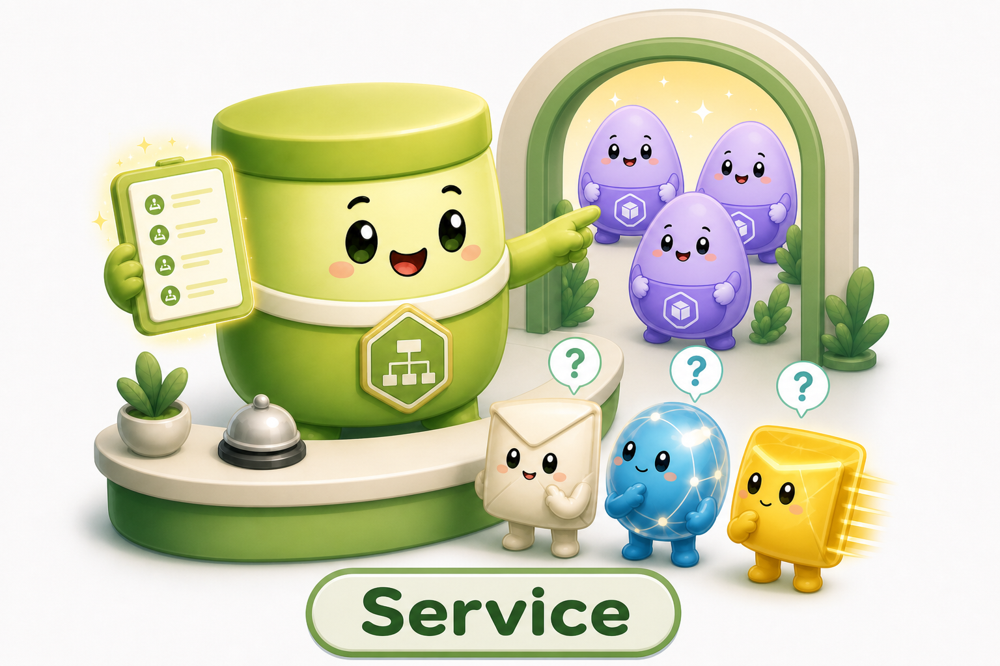

</div>

**Service**(서비스)는 애플리케이션에 접근할 방법을 선언하는 Kubernetes의 네트워크 리소스입니다. 가장 일반적인 구성에서는 같은 역할의 Pod 집합에 하나의 이름과 가상 IP를 제공하고, 그 접근점으로 온 연결을 요청을 처리할 수 있는 Pod에 전달하도록 합니다. 클라이언트가 기억할 대상은 개별 Pod의 위치가 아니라 이 Service의 이름입니다. [[3]](#ref-3)

위 그림의 안내 창구는 클라이언트가 찾아오는 Service의 접근점을, 뒤에 모인 Pod들은 요청을 처리할 대상을 나타냅니다. Pod가 교체되어도 클라이언트는 같은 창구를 찾는다는 관계입니다.

여기서 **가상 IP**는 특정 Pod의 위치 대신 Service의 접근점을 나타내는 주소입니다. 클러스터는 API에 기록된 선언을 바탕으로 이 주소와 실제 Pod 주소를 연결합니다. 요청을 받아 응답하는 주체는 Pod 안의 애플리케이션이며, Service 자체에서 서버 프로세스를 실행하지는 않습니다.

Deployment가 **어떤 Pod를 몇 개 실행할지** 관리한다면, Service는 **그 Pod 집합에 어떤 이름과 포트로 접근할지** 정합니다. 클라이언트가 Service 이름으로 요청하려면, 먼저 이 접근점에 연결할 Pod를 지정해야 합니다.

## 2. Service의 선언과 대상 Pod의 연결

이제 요청을 받는 웹 서버 Pod 두 개를 예로 들어, 하나의 Service 접근점에 연결해 보겠습니다. Pod를 유지하는 선언과 요청 대상을 선택하는 선언이 어떻게 만나는지 Fig 1에서 확인할 수 있습니다.

<div align="center">

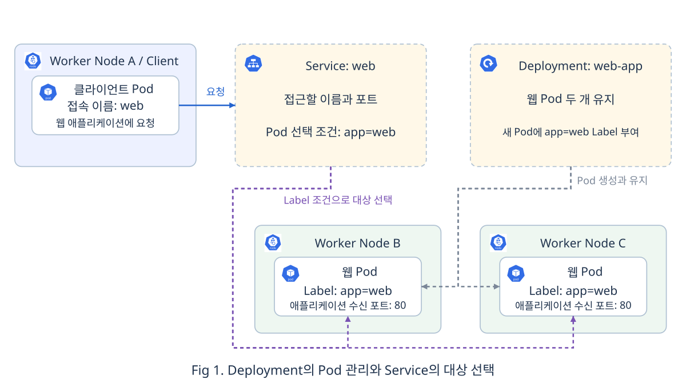

</div>

### 2.1 애플리케이션과 접근점의 연결 관계

Fig 1의 왼쪽 위 파란 배경은 요청을 보내는 클라이언트 Pod가 실행되는 Worker Node A입니다. 클라이언트는 오른쪽 Service의 `web`이라는 이름을 사용해 웹 애플리케이션에 접근합니다. 아래쪽 초록 배경의 Worker Node B와 C에는 요청을 처리할 웹 Pod가 하나씩 있습니다.

오른쪽 위 Deployment에서 내려오는 회색 점선은 웹 Pod를 생성하고 유지하는 관리 관계입니다. Deployment의 Pod 템플릿에는 `app=web`이라는 Label이 있어, 새로 만들어지는 Pod에도 같은 표시가 붙습니다. Service에서 내려오는 보라색 점선은 이 Label을 조건으로 요청 대상 Pod를 선택하는 관계입니다. 클라이언트의 요청은 Service의 접근점을 통해 선택된 웹 Pod에 도달하며, Deployment는 요청 전달 경로에 참여하지 않습니다.

Service는 자신과 같은 Namespace 안에서 Label에 맞는 Pod를 찾습니다. 예를 들어 `dev`의 Service는 `dev`의 웹 Pod를 선택하고, 같은 Label이 붙어 있어도 `prod`의 Pod는 선택 대상에 포함하지 않습니다.

클라이언트가 `web`으로 요청할 수 있도록, 이 관계를 Service의 이름과 선택 조건, 포트로 선언합니다.

### 2.2 Service가 선언하는 이름과 대상 및 포트

Fig 1의 관계를 설정으로 표현하려면 다음 세 가지가 필요합니다.

- **접근할 이름**: 클라이언트가 애플리케이션을 찾을 때 사용할 이름입니다. 여기서는 `web`입니다.
- **연결할 Pod의 조건**: 같은 역할의 Pod를 찾는 기준입니다. Pod에 붙인 Label을 Service의 Selector로 선택합니다.
- **연결할 포트**: 클라이언트가 사용할 Service 포트와, 실제 애플리케이션이 요청을 받을 Pod 쪽 포트를 연결합니다.

예를 들어 클라이언트에게는 80번 포트를 제공하면서, 실제 애플리케이션의 8080번 포트로 전달할 수 있습니다. 이때 애플리케이션은 실제로 8080번 포트에서 요청을 받고 있어야 합니다. 다음 웹 서버 예시는 Service와 애플리케이션 모두 80번 포트를 사용합니다.

이 연결 방식은 웹 서버뿐 아니라 데이터베이스 같은 애플리케이션에도 사용할 수 있습니다. Service는 IP와 포트, TCP 같은 통신 규약을 기준으로 연결을 전달합니다. 여기서 TCP는 웹 요청이나 데이터베이스 명령을 주고받는 데 사용하는 통신 방식이며, Service의 기본 프로토콜입니다. [[3]](#ref-3)

### 2.3 매니페스트로 확인하는 Label과 Selector의 연결

Fig 1에서 확인한 선택 관계를 아래 삽화와 함께 매니페스트로 옮겨 보겠습니다.

<div align="center">

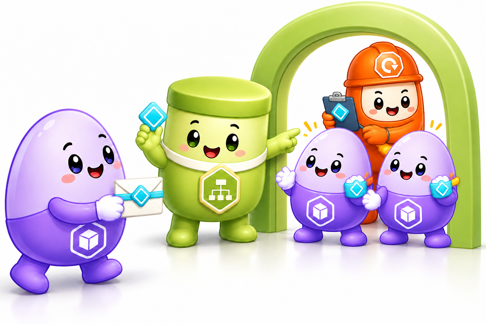

</div>

오른쪽의 Deployment는 두 웹 Pod에 같은 하늘색 표식을 붙여 관리합니다. Pod의 표식은 `app: web`이라는 Label을, Service가 들고 있는 같은 표식은 그 Label을 찾는 Selector를 나타냅니다.

왼쪽에서 봉투를 든 Pod는 요청을 보내는 클라이언트입니다. 봉투와 색 띠는 웹 애플리케이션으로 보내는 요청과 그 목적지를 표현합니다. 실제 통신에서는 클라이언트가 Service의 이름과 포트로 요청하고, Service의 Selector가 Pod에 붙은 Label을 기준으로 대상을 선택합니다.

먼저 Deployment를 아래와 같이 선언합니다. `default` Namespace에 웹 Pod 두 개를 유지하고, Pod 템플릿에 `app: web`이라는 Label을 지정합니다. 그림에서 두 Pod에 붙인 하늘색 표식에 해당합니다.

```yaml
apiVersion: apps/v1
kind: Deployment
metadata:
  name: web-app
  namespace: default
spec:
  replicas: 2
  selector:
    matchLabels:
      app: web
  template:
    metadata:
      labels:
        app: web
    spec:
      containers:
      - name: nginx
        image: nginx:1.28
        ports:
        - containerPort: 80
```

- `replicas`와 `template`: 유지할 Pod 개수와 새 Pod의 공통 구성을 정합니다.
- `template.metadata.labels`: 생성되는 Pod에 웹 애플리케이션임을 구분할 Label을 붙입니다. Deployment의 `selector.matchLabels`도 이 Label에 맞춥니다.

이 Deployment의 Pod에서는 nginx 웹 서버가 80번 포트로 요청을 받습니다. 이어서 같은 `default` Namespace에 Service를 선언합니다. Service의 Selector에 `app: web`을 지정해 앞의 Pod들을 선택하고, `web`이라는 이름과 80번 포트로 접근할 수 있도록 연결합니다.

```yaml
apiVersion: v1
kind: Service
metadata:
  name: web
  namespace: default
spec:
  selector:
    app: web
  ports:
  - port: 80
    targetPort: 80
```

- `metadata.name`: 클라이언트가 조회할 이름입니다.
- `spec.selector`: 요청 대상 후보인 Pod를 고르는 조건입니다. 앞의 Pod 템플릿에 붙인 Label과 연결됩니다.
- `port`와 `targetPort`: Service의 접근 포트와 실제 애플리케이션 포트를 연결합니다.

두 선언의 이름은 `web-app`과 `web`으로 서로 다릅니다. **연결 기준은 리소스 이름이 아니라 Pod의 Label과 Service의 Selector**이기 때문입니다. 새 Pod로 교체되어도 같은 Label이 붙으면 계속 같은 Service의 대상 후보가 됩니다.

이렇게 요청을 받을 Pod와 그 앞의 Service를 선언했습니다. 이제 클라이언트가 `web`이라는 이름으로 요청했을 때, 실제 웹 Pod에 도달하기까지의 과정을 살펴보겠습니다.

## 3. Service의 주소 조회와 요청 전달

앞의 Service를 생성하면 Kubernetes가 클러스터 내부에서 사용할 가상 IP를 자동으로 할당합니다. 여기서는 `web` Service에 `10.96.10.20`이 할당되었다고 가정합니다. [[3]](#ref-3)

클라이언트가 `http://web:80/`로 접속하려면 먼저 `web`에 해당하는 IP 주소를 알아내야 합니다. 이 주소를 알아낸 뒤 웹 요청을 보내면, 클러스터의 전달 규칙을 거쳐 실제 Pod에 도달합니다. 이름으로 주소를 찾는 과정부터 따라가 보겠습니다.

### 3.1 CoreDNS를 통한 Service 주소 조회

클라이언트가 이름으로 접속하려면 그 이름에 해당하는 IP 주소가 필요합니다. **DNS**(Domain Name System)는 이 주소를 알려 주는 시스템이며, 이름으로 주소를 알아내는 과정을 **이름 해석**이라고 합니다. [[4]](#ref-4) Kubernetes에서는 보통 **CoreDNS**라는 DNS 서버 프로그램이 이 질문에 답합니다. 웹 서버처럼 CoreDNS도 Pod 안의 컨테이너에서 실행되며, 다른 애플리케이션들이 Service 이름으로 접속할 주소를 찾도록 돕습니다. [[5]](#ref-5)

<div align="center">

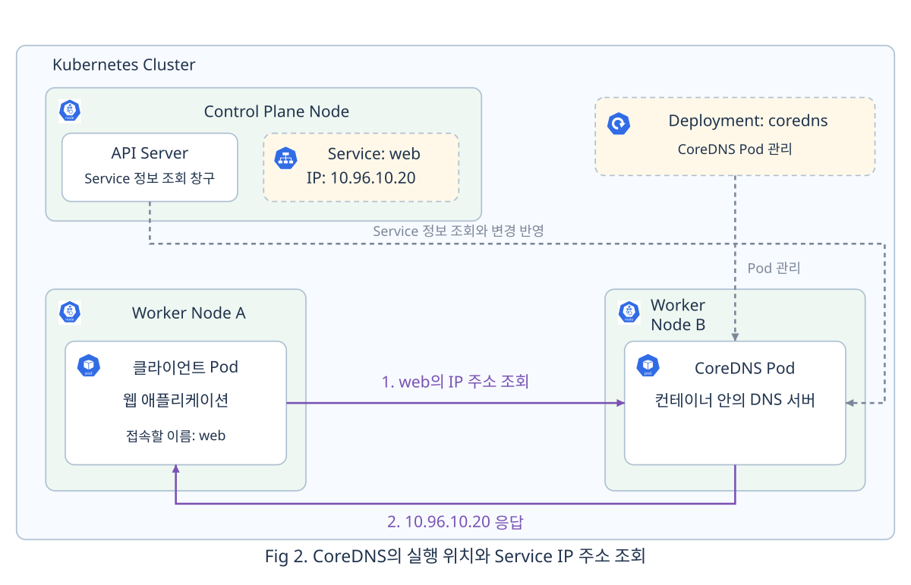

</div>

Fig 2의 Worker Node B에는 CoreDNS Pod가 있습니다. CoreDNS는 먼저 API Server를 통해 `web` Service의 이름과 IP 정보를 받아 둡니다. 이후 Service가 생성되거나 변경되면 그 정보를 반영합니다. [[6]](#ref-6) Worker Node A의 클라이언트가 `web`의 주소를 물으면, CoreDNS는 받아 둔 정보에서 `10.96.10.20`을 찾아 응답합니다. 클라이언트는 이 주소를 웹 요청의 목적지로 사용할 수 있습니다.

그림 위쪽의 `coredns` Deployment는 이 DNS 서버 Pod를 유지하는 역할입니다. 예를 들어 `kubeadm`으로 클러스터를 만들면 CoreDNS가 기본으로 설치되므로, 사용자가 웹 서버를 배포하기 전부터 클러스터에서 동작하고 있을 수 있습니다. CoreDNS의 Pod 개수와 실행 위치는 클러스터 설정에 따라 정해집니다. [[5]](#ref-5)

Service를 이름으로 찾을 때에도 3장에서 배운 Namespace 구분이 적용됩니다. 앞의 예시처럼 클라이언트와 Service가 같은 Namespace에 있으면 `web`이라는 짧은 이름을 사용합니다. `dev`의 Pod에서 `prod`의 Service를 찾으려면 `web.prod`처럼 Namespace를 함께 적습니다. 클러스터 도메인이 `cluster.local`인 환경에서는 전체 이름이 `web.prod.svc.cluster.local`입니다. [[4]](#ref-4)

실제로 실행 중인 DNS 서버는 다음 명령으로 확인할 수 있습니다. `kube-system`은 Kubernetes의 시스템 구성요소를 위한 Namespace입니다.

```bash
kubectl get pods -n kube-system -l k8s-app=kube-dns \
  -o custom-columns=NAME:.metadata.name,IP:.status.podIP,NODE:.spec.nodeName
```

다음은 CoreDNS Pod 두 개가 실행 중인 출력 예시입니다.

```text
NAME                       IP            NODE
coredns-76f75df574-abcde     10.244.2.3    worker-b
coredns-76f75df574-fghij     10.244.3.4    worker-c
```

- `IP`: DNS 서버가 실행되는 CoreDNS Pod 자체의 주소입니다.
- `NODE`: 해당 Pod가 배정된 Node입니다.

CoreDNS Pod도 교체되면 IP가 바뀔 수 있으므로, 클라이언트는 DNS용 Service인 `kube-dns`의 일정한 주소로 조회를 보냅니다. 일반적인 Pod에는 이 주소가 DNS 서버 주소로 설정됩니다. Fig 2에서 살펴본 주소 조회도 실제로는 이 Service를 거쳐 CoreDNS에 도달합니다. 이제 이 전달 경로까지 포함해 웹 요청이 도착하는 과정을 살펴보겠습니다. [[5]](#ref-5)

### 3.2 DNS 조회와 웹 요청의 전달 경로

클라이언트가 사용하는 접근점은 두 가지입니다. `kube-dns`는 DNS 조회를 보낼 곳이고, `web`은 웹 요청을 보낼 곳입니다. 두 Service 모두 가상 IP를 사용하므로, Node에는 **이 주소로 온 요청을 어느 Pod로 전달할지** 정하는 규칙이 필요합니다.

이 규칙을 준비하는 **kube-proxy**는 각 Node에서 실행되는 프로세스입니다. API Server에서 Service와 대상 정보를 받아 Node의 운영체제에 전달 규칙을 설정하고, 실제 요청이 오면 운영체제가 그 규칙을 적용합니다. 여기서는 kube-proxy를 사용하는 구성을 기준으로 설명합니다. [[7]](#ref-7)

대상 정보는 **EndpointSlice**라는 API 리소스에 기록됩니다. EndpointSlice에는 Service에 연결된 Pod의 주소와 포트, 준비 상태가 들어 있습니다. 앞에서 Service가 Label로 대상 Pod를 선택했다면, EndpointSlice는 그 결과를 실제 접속에 필요한 주소 목록으로 담는 것입니다. **Service와 대상 Pod를 연결하는 매핑 정보 테이블**로 이해할 수 있습니다. [[8]](#ref-8)

<div align="center">

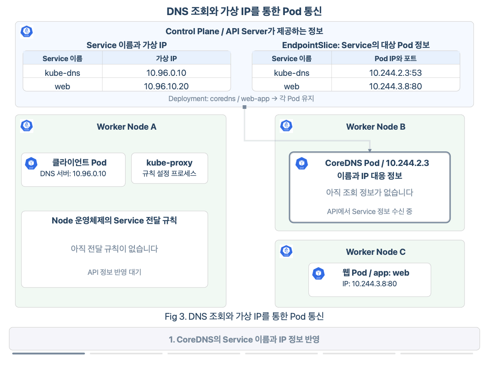

</div>

Fig 3 위쪽에는 두 종류의 정보가 있습니다. 왼쪽 표는 **Service 이름과 가상 IP**, 오른쪽 표는 **EndpointSlice에 담긴 대상 Pod의 주소와 포트**를 보여 줍니다. CoreDNS는 이름에 해당하는 Service IP를 응답하는 데 왼쪽 정보를 사용하고, kube-proxy는 두 정보를 연결해 Node의 전달 규칙을 준비합니다. 이러한 준비와 변경 반영은 클라이언트의 웹 요청과 별개로 이루어집니다.

그림에서 CoreDNS가 `web`의 주소를 받아 두고 Node A에 전달 규칙이 마련되면, 클라이언트가 주소 조회를 시작합니다. 먼저 DNS 서버 주소로 설정된 `10.96.0.10`, 즉 `kube-dns` Service의 IP로 `web`의 주소를 묻습니다. Node A의 DNS 전달 규칙이 이 조회를 Worker Node B의 CoreDNS Pod인 `10.244.2.3:53`으로 보냅니다. 여기서 53은 DNS 서버가 조회를 받는 포트입니다.

CoreDNS는 `web`의 Service IP인 `10.96.10.20`을 응답합니다. 이 값을 받은 클라이언트는 해당 주소의 80번 포트로 웹 요청을 보냅니다. 이번에는 Node A의 웹 요청 전달 규칙이 목적지를 Worker Node C의 웹 Pod인 `10.244.3.8:80`으로 바꿉니다. 그 주소에서 실행 중인 웹 애플리케이션이 요청을 처리합니다.

보라색 경로에서는 접속할 주소를 알아내고, 파란색 경로에서는 그 주소를 사용해 애플리케이션을 호출합니다. 따라서 웹 요청을 처리하는 동안에는 CoreDNS를 다시 거칠 필요 없이, 알아낸 Service IP와 Node의 전달 규칙으로 대상 Pod에 도달할 수 있습니다.

### 3.3 여러 Pod로의 요청 분배

앞에서는 한 웹 Pod로 요청이 도착하는 경로를 따라갔습니다. 그렇다면 같은 Service에 준비된 웹 Pod가 두 개 있다면 어느 쪽이 요청을 받을까요? 클라이언트는 동일한 Service 주소를 사용하고, Node의 전달 규칙이 대상 Pod를 선택합니다.

<div align="center">

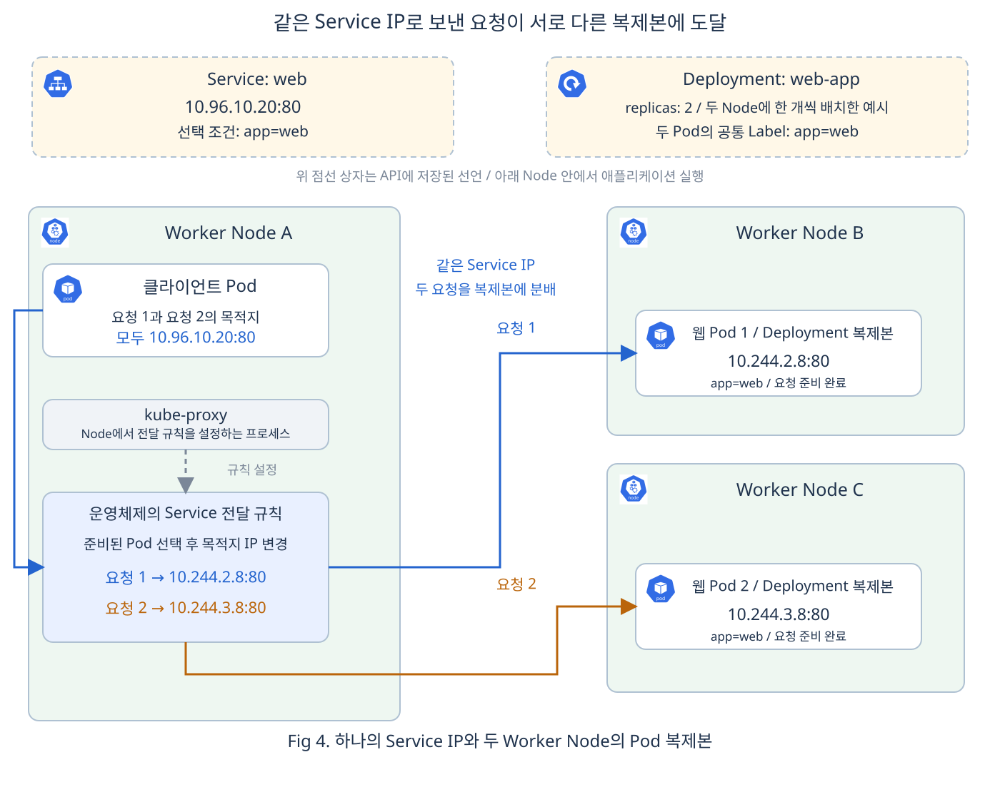

</div>

Fig 4에서는 Deployment가 유지하는 웹 Pod가 Worker Node B와 C에 하나씩 있습니다. 두 Pod 모두 `app=web`이라는 Label이 있고 요청을 받을 준비가 되어 있어, `web` Service의 대상 목록에 포함됩니다. Node A의 kube-proxy는 이 목록을 바탕으로 전달 규칙을 설정합니다.

클라이언트는 요청 1과 요청 2를 모두 `10.96.10.20:80`으로 보냅니다. 그림에서는 각 요청에 새 연결을 사용하고, 서로 다른 Pod가 선택된 상황을 보여 줍니다. Node A의 규칙이 요청 1의 목적지를 `10.244.2.8:80`으로 바꾸면 Node B의 웹 Pod가 처리합니다. 요청 2는 `10.244.3.8:80`으로 전달되어 Node C의 웹 Pod가 처리합니다.

Fig 4처럼 요청을 나눠 처리할 때는 먼저 요청을 받을 수 있는 Pod를 추린 뒤, 그중 하나를 선택합니다. 기본적인 선택 기준과 이를 바꾸는 설정은 다음과 같습니다.

- **Label과 준비 상태**: 앞의 예시에서는 Service의 Selector와 Label이 일치하고 요청을 받을 준비가 된 Pod가 후보입니다. 두 웹 Pod가 모두 이 조건을 만족하므로 어느 쪽으로도 요청을 보낼 수 있습니다. [[3]](#ref-3)
- **새 연결의 대상 선택**: kube-proxy의 `iptables` 또는 `nftables` 방식에서는 기본적으로 후보 중 하나를 무작위로 선택합니다. 따라서 그림의 요청 1과 요청 2가 서로 다른 Pod에 도착할 수도 있고, 같은 Pod에 도착할 수도 있습니다. [[7]](#ref-7)
- **클라이언트 IP에 따른 대상 유지**: Service에 `sessionAffinity: ClientIP`를 설정하면 같은 클라이언트 IP에서 오는 연결을 같은 Pod로 보내도록 할 수 있습니다. 기본값은 `None`이며, 앞의 매니페스트도 이 기본값을 사용합니다. [[7]](#ref-7)

여기서 Pod를 선택하는 시점은 새 연결을 만들 때입니다. 이미 맺은 연결로 여러 웹 요청을 보내면 그 요청들은 같은 Pod로 전달됩니다. 이렇게 정해진 후보 안에서 요청을 분배하므로, Pod가 추가되거나 교체될 때는 전달 규칙의 대상 목록도 함께 바뀌어야 합니다.

### 3.4 Pod 교체와 준비 상태에 따른 대상 갱신

웹 Pod가 새 IP로 교체되면, Service의 선택 조건을 실제 주소 목록에 다시 반영해야 합니다. 이 일을 하는 **EndpointSlice Controller**는 Control Plane에서 Service와 Pod의 변화를 관찰합니다. Service와 같은 Namespace에서 Selector에 맞는 Pod를 찾고, 그 주소와 준비 상태를 EndpointSlice에 기록합니다. kube-proxy는 API Server를 통해 변경된 정보를 받아 각 Node의 전달 규칙을 갱신합니다. [[8]](#ref-8)

<div align="center">

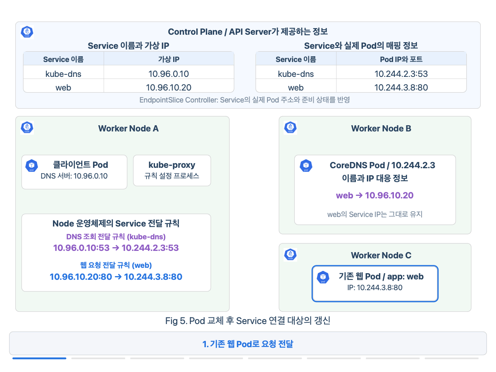

</div>

Fig 5에서는 기존 웹 Pod인 `10.244.3.8`이 요청을 처리하다가 종료됩니다. 이후 새 웹 Pod가 `10.244.3.9`를 받고 요청을 받을 준비를 마칩니다. EndpointSlice Controller가 새 주소를 대상 정보에 반영하면, kube-proxy가 이 변경을 받아 Node A의 전달 규칙을 새 Pod 주소로 갱신합니다. 그림은 새 Pod가 준비된 뒤 요청 대상으로 반영되는 흐름을 중심으로 보여 줍니다.

그동안 CoreDNS가 보관하는 `web`의 Service IP는 `10.96.10.20`으로 유지됩니다. 그림 후반에 클라이언트가 이름을 다시 조회해도 같은 주소를 받습니다. 이미 이 주소를 알고 있는 클라이언트는 그대로 새 요청을 보낼 수 있으며, 갱신된 Node의 규칙이 요청을 `10.244.3.9`로 전달합니다. Pod 교체에 맞춰 바뀌는 것은 클라이언트의 접속 주소가 아니라, 그 뒤에서 요청을 받을 Pod 주소입니다.

요청 대상이 되려면 Label뿐 아니라 준비 상태도 맞아야 합니다. 실제 EndpointSlice에는 새 Pod의 주소가 준비 전에 기록될 수도 있으며, kube-proxy는 준비 상태를 함께 보고 전달 대상을 정합니다. 4장에서 살펴본 준비 검사가 실패하면 해당 Pod는 일반적인 Service의 새 연결 대상에서 제외되고, 준비 상태가 회복되면 다시 포함될 수 있습니다. [[9]](#ref-9)

따라서 이름 조회에 성공하더라도 요청을 처리할 준비가 된 Pod가 있어야 응답을 받을 수 있습니다. 교체 정보가 반영되는 동안에는 요청이 실패할 수 있어, 클라이언트가 다시 연결해 시도해야 할 수도 있습니다. Service의 일정한 주소와 준비된 대상 목록이 함께 갖춰져야 통신이 이어집니다.

지금까지는 클러스터 내부의 클라이언트가 Service에 접근하는 흐름을 살펴봤습니다. 외부 사용자의 요청을 받거나 내부 애플리케이션이 외부 시스템을 호출할 때에는 접근 방법도 달라집니다. Kubernetes는 이를 위해 `spec.type`에 **ClusterIP, NodePort, LoadBalancer, ExternalName** 네 가지 값을 제공하며, 이어서 각 방식의 사용 상황을 비교하겠습니다.

## 4. 클러스터 내부와 외부의 통신을 위한 Service 타입

앞에서 살펴본 내부 통신을 외부까지 넓히려면, 요청을 보내는 클라이언트의 위치와 사용할 접속 주소를 먼저 정해야 합니다. Service의 `spec.type`은 이 접근 방식을 선택하는 필드입니다.

- **ClusterIP**: 같은 클러스터의 애플리케이션끼리 Service 이름과 가상 IP로 통신할 때 사용합니다.
- **NodePort**: 외부 클라이언트가 접근 가능한 Node의 IP와 지정된 포트로 접속할 때 사용합니다.
- **LoadBalancer**: 외부 로드 밸런서의 주소로 요청을 받아 클러스터의 애플리케이션에 전달할 때 사용합니다.
- **ExternalName**: 내부 애플리케이션이 외부 시스템의 DNS 이름을 Service 이름의 별칭으로 찾을 때 사용합니다.

먼저 같은 웹 Pod 집합에 내부와 외부에서 접근하는 세 가지 방식을 비교하겠습니다. ClusterIP, NodePort, LoadBalancer 예시에서는 `web` Service의 접근 방법만 달라집니다. ExternalName에서는 요청 방향을 바꾸어, 내부 Pod가 외부 API를 호출하는 상황을 살펴봅니다.

### 4.1 ClusterIP: 내부 Pod 간 통신

쇼핑몰의 주문 처리 Pod가 같은 클러스터의 상품 조회 Pod에 재고를 요청한다고 가정해 보겠습니다. 상품 조회 기능을 내부에서만 사용한다면, 주문 애플리케이션이 Service 이름으로 호출할 수 있는 접근점이면 충분합니다. 이때 사용하는 타입이 **ClusterIP**입니다.

2절에서 만든 `web` Service와 3절에서 따라간 요청 경로가 이 방식입니다. `spec.type`을 생략하면 ClusterIP가 적용되므로, 앞의 선언으로 이미 내부 접근점을 마련한 셈입니다. [[3]](#ref-3)

<div align="center">

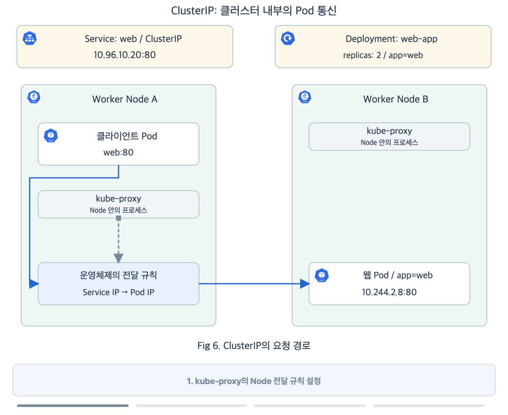

</div>

Fig 6은 두 웹 Pod 중 아래쪽 Pod가 선택된 요청을 보여 줍니다. Node A의 클라이언트는 `web`의 Service IP로 요청하고, Node의 전달 규칙이 이를 Node B의 웹 Pod로 보냅니다. 웹 Pod가 처리한 결과는 클라이언트에게 돌아옵니다. 내부 애플리케이션은 이처럼 Service의 이름과 포트로 통신합니다.

일반적인 클러스터 외부 컴퓨터에는 이 가상 IP로 가는 경로가 없습니다. 개발자의 PC나 외부 사용자가 접속하려면, 외부에서 도달할 수 있는 주소와 포트를 추가해야 합니다.

### 4.2 NodePort: Node 포트를 통한 외부 접근

**NodePort**는 ClusterIP의 내부 접근점을 유지하면서 Node의 지정된 포트에도 진입점을 추가합니다. 클라이언트는 접근 가능한 `Node IP:nodePort`로 요청합니다.

예를 들어 외부 로드 밸런서가 없는 사내 테스트 클러스터에서 개발자의 PC로 웹 화면을 확인할 때 사용할 수 있습니다. PC에서 Node에 접속할 수 있다면 `Node IP:30080`으로 요청해 동작을 확인합니다. 별도로 운영하는 로드 밸런서의 전달 대상을 각 Node의 이 포트로 설정하는 구성에도 활용할 수 있습니다. [[3]](#ref-3)

<div align="center">

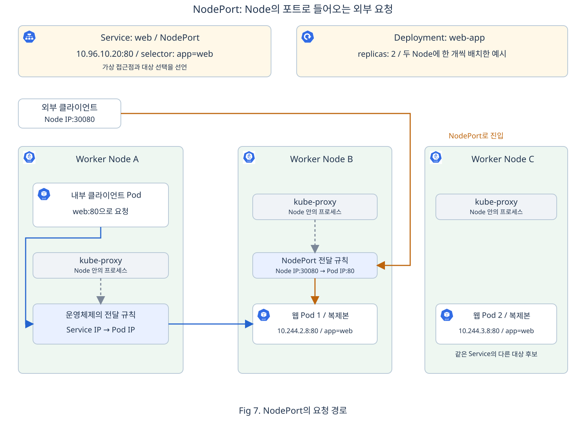

</div>

Fig 7의 파란 경로는 기존 내부 통신입니다. Node A의 클라이언트가 Service IP로 요청하면, Node A의 규칙이 목적지 Pod를 선택해 전달합니다. 주황 경로에서는 외부 클라이언트가 **Node B의 IP와 30080번 포트**로 접속합니다. Node B는 이 포트로 들어온 요청에 Service의 전달 규칙을 적용해 웹 Pod로 보냅니다.

그림에서는 두 요청 모두 Node B의 웹 Pod 1에 도달합니다. Node C의 웹 Pod 2도 같은 Service의 대상 후보이므로, 다른 요청에서는 이 Pod가 선택될 수 있습니다. 내부 접근점과 Node 포트 진입점이 같은 Pod 집합으로 이어지는 것입니다.

다음은 앞의 웹 애플리케이션에 이 접근 방식을 적용한 선언입니다.

```yaml
apiVersion: v1
kind: Service
metadata:
  name: web
  namespace: default
spec:
  type: NodePort
  selector:
    app: web
  ports:
  - name: http
    port: 80
    targetPort: 80
    protocol: TCP
    nodePort: 30080
```

- `spec.type: NodePort`: 내부 접근점에 Node 포트 진입점을 추가합니다.
- `nodePort: 30080`: 클라이언트가 `Node IP:30080`으로 접근할 때 사용하는 포트입니다.

`port: 80`은 기존 내부 접근점의 포트이고, `nodePort: 30080`은 외부에서 Node에 접속할 때의 포트입니다. 어느 쪽으로 들어오든 `targetPort: 80`에서 실행 중인 웹 서버에 전달됩니다.

`nodePort`를 생략하면 기본적으로 30000~32767 범위에서 포트를 자동 할당합니다. 이 범위는 클러스터 설정에 따라 달라질 수 있습니다. 외부 클라이언트가 실제로 접속하려면 Node까지의 네트워크 경로와 해당 포트를 허용하는 방화벽 또는 클라우드 보안 그룹도 필요합니다.

### 4.3 LoadBalancer: 외부 로드 밸런서를 통한 접근

앞의 NodePort 방식으로 외부 고객에게 특정 Node 주소를 알려 주면, 그 Node에 장애가 났을 때 고객은 다른 Node 주소로 접속해야 합니다. 외부 로드 밸런서를 두면 고객에게는 하나의 접속 주소를 제공하고, 그 뒤에서 요청을 받을 대상을 선택할 수 있습니다. **LoadBalancer**는 이러한 외부 접근점의 구성을 요청하는 Service 타입입니다. [[3]](#ref-3)

이 선언을 실제 로드 밸런서로 만드는 것은 클러스터와 외부 환경을 연결하는 **컨트롤러**입니다. 사용할 수 있는 로드 밸런서는 환경에 설치되거나 제공되는 구현에 따라 달라집니다. 클라우드에서는 해당 사업자의 로드 밸런서를 생성·설정하는 컨트롤러가 이 일을 맡고, 자체 서버 환경에서는 별도의 구현을 설치해 외부 접근점을 마련합니다. 따라서 `type: LoadBalancer`라는 공통 선언에 어떤 구현이 응답하는지를 함께 알아야 합니다.

여기서는 **AWS Load Balancer Controller**가 AWS의 **NLB**(Network Load Balancer)를 생성하는 경우를 살펴보겠습니다. 이 컨트롤러는 클러스터 안에서 실행되며, Kubernetes API로 Service 선언을 확인하고 AWS API로 실제 NLB와 전달 설정을 생성·관리합니다. 이를 위해 컨트롤러 설치와 AWS 리소스를 관리할 IAM 권한이 준비되어 있어야 합니다. 이 환경에서는 사용자가 AWS 콘솔에서 NLB를 미리 만들 필요 없이 Service 선언으로 생성을 요청할 수 있습니다. [[10]](#ref-10)

아래 선언은 인터넷에서 접근할 NLB를 요청하고, NLB의 전달 대상으로 Node를 사용하는 `instance` 방식을 지정합니다.

```yaml
apiVersion: v1
kind: Service
metadata:
  name: web
  namespace: default
  annotations:
    service.beta.kubernetes.io/aws-load-balancer-nlb-target-type: instance
    service.beta.kubernetes.io/aws-load-balancer-scheme: internet-facing
spec:
  type: LoadBalancer
  loadBalancerClass: service.k8s.aws/nlb
  selector:
    app: web
  ports:
  - name: http
    port: 80
    targetPort: 80
    protocol: TCP
```

- `spec.type: LoadBalancer`와 `spec.loadBalancerClass`: 외부 접근점을 요청하고, 이를 AWS Load Balancer Controller가 처리하도록 지정합니다.
- `aws-load-balancer-nlb-target-type: instance`: NLB가 Node의 NodePort로 요청을 전달하도록 지정합니다.
- `aws-load-balancer-scheme: internet-facing`: 인터넷에서 접근할 수 있는 NLB를 요청합니다.
- `port: 80`과 `targetPort: 80`: 이 예시에서 NLB가 요청을 받을 포트는 `80`이며, 최종 목적지인 웹 Pod도 `80`번 포트를 사용합니다. `port`는 클러스터 내부에서 사용하는 Service 포트이기도 합니다.

이 선언에는 `nodePort`가 없지만, `LoadBalancer` Service를 생성하면 Kubernetes가 기본적으로 사용 가능한 NodePort를 자동 할당합니다. 할당된 값은 API Server에 저장되는 Service의 `spec.ports[].nodePort`에 기록됩니다. Fig 8에서는 `30080`이 할당되었다고 가정합니다. [[3]](#ref-3)

AWS Load Balancer Controller는 이 값을 읽고 AWS API를 호출해 NLB를 생성한 뒤, 요청을 전달할 Node들과 포트 `30080`을 등록합니다. AWS에서는 이 전달 대상과 포트를 **Target Group**이라는 리소스로 묶어 관리합니다. 이어서 컨트롤러는 NLB에 요청을 받는 설정인 **리스너**를 80번 포트로 만들고, 등록된 대상으로 전달하도록 연결합니다. 사용자가 AWS 콘솔에 입력할 대상과 포트 설정을 컨트롤러가 대신 작성하는 것입니다. [[10]](#ref-10)

이렇게 Kubernetes가 NodePort를 할당하고 컨트롤러가 그 값을 AWS에 반영하면, NLB에는 요청을 어디로 보낼지에 대한 설정이 준비됩니다. 클라이언트가 요청을 보낼 때에는 NLB가 이미 구성된 수신 포트와 전달 대상 설정에 따라 요청을 보냅니다.

<div align="center">

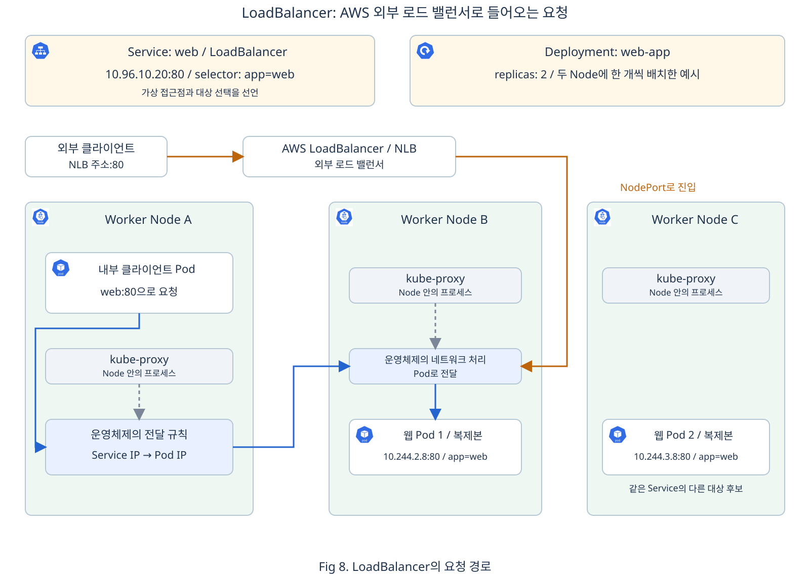

</div>

Fig 8에서는 NLB 뒤에 Worker Node B와 C가 나란히 있으며, 두 Node가 NLB의 전달 대상으로 등록되어 있습니다. 외부 클라이언트가 NLB의 80번 포트로 요청하면, NLB는 새 연결을 받을 대상을 선택해 해당 Node의 30080번 포트로 전달합니다. 왼쪽 경로는 Node B를 거쳐 웹 Pod 1에 도착한 요청이고, 오른쪽 경로는 다른 연결의 요청이 Node C를 거쳐 웹 Pod 2에 도착한 예시입니다.

NLB가 Node를 선택한 뒤에는 해당 Node의 Service 전달 규칙이 최종 Pod를 선택합니다. 그림에서는 각 Node 안의 Pod로 이어지는 경로를 보여 주며, 기본 설정에서는 다른 Node의 준비된 Pod로도 전달할 수 있습니다. 클라이언트는 이 대상들을 직접 고를 필요 없이 같은 NLB 주소로 요청합니다.

이 예시의 포트와 설정 주체를 정리하면 다음과 같습니다.

| 요청이 도착하는 곳 | 포트 | 설정 주체와 기준 |
| --- | --- | --- |
| NLB 리스너 | `80` | 컨트롤러가 Service의 `port`를 읽어 설정 |
| 로드 밸런서에 등록된 Node | `30080` | Kubernetes가 NodePort를 할당하고, 컨트롤러가 AWS의 전달 포트에 반영 |
| 웹 Pod | `80` | 웹 서버의 수신 포트이며, Service의 `targetPort`로 지정 |

여기서는 컨트롤러가 NLB와 전달 대상 설정을 함께 관리하므로 AWS에서 포트를 별도로 입력하지 않습니다. NLB를 AWS 콘솔이나 Terraform으로 직접 구성하는 경우에는 전달 대상의 포트도 실제 NodePort에 맞춰 설정해야 합니다.

Fig 8과 달리 NLB의 대상을 Pod IP로 등록하는 `ip` 방식에서는 NLB가 Pod로 직접 요청을 전달할 수 있습니다. [[10]](#ref-10) 이처럼 NodePort를 거치지 않는 구현에서는 NodePort 자동 할당을 끄도록 설정할 수도 있습니다. [[11]](#ref-11)

지금까지는 클러스터의 웹 Pod로 들어오는 요청을 살펴봤습니다. 반대로 클러스터 안의 애플리케이션이 외부 시스템을 호출할 때에는, 그 시스템을 찾을 이름을 관리하는 방식이 필요할 수 있습니다.

### 4.4 ExternalName: 외부 시스템의 DNS 별칭

내부 애플리케이션이 클러스터 밖의 `api.example.com`에서 정보를 가져온다고 가정해 보겠습니다. 이 외부 주소를 `api`라는 내부 이름으로 찾도록 연결하면, 애플리케이션이 사용할 별칭을 Service로 관리할 수 있습니다. **ExternalName**은 이렇게 Service 이름을 외부 DNS 이름에 연결하는 타입입니다. [[12]](#ref-12)

<div align="center">

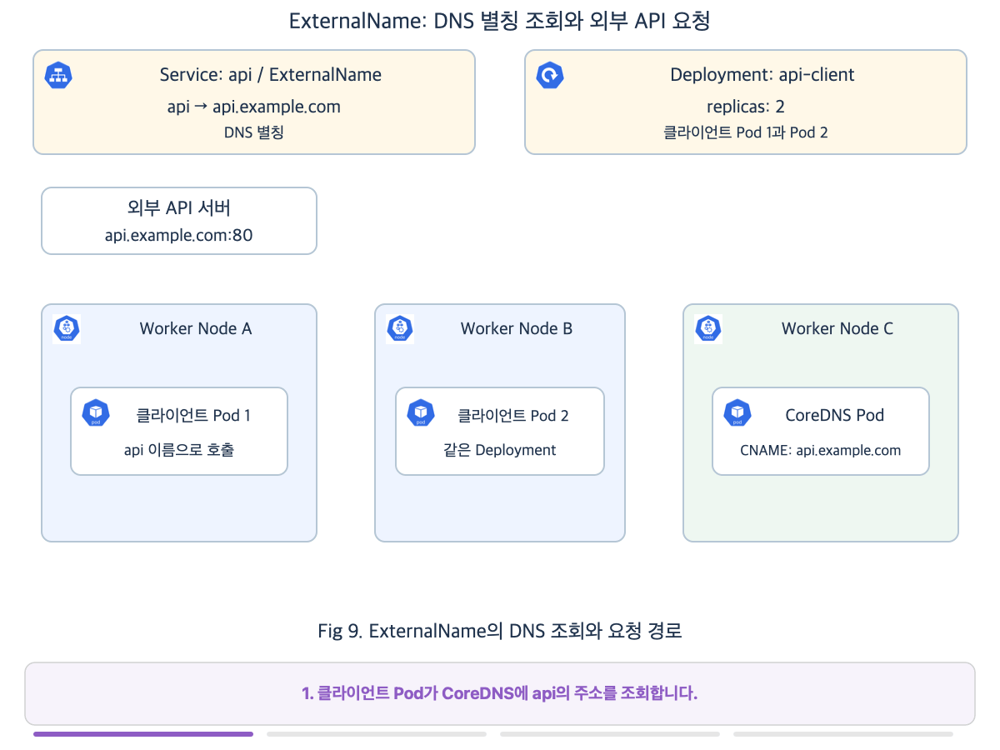

</div>

Fig 9의 Deployment는 외부 API를 호출하는 클라이언트 Pod 두 개를 유지합니다. 앞의 그림에서 요청을 받던 웹 Pod와 달리, 여기서는 이 Pod들이 요청을 보내는 쪽입니다.

Fig 9에서 Node A의 클라이언트 Pod가 `api`의 주소를 조회하면, CoreDNS는 `api.example.com`이라는 외부 이름을 **CNAME**으로 알려 줍니다. CNAME은 다른 DNS 이름을 가리키는 별칭 응답입니다. 클라이언트의 DNS 조회는 이 별칭을 따라 외부 이름의 IP 주소를 알아내는 과정으로 이어집니다. 그림에서는 조회와 응답을 보라색 화살표로 표시하고, 외부 이름의 주소로 `203.0.113.10`을 받았다고 가정합니다.

주소를 알아낸 뒤에는 주황색 경로로 바뀝니다. 클라이언트 Pod가 `203.0.113.10`의 80번 포트로 웹 요청을 보내면 외부 API 서버가 직접 받습니다. CoreDNS는 주소를 찾는 데 관여하고, 실제 API 요청은 클라이언트에서 외부 서버로 향합니다. Node B의 클라이언트 Pod도 같은 이름으로 조회해 이 과정을 이용할 수 있습니다.

그림은 별칭 확인과 IP 주소 조회를 나누어 보여 줍니다. 실제 DNS 응답에는 별칭과 IP 주소가 함께 포함되거나 캐시된 주소가 사용될 수 있습니다.

다음은 외부 API를 `api`라는 내부 이름으로 찾도록 하는 선언입니다.

```yaml
apiVersion: v1
kind: Service
metadata:
  name: api
  namespace: default
spec:
  type: ExternalName
  externalName: api.example.com
```

- `metadata.name: api`: 클라이언트가 조회할 내부 Service 이름입니다.
- `spec.type: ExternalName`과 `spec.externalName`: Service 이름을 `api.example.com`이라는 외부 DNS 이름에 연결합니다.

앞의 세 타입이 웹 Pod를 선택할 접근점을 제공했다면, ExternalName은 DNS에서 사용할 이름을 연결합니다. 실제 요청은 조회 결과를 받은 클라이언트가 외부 서버로 직접 보냅니다. [[12]](#ref-12)

접속하려면 외부 서버까지의 네트워크 경로가 있어야 합니다. HTTP나 HTTPS를 사용한다면 이름도 확인해야 합니다. 클라이언트가 사용한 `api`라는 별칭과 외부 서버가 기대하는 호스트 이름이나 인증서 이름이 다르면 요청이 실패할 수 있으므로, 서버와 클라이언트의 설정을 함께 맞춰야 합니다.

외부 서버의 주소를 알아낸 뒤 직접 연결했듯이, 클러스터 내부에서도 가상 IP를 거치지 않고 개별 Pod의 주소를 알아내 연결하는 구성이 필요할 수 있습니다.

### 4.5 가상 IP 없이 Pod 주소를 제공하는 Headless Service

여러 Pod 중 하나에 요청을 맡기는 대신, 애플리케이션이 연결할 Pod를 직접 선택해야 하는 경우도 있습니다. 예를 들어 데이터베이스의 여러 구성원 중 특정 Pod와 통신하려면 개별 Pod의 주소를 알아야 합니다. **Headless Service**는 이를 위해 가상 IP 없이 대상 주소를 DNS로 알려 주는 구성입니다. `spec.type: ClusterIP`에 `spec.clusterIP: None`을 지정하므로, 앞의 네 타입 중 ClusterIP를 사용하는 방식입니다. [[3]](#ref-3)

앞의 웹 Pod 두 개를 선택하는 Service를 이 방식으로 선언하면 다음과 같습니다.

```yaml
apiVersion: v1
kind: Service
metadata:
  name: web-headless
  namespace: default
spec:
  type: ClusterIP
  clusterIP: None
  selector:
    app: web
  ports:
  - port: 80
    targetPort: 80
```

- `spec.clusterIP: None`: Service의 가상 IP를 할당하지 않고, DNS 조회로 대상 Pod 주소를 제공하도록 지정합니다.

두 웹 Pod가 모두 준비되어 있다면, `web-headless`를 조회한 클라이언트는 `10.244.2.8`과 `10.244.3.8`처럼 Pod들의 IP를 응답으로 받습니다. 애플리케이션이나 사용하는 통신 라이브러리가 그중 접속할 주소를 선택해 Pod의 80번 포트로 직접 연결합니다. 이때 kube-proxy가 Service 가상 IP를 Pod IP로 바꾸는 과정은 필요하지 않습니다. [[3]](#ref-3)

같은 웹 Pod 집합이라도, 두 구성에서 클라이언트가 받는 주소와 대상을 고르는 주체가 달라집니다.

| 비교 항목 | 일반 ClusterIP 구성 | Headless 구성 |
| --- | --- | --- |
| DNS 조회 결과 | Service 가상 IP 하나 | 준비된 대상 Pod들의 IP |
| 이 예시의 응답 주소 | `10.96.10.20` | `10.244.2.8`, `10.244.3.8` |
| 접속할 Pod 선택 | Node에 설정된 Service 전달 규칙 | 클라이언트 애플리케이션이나 통신 라이브러리 |

Headless도 여기서는 `type: ClusterIP`로 선언합니다. 내부 통신에서 하나의 접근점 뒤로 요청을 분배할지, 개별 Pod 주소를 알려 주어 클라이언트가 선택하게 할지에 따른 구성 차이입니다.

## 다음 글로 넘어가기 전에

이번 글에서 다룬 내용은 이렇습니다. Pod끼리는 클러스터 네트워크에서 IP와 포트로 통신하지만, Pod가 교체될 때마다 클라이언트가 새 주소를 추적하는 방식은 관리하기 어렵습니다. Service는 그 앞에 일정한 접근점을 제공합니다. Deployment가 Pod 집합을 유지하는 역할과 Service가 통신할 접근점을 선언하는 역할은 서로 다릅니다.

클라이언트는 DNS에서 Service 주소를 알아낸 뒤 연결을 시작합니다. Node의 네트워크 규칙은 그 연결을 준비된 Pod로 전달하며, EndpointSlice Controller와 kube-proxy는 Pod 변화가 이 경로에 반영되도록 대상 정보와 규칙을 갱신합니다. 이름 해석의 성공과 실제 요청 처리의 성공은 구분해서 확인해야 합니다.

접근 방법은 요청을 보내는 쪽과 대상의 위치에 따라 선택합니다. 내부 통신에는 ClusterIP를, 외부 요청의 진입점에는 NodePort나 LoadBalancer를, 외부 시스템의 이름 연결에는 ExternalName을 사용할 수 있습니다.

Service로 IP와 포트를 통한 접근점을 마련했다면, 여러 웹 애플리케이션을 하나의 사이트로 제공하는 상황도 생각해 볼 수 있습니다. 이때는 같은 주소로 들어온 요청 중 `/web`은 웹 화면으로, `/api`는 상품 정보 API로 나누어 보내야 합니다. 다음 글에서는 Ingress를 통해 요청한 이름과 경로에 따라 알맞은 Service로 연결하고, HTTPS로 안전하게 접속하는 방법을 살펴봅니다.

## 참고문헌

- <a id="ref-1"></a>[1] [Kubernetes 네트워크 모델 공식 문서](https://kubernetes.io/docs/concepts/services-networking/)
- <a id="ref-2"></a>[2] [제공된 『쿠버네티스 교과서』 3장: 3.1절과 3.5절, 인쇄 쪽수 80~84·103~107쪽](../Textbook/%E1%84%80%E1%85%B5%E1%86%B7%E1%84%89%E1%85%A5%E1%86%BC%E1%84%89%E1%85%AE_%E1%84%8F%E1%85%AE%E1%84%87%E1%85%A5%E1%84%82%E1%85%A6%E1%84%90%E1%85%B5%E1%84%89%E1%85%B3%20%E1%84%80%E1%85%AD%E1%84%80%E1%85%AA%E1%84%89%E1%85%A5_ocr_3%E1%84%8C%E1%85%A1%E1%86%BC.pdf)
- <a id="ref-3"></a>[3] [Service 개념과 타입 공식 문서](https://kubernetes.io/docs/concepts/services-networking/service/)
- <a id="ref-4"></a>[4] [Service와 Pod DNS 공식 문서](https://kubernetes.io/docs/concepts/services-networking/dns-pod-service/)
- <a id="ref-5"></a>[5] [Kubernetes의 CoreDNS 운영 공식 문서](https://kubernetes.io/docs/tasks/administer-cluster/coredns/)
- <a id="ref-6"></a>[6] [CoreDNS의 Kubernetes 정보 조회 공식 문서](https://coredns.io/plugins/kubernetes/)
- <a id="ref-7"></a>[7] [Service 가상 IP와 프록시 공식 문서](https://kubernetes.io/docs/reference/networking/virtual-ips/)
- <a id="ref-8"></a>[8] [EndpointSlice 공식 문서](https://kubernetes.io/docs/concepts/services-networking/endpoint-slices/)
- <a id="ref-9"></a>[9] [Readiness Probe 공식 문서](https://kubernetes.io/docs/tasks/configure-pod-container/configure-liveness-readiness-startup-probes/)
- <a id="ref-10"></a>[10] [AWS Load Balancer Controller의 NLB 공식 문서](https://kubernetes-sigs.github.io/aws-load-balancer-controller/latest/guide/service/nlb/)
- <a id="ref-11"></a>[11] [LoadBalancer의 NodePort 할당 공식 문서](https://kubernetes.io/docs/concepts/services-networking/service/#load-balancer-nodeport-allocation)
- <a id="ref-12"></a>[12] [ExternalName 공식 문서](https://kubernetes.io/docs/concepts/services-networking/service/#externalname)
