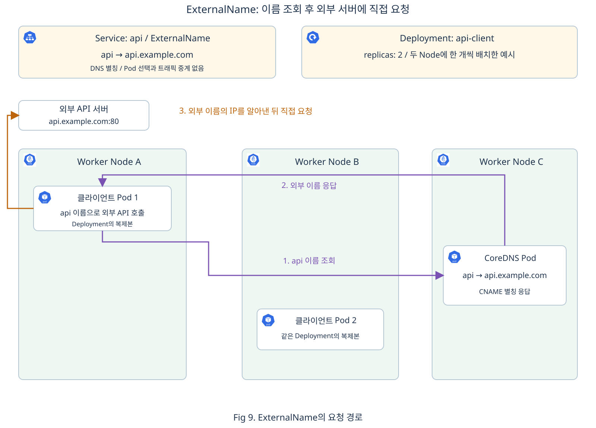

# Chap06. Service와 클러스터 통신

> 16장 연재의 여섯째 글입니다. Pod끼리 통신하는 방법과 Service가 필요한 이유를 먼저 살펴봅니다. Service 이름으로 접속할 IP 주소를 찾고 요청이 실제 Pod에 도달하는 과정을 이해한 뒤, 네 가지 Service 타입의 접근 범위를 비교합니다.

## 들어가며

<div align="center">


</div>

5장에서는 장애가 발생했을 때 컨테이너를 다시 실행하거나 Pod를 대체하는 과정을 살펴보았습니다. 새 Pod의 IP가 달라지면, 이전 주소로 요청하던 애플리케이션도 접속할 주소를 바꿔야 합니다. 실행을 복구한 뒤에도 요청이 새 Pod에 도달할 방법이 필요한 것입니다.

쇼핑몰의 웹 화면을 만드는 애플리케이션과 상품 정보를 반환하는 API가 서로 다른 Pod에서 실행된다고 가정해 보겠습니다. 웹 애플리케이션은 상품 목록을 가져오기 위해 API에 요청합니다. API Pod가 교체되거나 여러 개로 늘어나더라도, 웹 애플리케이션이 그때마다 접속 주소 목록을 고쳐야 한다면 자동 복구와 배포의 이점을 충분히 활용하기 어렵습니다.

클라이언트가 기억하는 이름과 주소는 유지하면서, 그 뒤에서 요청을 받는 Pod만 바꿀 수 있다면 어떨까요? Service는 이러한 접근점을 제공합니다. 내부 애플리케이션끼리 통신할 때뿐 아니라 외부 사용자의 요청을 받거나 외부 시스템을 호출할 때도, 요청을 보낼 쪽과 받을 쪽에 맞는 접근 방법을 선택할 수 있습니다.

## 1. Pod 사이의 통신과 Service의 필요성

안정적인 접속 주소가 필요한 이유를 이해하려면, 먼저 주소가 바뀌기 전의 Pod끼리 어떻게 통신하는지 살펴볼 필요가 있습니다.

### 1.1 Pod IP를 이용한 클러스터 내부 통신

3장에서 같은 Pod의 컨테이너는 네트워크를 공유하고 `localhost`로 통신할 수 있다고 설명했습니다. 서로 다른 Pod는 각자의 IP를 사용하므로, 다른 Pod에 있는 애플리케이션을 호출할 때는 그 Pod의 IP와 애플리케이션이 수신하는 포트가 필요합니다. 여기서 **클라이언트**는 요청을 보내는 애플리케이션을 뜻하며, 클러스터 내부의 Pod도 클라이언트가 될 수 있습니다.

예를 들어 웹 Pod가 상품 API Pod의 `10.244.2.8:80`으로 HTTP 요청을 보내면, 이 주소의 80번 포트에서 실행 중인 API 프로세스가 요청을 받아 응답합니다. 이처럼 Pod 사이에서도 애플리케이션이 사용하는 HTTP 요청과 응답으로 데이터를 주고받습니다.

클러스터에는 서로 다른 Node의 Pod도 IP로 연결할 수 있는 네트워크가 구성됩니다. 이 연결을 구현하는 것이 클러스터에 설치된 네트워크 플러그인입니다. 통신을 막는 별도 정책이 없고 네트워크와 수신 프로세스가 정상이라면, 웹 Pod와 API Pod가 서로 다른 Node에 있어도 통신할 수 있습니다. Namespace가 서로 달라도 이 조건은 같습니다. 3장에서 나눈 리소스의 관리 범위와 별개로, Pod 간 통신을 제한하려면 네트워크 정책을 적용합니다. [[1]](#ref-1)

### 1.2 Pod 교체와 접속 주소 관리의 한계

IP를 알고 있을 때는 직접 통신할 수 있지만, 그 주소를 계속 사용할 수 있다는 보장은 없습니다. 상품 API Pod가 `10.244.2.8`에서 실행되다가 새 Pod로 교체되어 `10.244.1.9`를 받으면, 웹 애플리케이션에 저장한 이전 주소는 더 이상 같은 대상을 가리키지 않습니다.

API Pod를 두 개로 늘리면 문제도 넓어집니다. 웹 애플리케이션은 어느 주소로 연결할지 선택해야 하고, Pod가 사라지거나 추가될 때마다 목록을 갱신해야 합니다. Deployment가 Pod 개수를 유지하는 동안, 호출하는 쪽에서는 현재 요청을 받을 Pod의 주소를 계속 알아야 합니다.

따라서 필요한 것은 특정 Pod의 주소를 외워 두는 방식 대신 **같은 역할의 애플리케이션에 계속 연결할 수 있는 접근점**입니다. [[2]](#ref-2)

### 1.3 애플리케이션의 접근점을 제공하는 Service

<div align="center">


</div>

<div align="center">


</div>

**Service**(서비스)는 애플리케이션에 접근할 방법을 선언하는 Kubernetes의 네트워크 리소스입니다. 가장 일반적인 구성에서는 같은 역할의 Pod 집합에 하나의 이름과 가상 IP를 제공하고, 그 접근점으로 온 연결을 요청을 처리할 수 있는 Pod에 전달하도록 합니다. 클라이언트가 기억할 대상은 개별 Pod의 위치가 아니라 이 Service의 이름입니다. [[3]](#ref-3)

위 그림의 안내 창구는 클라이언트가 찾아오는 Service의 접근점을, 뒤에 모인 Pod들은 요청을 처리할 대상을 나타냅니다. Pod가 교체되어도 클라이언트는 같은 창구를 찾는다는 관계입니다.

여기서 **가상 IP**는 특정 Pod의 위치 대신 Service의 접근점을 나타내는 주소입니다. 클러스터는 API에 기록된 선언을 바탕으로 이 주소와 실제 Pod 주소를 연결합니다. 요청을 받아 응답하는 주체는 Pod 안의 애플리케이션이며, Service 자체에서 서버 프로세스를 실행하지는 않습니다.

Deployment가 **어떤 Pod를 몇 개 실행할지** 관리한다면, Service는 **그 Pod 집합에 어떤 이름과 포트로 접근할지** 정합니다. 클라이언트가 Service 이름으로 요청하려면, 먼저 이 접근점에 연결할 Pod를 지정해야 합니다.

## 2. Service의 선언과 대상 Pod의 연결

같은 웹 애플리케이션을 실행하는 Pod 두 개에 하나의 접근점을 연결해 보겠습니다. Pod를 유지하는 선언과 요청 대상을 선택하는 선언이 어떻게 만나는지 Fig 1에서 확인할 수 있습니다.

<div align="center">


</div>

### 2.1 애플리케이션과 접근점의 연결 관계

Fig 1은 클러스터 안의 애플리케이션이 웹 서버에 요청하는 상황입니다. 웹 서버는 두 Pod에서 실행되고, Deployment는 이 Pod들이 유지되도록 관리합니다.

<div align="center">


</div>

위 그림에서 봉투를 든 왼쪽 Pod는 요청을 보내는 클라이언트이고, 문 뒤에서 손을 내미는 Pod들은 요청을 처리할 웹 서버입니다. Service가 안내하는 하나의 문은 웹 Pod들의 공통 접근점을 나타냅니다. 클라이언트는 개별 웹 Pod 대신 Service의 이름으로 요청하며, 이 요청을 어느 Pod에 전달할지는 Service에 선언한 대상 조건과 현재 준비 상태를 바탕으로 정해집니다.

Deployment가 만든 두 웹 Pod에는 같은 역할임을 나타내는 Label이 붙습니다. Service는 자신과 같은 Namespace 안에서 이 Label을 선택 조건으로 사용해 요청 대상을 찾습니다. 예를 들어 `dev`의 Service는 `dev`의 웹 Pod를 선택하고, 같은 Label이 붙어 있어도 `prod`의 Pod는 선택 대상에 포함하지 않습니다. 두 리소스가 같은 Pod 집합에 연결되는 이유입니다.

이 접근점의 이름을 **`web`**이라고 하겠습니다. 클라이언트가 Pod의 개수나 위치를 몰라도 `web`으로 요청할 수 있도록, Service에 이름과 선택 조건, 포트를 선언합니다.

### 2.2 Service가 선언하는 이름과 대상 및 포트

Fig 1의 관계를 설정으로 표현하려면 다음 세 가지가 필요합니다.

- **접근할 이름**: 클라이언트가 애플리케이션을 찾을 때 사용할 이름입니다. 여기서는 `web`입니다.
- **연결할 Pod의 조건**: 같은 역할의 Pod를 찾는 기준입니다. Pod에 붙인 Label을 Service의 Selector로 선택합니다.
- **연결할 포트**: 클라이언트가 사용할 Service 포트와, 실제 애플리케이션이 요청을 받을 Pod 쪽 포트를 연결합니다.

예를 들어 클라이언트에게는 80번 포트를 제공하면서, 실제 애플리케이션의 8080번 포트로 전달할 수 있습니다. 이때 애플리케이션은 실제로 8080번 포트에서 요청을 받고 있어야 합니다. 다음 웹 서버 예시는 Service와 애플리케이션 모두 80번 포트를 사용합니다.

이 연결 방식은 웹 서버뿐 아니라 데이터베이스 같은 애플리케이션에도 사용할 수 있습니다. Service는 IP와 포트, TCP 같은 통신 규약을 기준으로 연결을 전달합니다. 여기서 TCP는 웹 요청이나 데이터베이스 명령을 주고받는 데 사용하는 통신 방식이며, Service의 기본 프로토콜입니다. [[3]](#ref-3)

### 2.3 매니페스트로 확인하는 Label과 Selector의 연결

그림의 관계를 선언으로 옮겨 보겠습니다. 여기서는 Deployment와 Service를 모두 `default` Namespace에 둡니다. Deployment는 웹 Pod 두 개를 만들고 각각에 `app: web`이라는 Label을 붙입니다. Service는 이 Label이 있는 Pod를 요청 대상 후보로 선택합니다.

```yaml
apiVersion: apps/v1
kind: Deployment
metadata:
  name: web-app
  namespace: default
spec:
  replicas: 2
  selector:
    matchLabels:
      app: web
  template:
    metadata:
      labels:
        app: web
    spec:
      containers:
      - name: nginx
        image: nginx:1.28
        ports:
        - containerPort: 80
```

- `replicas`와 `template`: 유지할 Pod 개수와 새 Pod의 공통 구성을 정합니다.
- `template.metadata.labels`: 생성되는 Pod에 웹 애플리케이션임을 구분할 Label을 붙입니다. Deployment의 `selector.matchLabels`도 이 Label에 맞춥니다.

웹 서버 프로그램으로 nginx를 사용합니다. 컨테이너는 80번 포트에서 요청을 받으며, 이 Pod들을 선택할 Service는 다음과 같습니다.

```yaml
apiVersion: v1
kind: Service
metadata:
  name: web
  namespace: default
spec:
  selector:
    app: web
  ports:
  - port: 80
    targetPort: 80
```

- `metadata.name`: 클라이언트가 조회할 이름입니다.
- `spec.selector`: 요청 대상 후보인 Pod를 고르는 조건입니다. 앞의 Pod 템플릿에 붙인 Label과 연결됩니다.
- `port`와 `targetPort`: Service의 접근 포트와 실제 애플리케이션 포트를 연결합니다.

두 선언을 다른 Namespace에서 사용하려면 각각의 `metadata.namespace`를 같은 값으로 지정합니다. Deployment가 만드는 Pod도 그 Namespace에 속하므로 Service가 선택할 수 있습니다.

두 선언의 이름은 `web-app`과 `web`으로 서로 다릅니다. **연결 기준은 리소스 이름이 아니라 Pod의 Label과 Service의 Selector**이기 때문입니다. 새 Pod로 교체되어도 같은 Label이 붙으면 계속 같은 Service의 대상 후보가 됩니다.

이 Service를 생성하면 Kubernetes가 클러스터 내부에서 사용할 가상 IP를 자동으로 할당합니다. 여기서는 `web` Service에 `10.96.10.20`이 할당되었다고 가정합니다. [[3]](#ref-3)

## 3. Service의 주소 조회와 요청 전달

Service와 대상 Pod를 연결했으므로, 이제 클라이언트가 `http://web:80/`로 요청을 보내는 과정을 살펴보겠습니다. 이 호출은 두 단계로 나뉩니다. 먼저 이름에 해당하는 주소를 알아내고, 그 주소로 연결해 요청을 보냅니다. **주소 조회와 애플리케이션 통신은 서로 다른 과정**입니다. [[2]](#ref-2)

### 3.1 Service의 주소를 알려 주는 CoreDNS

클라이언트가 `web`이라는 이름으로 요청을 보내면, 먼저 “`web`에 접속하려면 어느 IP 주소를 사용해야 할까?”를 확인해야 합니다. 이때 이름에 해당하는 IP 주소를 알려 주는 것이 **DNS**(Domain Name System)이며, 이렇게 주소를 알아내는 과정을 **이름 해석**이라고 합니다. [[4]](#ref-4) Kubernetes에서는 보통 **CoreDNS**라는 DNS 서버 프로그램이 이 질문에 답합니다. 앞에서 웹 서버를 Pod 안의 컨테이너로 실행했듯이, CoreDNS도 Pod 안에서 실행되며 클러스터의 애플리케이션들이 이름으로 서로를 찾을 수 있도록 돕습니다. [[5]](#ref-5)

CoreDNS를 직접 설치한 기억이 없어도 클러스터에서 발견할 수 있습니다. 예를 들어 `kubeadm`으로 클러스터를 만들면 CoreDNS가 기본으로 설치됩니다. 사용할 DNS 서버는 클러스터의 설치 도구와 설정에 따라 달라집니다. 보통은 `coredns`라는 Deployment가 Pod 개수를 관리하며, 웹 애플리케이션과 마찬가지로 컨트롤러가 필요한 Pod를 유지합니다. [[5]](#ref-5)

<div align="center">


</div>

Fig 2에서는 CoreDNS Pod가 Worker Node B에 배치되어 있습니다. CoreDNS의 Pod 개수와 배치 위치는 클러스터 설정에 따라 정해집니다. 다른 Node의 클라이언트도 클러스터 네트워크를 통해 CoreDNS에 주소를 물을 수 있습니다.

그렇다면 CoreDNS는 `web`의 주소를 어떻게 알까요? **API Server를 통해 Service의 이름과 IP 정보를 받아 두고, Service가 생성되거나 변경되면 그 정보를 반영합니다.** [[6]](#ref-6) 클라이언트의 조회에는 CoreDNS가 받아 둔 정보를 이용해 응답합니다.

3장에서 같은 리소스 이름을 Namespace별로 사용할 수 있다고 설명했습니다. DNS로 Service를 찾을 때도 이 구분이 필요합니다. Pod에서 `web`처럼 짧은 이름을 사용하면 자신의 Namespace에 있는 Service를 찾습니다. 앞의 예시에서는 클라이언트와 `web` Service가 모두 `default`에 있습니다. `dev`의 클라이언트가 `prod`의 `web` Service를 호출하려면 `web.prod`처럼 Namespace를 함께 적습니다. 클러스터 도메인이 `cluster.local`이라면 전체 이름은 `web.prod.svc.cluster.local`입니다. 이렇게 찾은 주소로 요청을 보낼 수 있는지는 클러스터의 통신 정책에 따릅니다. [[4]](#ref-4)

일반적인 Pod에는 클러스터 DNS를 사용할 수 있도록 DNS 서버 주소가 설정됩니다. CoreDNS 앞에도 `kube-dns`라는 Service가 있어, CoreDNS Pod가 교체되더라도 다른 Pod들이 일정한 주소로 DNS 조회를 보낼 수 있습니다. 애플리케이션은 CoreDNS Pod의 위치를 직접 관리하지 않고 `web`이라는 이름으로 접속하면 됩니다. [[5]](#ref-5)

실제 클러스터에서도 다음 명령으로 CoreDNS Pod와 실행 중인 Node를 확인할 수 있습니다. `kube-system`은 Kubernetes 시스템 구성요소를 위한 Namespace입니다. `-n kube-system`은 앞에서 사용한 `default` 대신 이 Namespace의 Pod를 조회하도록 지정합니다.

```bash
# CoreDNS Pod의 실행 상태와 배치된 Node 확인
kubectl get pods -n kube-system -l k8s-app=kube-dns -o wide
```

다음은 CoreDNS Pod 두 개가 실행 중인 출력 예시입니다.

```text
NAME                       READY   STATUS    RESTARTS   AGE   IP            NODE       NOMINATED NODE   READINESS GATES
coredns-76f75df574-abcde     1/1     Running   0          1d    10.244.2.3    worker-b   <none>           <none>
coredns-76f75df574-fghij     1/1     Running   0          1d    10.244.3.4    worker-c   <none>           <none>
```

- `NAME`: 이름이 `coredns-`로 시작하는 Pod에서 DNS 서버가 실행되고 있음을 확인합니다.
- `NODE`: 각 CoreDNS Pod가 실제로 배치된 Node입니다.

이 출력의 IP는 CoreDNS Pod 자체의 주소입니다. 클라이언트는 DNS용 Service를 통해 여기에 조회를 보내고, 응답으로 웹 Service의 IP를 받습니다. 두 주소를 구분하면 이름 조회와 웹 요청의 경로도 구분할 수 있습니다.

### 3.2 DNS 조회부터 웹 Pod까지의 요청 경로

이제 `web`이라는 이름으로 보낸 요청이 실제 웹 Pod에 도달하는 과정을 살펴보겠습니다. 주소를 알아내는 것에 더해, **Service의 가상 IP와 실제 Pod를 연결할 정보**가 필요합니다.

이 연결을 준비하는 **kube-proxy**는 각 Node에서 실행되는 프로세스입니다. API Server에서 정보를 받아, Service IP로 온 연결을 실제 Pod IP와 포트로 전달할 규칙을 Node의 운영체제에 설정합니다. 이후의 요청 전달은 운영체제가 해당 규칙을 적용해 처리합니다. 여기서는 kube-proxy를 사용하는 구성을 기준으로 살펴봅니다. [[7]](#ref-7)

어느 Pod에 전달할지는 **EndpointSlice**에 기록된 정보를 바탕으로 정합니다. EndpointSlice는 Service의 실제 연결 대상인 Pod의 주소, 포트와 준비 상태를 담는 API 리소스입니다. “이 Service가 어느 Pod의 어느 포트로 연결되는가”를 담은 **매핑 정보 테이블**로 이해하면 됩니다. CoreDNS가 알려 주는 Service 주소와 그 뒤에서 요청을 받을 Pod 주소는 이렇게 구분됩니다. [[8]](#ref-8)

다음 그림에서는 클라이언트 Pod, CoreDNS Pod, 웹 Pod를 서로 다른 Node에 배치해 두 통신 경로를 구분합니다.

<div align="center">


</div>

Fig 3의 처음에는 API의 Service 정보가 CoreDNS에 반영되고, kube-proxy가 Node에 전달 규칙을 설정합니다. CoreDNS에는 이름으로 조회할 주소가, Node에는 그 주소로 들어온 요청을 실제 Pod에 전달할 정보가 준비됩니다. 이러한 정보 갱신은 웹 요청과 별개로 이루어집니다.

클라이언트가 `web`에 접속하려 하면 먼저 Pod에 설정된 DNS 서버 주소인 `10.96.0.10`으로 IP를 묻습니다. 이 주소는 `kube-dns` Service의 IP입니다. Node의 규칙은 조회의 목적지를 CoreDNS Pod의 IP로 바꾸어 전달합니다.

CoreDNS는 받아 둔 정보에서 `web`의 Service IP인 `10.96.10.20`을 찾아 응답합니다. 이 응답을 받은 클라이언트는 알아낸 주소로 웹 요청을 보냅니다. 이번에는 Node의 규칙이 웹 Pod를 선택해 전달하고, 웹 애플리케이션이 요청을 처리합니다.

따라서 DNS 조회는 **접속할 주소를 알아내는 통신**, 웹 요청은 **그 주소의 애플리케이션을 호출하는 통신**입니다. CoreDNS는 주소 조회에 응답하고, 실제 웹 요청은 Node의 규칙을 따라 웹 Pod로 향합니다.

<div align="center">


</div>

Fig 3에서 한 웹 Pod에 도달하는 경로를 살펴보았다면, Fig 4는 **Deployment의 웹 Pod 복제본이 Worker Node B와 C에 한 개씩 있는 상황**입니다. 두 Pod 모두 `app=web`이라는 Label이 있고 요청할 준비가 되어 있어, 같은 `web` Service의 연결 대상이 됩니다.

클라이언트 Pod는 **요청 1과 요청 2를 모두 같은 Service IP인 `10.96.10.20:80`으로 보냅니다.** Node A의 운영체제는 kube-proxy가 설정한 규칙에 따라 준비된 Pod 중 하나를 선택하고, 요청의 목적지를 그 Pod의 IP와 포트로 바꾸어 전달합니다. 클라이언트는 같은 주소를 사용하고, 실제 대상 선택은 Node의 규칙에 맡기는 것입니다.

- **요청 1**: Worker Node B의 웹 Pod 1인 `10.244.2.8:80`으로 전달됩니다.
- **요청 2**: Worker Node C의 웹 Pod 2인 `10.244.3.8:80`으로 전달됩니다.

이처럼 하나의 Service 주소로 받은 요청을 여러 복제본에 분배할 수 있습니다. Fig 4는 각 요청이 새 연결을 사용해 서로 다른 Pod로 전달된 예시입니다. 같은 연결을 재사용하는 요청은 같은 Pod로 갈 수 있으며, Pod 선택 방식은 네트워크 구현과 설정에 따라 달라집니다.

### 3.3 Pod 변경에 따른 연결 대상 갱신

웹 Pod가 교체되어 새 IP를 받으면 어떻게 될까요? 클라이언트가 계속 같은 Service 주소를 사용하려면, 앞에서 준비한 매핑 정보와 Node의 전달 규칙에 새 Pod 주소가 반영되어야 합니다. 이 작업은 다음 두 주체가 나누어 수행합니다.

- **EndpointSlice Controller**: Control Plane에서 Service와 Pod의 변화를 관찰하고, Service와 같은 Namespace에서 Selector에 맞는 Pod를 찾고, 주소와 준비 상태를 같은 Namespace의 EndpointSlice에 반영합니다.
- **kube-proxy**: API Server를 통해 Service와 EndpointSlice의 변경 정보를 받아 각 Node의 전달 규칙을 갱신합니다.

<div align="center">


</div>

Fig 5에서는 웹 Pod가 교체되면서 대상 주소가 `10.244.3.8`에서 `10.244.3.9`로 바뀝니다. EndpointSlice Controller는 새 Pod의 주소와 준비 상태를 기록합니다. 준비 전에도 주소가 기록될 수 있으며, 준비 상태가 바뀌면 그 변화도 함께 반영됩니다. kube-proxy는 이 정보를 받아 준비된 Pod로 새 연결을 전달하도록 Node의 규칙을 갱신합니다. [[8]](#ref-8) CoreDNS가 알려 주는 Service IP인 `10.96.10.20`은 그대로이며, 갱신을 마친 뒤 같은 주소로 보낸 새 요청은 새 Pod에 도달합니다.

새 Pod에 같은 Label이 붙고 요청을 받을 준비가 끝나면, 이 과정을 통해 새 주소가 연결 대상에 포함됩니다. **Service가 유지되는 동안에는 이름과 가상 IP가 그대로이고, 실제로 요청을 받을 Pod 주소만 바뀝니다.** 따라서 클라이언트가 접속 설정에 새 Pod IP를 직접 적을 필요가 없습니다. CoreDNS Pod가 교체될 때도 같은 원리로 DNS용 Service인 `kube-dns`의 주소를 계속 사용할 수 있습니다. [[2]](#ref-2)

4장에서 살펴본 준비 검사가 실패하면 해당 Pod는 일반적인 Service의 새 연결 대상에서 제외됩니다. 준비 상태가 회복되면 다시 대상이 될 수 있습니다. 이러한 갱신은 Pod의 상태나 구성이 바뀔 때 이루어집니다. [[9]](#ref-9)

변경 반영에는 시간이 걸릴 수 있으므로, 교체 중 실패한 요청은 클라이언트에서 다시 연결해 시도해야 할 수 있습니다. 또한 주소 조회가 성공해도 요청을 받을 준비가 된 Pod가 있어야 정상 응답을 받을 수 있습니다.

Kubernetes의 Service는 `spec.type`에 지정할 수 있는 값으로 **ClusterIP, NodePort, LoadBalancer, ExternalName** 네 가지를 지원합니다. 지금까지 살펴본 내부 통신을 바탕으로, 각 타입이 어디에서 들어오는 요청에 어떤 접근점을 제공하는지 비교하겠습니다.

## 4. 클러스터 내부와 외부의 통신을 위한 Service 타입

Service 타입은 **클라이언트가 어디에서 어떤 주소로 접근할지**를 기준으로 선택합니다. 네 타입은 모두 `kind: Service`로 선언하며, `spec.type`으로 접근 방식을 정합니다.

- **ClusterIP**: 클러스터 내부 애플리케이션끼리 통신할 때 먼저 검토합니다. 지금까지 살펴본 이름과 가상 IP를 통한 내부 접근점입니다.
- **NodePort**: 외부 클라이언트가 Node의 IP와 지정된 포트로 직접 접속해야 할 때 사용합니다. 사용할 Node 주소의 선택과 해당 Node의 장애에 대한 대응은 별도로 준비해야 합니다.
- **LoadBalancer**: 외부 로드 밸런서의 접속 주소가 필요하고, 이를 생성할 클라우드 연동 등의 구현이 갖춰져 있을 때 사용합니다.
- **ExternalName**: 기존 외부 시스템을 클러스터 내부의 Service 이름으로 찾을 때 사용합니다. 외부 DNS 이름을 별칭으로 알려 주며, Pod를 선택하거나 요청을 중계하지 않습니다.

ClusterIP, NodePort, LoadBalancer는 같은 웹 Pod 집합에 연결하는 상황을 기준으로 비교합니다. 이 세 타입의 매니페스트는 하나의 `web` Service를 서로 다른 방식으로 선언한 예시입니다. ExternalName에서는 내부 Pod가 외부 API를 호출하는 상황을 살펴봅니다.

### 4.1 ClusterIP: 내부 Pod 간 통신

**ClusterIP**는 클러스터 내부에서 사용하는 Service 이름과 가상 IP를 제공합니다. `spec.type`을 생략했을 때 적용되는 기본 타입입니다. 지금까지 살펴본 내부 접근점이 이 타입에 해당합니다.

예를 들어 쇼핑몰의 주문 처리 Pod가 같은 클러스터의 상품 조회 Pod에 재고를 요청하는 상황입니다. 상품 조회 기능을 인터넷에 별도로 공개할 필요가 없다면, ClusterIP Service를 두고 주문 애플리케이션이 그 이름으로 호출하게 할 수 있습니다. 상품 조회 Pod가 교체되어도 호출하는 쪽은 개별 Pod의 IP를 관리하지 않아도 됩니다.

<div align="center">


</div>

Fig 6은 내부 클라이언트의 요청이 Node의 전달 규칙을 거쳐 선택된 웹 Pod에 도달하는 과정입니다. 클라이언트는 Service IP로 요청하고, Node A의 규칙이 선택한 웹 Pod가 Node B에서 요청을 처리합니다. 웹 Pod가 응답하면 같은 통신 경로를 통해 클라이언트가 결과를 받습니다.

2절의 Service 선언이 이 타입의 예시입니다. 내부 클라이언트는 `http://web:80/`을 사용하며, Pod가 어느 Node에 있는지에 따라 접속 주소를 바꾸지 않습니다.

일반적인 클러스터 외부 컴퓨터에는 ClusterIP로 가는 경로가 없습니다. 외부에서 들어올 경로가 필요하면 다음 절의 NodePort나 LoadBalancer 같은 진입점을 함께 검토합니다.

### 4.2 NodePort: Node 포트를 통한 외부 접근

**NodePort**는 ClusterIP의 내부 접근점을 유지하면서 Node의 지정된 포트에도 진입점을 추가합니다. 클라이언트는 접근 가능한 `Node IP:nodePort`로 요청합니다.

예를 들어 외부 로드 밸런서가 없는 사내 테스트 클러스터에서 개발자의 PC로 웹 화면을 확인할 때 사용할 수 있습니다. PC에서 Node에 접속할 수 있다면 `Node IP:30080`으로 요청해 동작을 확인합니다. 별도로 운영하는 로드 밸런서의 전달 대상을 각 Node의 이 포트로 설정하는 구성에도 활용할 수 있습니다. [[3]](#ref-3)

<div align="center">


</div>

Fig 7에서 내부 Pod는 Service 이름과 `port`를 사용하고, 외부 클라이언트는 Node 주소와 `nodePort`를 사용합니다. 두 경로는 같은 Selector가 고른 nginx Pod 집합으로 이어집니다. 외부 요청을 받은 Node도 전달 규칙을 적용해 준비된 웹 Pod로 요청을 보냅니다.

다음은 앞의 웹 애플리케이션에 이 접근 방식을 적용한 선언입니다.

```yaml
apiVersion: v1
kind: Service
metadata:
  name: web
  namespace: default
spec:
  type: NodePort
  selector:
    app: web
  ports:
  - name: http
    port: 80
    targetPort: 80
    protocol: TCP
    nodePort: 30080
```

- `spec.type: NodePort`: 내부 접근점에 Node 포트 진입점을 추가합니다.
- `nodePort: 30080`: 클라이언트가 `Node IP:30080`으로 접근할 때 사용하는 포트입니다.

이 선언에서 내부 클라이언트는 `web:80`을, 외부 클라이언트는 접근 가능한 `Node IP:30080`을 사용합니다. 두 접근점으로 온 요청 모두 웹 Pod의 80번 포트로 전달됩니다.

`nodePort`를 생략하면 클러스터에 설정된 범위에서 자동 할당됩니다. 기본 범위는 30000~32767이지만 클러스터 설정에 따라 달라질 수 있습니다. 30080번이 이미 다른 Service에 할당되어 있으면 다른 포트를 사용해야 합니다.

외부 호출에는 Node까지의 네트워크 경로와 해당 포트를 허용하는 방화벽 또는 클라우드 보안 그룹이 필요합니다.

기본 외부 트래픽 정책인 `externalTrafficPolicy: Cluster`에서는 요청을 받은 Node에 대상 Pod가 없어도 다른 Node의 준비된 Pod로 전달할 수 있습니다. NodePort는 여러 Node에 진입점을 제공하지만 클라이언트가 사용할 Node 주소를 자동으로 선택해 주지는 않습니다. 특정 Node 주소만 사용하다가 해당 Node에 장애가 나면 다른 주소로 접속해야 합니다. 이 주소 선택을 외부 로드 밸런서에 맡기는 방법도 있습니다.

### 4.3 LoadBalancer: 외부 로드 밸런서를 통한 접근

**LoadBalancer**는 외부 로드 밸런서 구현에 Service 진입점 생성을 요청하는 타입입니다. 클라우드 연동처럼 로드 밸런서를 생성하고 연결할 구현이 준비되어 있어야 합니다.

예를 들어 AWS에서 실행하는 애플리케이션을 외부 고객에게 제공하면서, 고객이 개별 Node 주소를 선택하지 않고 하나의 접속 주소를 사용하게 하려는 상황입니다. 인터넷에서 접근할 수 있도록 구성한 AWS 로드 밸런서의 주소로 요청을 받고, 로드 밸런서가 등록된 대상으로 전달하게 할 수 있습니다. 클라이언트에게 Node 주소 목록을 직접 배포하지 않아도 된다는 점이 NodePort에 직접 접속하는 방식과 다릅니다.

<div align="center">


</div>

Fig 8은 AWS의 네트워크 로드 밸런서인 **NLB**(Network Load Balancer)가 Node를 대상으로 등록하는 `instance` 방식의 예시입니다. 외부 요청은 NLB의 80번 포트에서 NodePort를 거쳐 Pod로 전달됩니다. 등록된 Node가 요청을 받으면 준비된 웹 Pod로 전달하고, 그 Pod의 애플리케이션이 응답합니다. [[10]](#ref-10)

다음은 앞의 웹 애플리케이션에 이 접근 방식을 적용한 선언입니다. 필요한 구현과 환경별 설정이 갖춰졌을 때 외부 접근점이 생성됩니다.

```yaml
apiVersion: v1
kind: Service
metadata:
  name: web
  namespace: default
spec:
  type: LoadBalancer
  selector:
    app: web
  ports:
  - name: http
    port: 80
    targetPort: 80
    protocol: TCP
```

- `spec.type: LoadBalancer`: 외부 로드 밸런서 구현에 접근점 생성을 요청합니다.

외부 로드 밸런서가 들어오는 요청을 받더라도, Service가 선택하는 Pod와 애플리케이션의 수신 포트는 앞의 예시와 같습니다. AWS NLB에서 Pod IP를 직접 대상으로 등록하는 `ip` 방식을 사용하면 NodePort를 거치지 않는 경로도 구성할 수 있습니다. [[10]](#ref-10) 이처럼 직접 전달하는 구현에서는 NodePort 할당을 생략할 수 있습니다. [[11]](#ref-11) 로드 밸런서의 주소를 인터넷에 공개할지 사설 네트워크에서만 사용할지도 환경에 맞게 설정합니다.

지금까지는 클러스터의 Pod에 요청을 전달하는 진입점을 비교했습니다. 반대로 내부 애플리케이션이 클러스터 밖의 기존 시스템을 이름으로 찾아야 하는 경우도 있습니다.

### 4.4 ExternalName: 외부 시스템의 DNS 별칭

**ExternalName**은 Service 이름을 외부 DNS 이름의 별칭으로 연결합니다.  클러스터 안의 애플리케이션이 기존 외부 API를 일관된 내부 이름으로 찾을 때 사용할 수 있습니다.

예를 들어 애플리케이션은 Kubernetes로 옮겼지만 데이터베이스는 클러스터 밖에서 계속 운영하는 상황입니다. 데이터베이스의 DNS 이름에 `db`라는 Service 별칭을 연결하면, 애플리케이션은 그 별칭으로 외부 데이터베이스의 주소를 찾을 수 있습니다. 데이터베이스 접속 주소가 바뀔 때 별칭이 가리키는 이름을 관리하는 용도로 활용할 수 있으며, 실제 연결은 클라이언트가 외부 데이터베이스로 직접 맺습니다. [[12]](#ref-12)

<div align="center">



</div>

Fig 9에서 애플리케이션 Pod는 먼저 CoreDNS에 ExternalName Service를 조회합니다. CoreDNS는 외부 DNS 이름을 **CNAME**으로 반환합니다. 이 응답은 조회한 이름 대신 사용할 다른 DNS 이름을 알려 줍니다. 클라이언트는 그 외부 이름에 해당하는 IP 주소를 알아낸 뒤 외부 서버로 직접 요청합니다. 보라색 화살표는 DNS 조회와 응답을, 주황색 화살표는 외부 API로 향하는 실제 요청을 나타냅니다.

다음은 외부 API를 `api`라는 내부 이름으로 찾도록 하는 선언입니다.

```yaml
apiVersion: v1
kind: Service
metadata:
  name: api
  namespace: default
spec:
  type: ExternalName
  externalName: api.example.com
```

- `metadata.name: api`: 클라이언트가 조회할 내부 Service 이름입니다.
- `spec.type: ExternalName`과 `spec.externalName`: Service 이름을 `api.example.com`이라는 외부 DNS 이름에 연결합니다.

이 경우에는 Pod를 고르는 대신 외부 DNS 이름을 연결합니다. 따라서 별도의 Service 가상 IP나 Pod 대상 목록을 사용하지 않고, 주소 조회 후 클라이언트가 외부 서버에 직접 접속합니다. [[12]](#ref-12)

접속하려면 외부 서버까지의 네트워크 경로가 있어야 합니다. HTTP나 HTTPS를 사용한다면 이름도 확인해야 합니다. 클라이언트가 사용한 `api`라는 별칭과 외부 서버가 기대하는 호스트 이름이나 인증서 이름이 다르면 요청이 실패할 수 있으므로, 서버와 클라이언트의 설정을 함께 맞춰야 합니다.

외부 서버의 주소를 알아낸 뒤 직접 연결했듯이, 클러스터 내부에서도 가상 IP를 거치지 않고 개별 Pod의 주소를 알아내 연결하는 구성이 필요할 수 있습니다.

### 4.5 ClusterIP의 변형: Headless Service

여러 Pod 중 하나에 요청을 맡기는 대신, 애플리케이션이 연결할 Pod를 직접 선택해야 하는 경우도 있습니다. 예를 들어 데이터베이스의 여러 구성원 중 특정 Pod와 통신하려면 개별 Pod의 주소를 알아야 합니다. **Headless Service**는 이를 위해 가상 IP 없이 대상 주소를 DNS로 알려 주는 구성입니다. `spec.type: ClusterIP`에 `spec.clusterIP: None`을 지정하므로, 앞의 네 타입 중 ClusterIP를 사용하는 방식입니다. [[3]](#ref-3)

앞의 웹 Pod 두 개를 선택하는 Service를 이 방식으로 선언하면 다음과 같습니다.

```yaml
apiVersion: v1
kind: Service
metadata:
  name: web-headless
  namespace: default
spec:
  type: ClusterIP
  clusterIP: None
  selector:
    app: web
  ports:
  - port: 80
    targetPort: 80
```

- `spec.clusterIP: None`: Service의 가상 IP를 할당하지 않고, DNS 조회로 대상 Pod 주소를 제공하도록 지정합니다.

두 웹 Pod가 모두 준비되어 있다면, `web-headless`를 조회한 클라이언트는 `10.244.2.8`과 `10.244.3.8`처럼 Pod들의 IP를 응답으로 받습니다. 애플리케이션이나 사용하는 통신 라이브러리가 그중 접속할 주소를 선택해 Pod의 80번 포트로 직접 연결합니다. 이때 kube-proxy가 Service 가상 IP를 Pod IP로 바꾸는 과정은 필요하지 않습니다. [[3]](#ref-3)

일반적인 ClusterIP 구성이 하나의 가상 IP 뒤에서 Pod를 선택한다면, 이 Headless 구성은 **Pod 주소를 알려 주고 연결 대상의 선택을 클라이언트에 맡깁니다.**

## 다음 글로 넘어가기 전에

이번 글에서 다룬 내용은 이렇습니다. Pod끼리는 클러스터 네트워크에서 IP와 포트로 통신하지만, Pod가 교체될 때마다 클라이언트가 새 주소를 추적하는 방식은 관리하기 어렵습니다. Service는 그 앞에 일정한 접근점을 제공합니다. Deployment가 Pod 집합을 유지하는 역할과 Service가 통신할 접근점을 선언하는 역할은 서로 다릅니다.

클라이언트는 DNS에서 Service 주소를 알아낸 뒤 연결을 시작합니다. Node의 네트워크 규칙은 그 연결을 준비된 Pod로 전달하며, EndpointSlice Controller와 kube-proxy는 Pod 변화가 이 경로에 반영되도록 대상 정보와 규칙을 갱신합니다. 이름 해석의 성공과 실제 요청 처리의 성공은 구분해서 확인해야 합니다.

접근 방법은 요청을 보내는 쪽과 대상의 위치에 따라 선택합니다. 내부 통신에는 ClusterIP를, 외부 요청의 진입점에는 NodePort나 LoadBalancer를, 외부 시스템의 이름 연결에는 ExternalName을 사용할 수 있습니다.

Service로 IP와 포트를 통한 접근점을 마련했다면, 여러 웹 애플리케이션을 하나의 사이트로 제공하는 상황도 생각해 볼 수 있습니다. 이때는 같은 주소로 들어온 요청 중 `/web`은 웹 화면으로, `/api`는 상품 정보 API로 나누어 보내야 합니다. 다음 글에서는 Ingress를 통해 요청한 이름과 경로에 따라 알맞은 Service로 연결하고, HTTPS로 안전하게 접속하는 방법을 살펴봅니다.

## 참고문헌

- <a id="ref-1"></a>[1] [Kubernetes 네트워크 모델 공식 문서](https://kubernetes.io/docs/concepts/services-networking/)
- <a id="ref-2"></a>[2] [제공된 『쿠버네티스 교과서』 3장: 3.1절과 3.5절, 인쇄 쪽수 80~84·103~107쪽](../Textbook/%E1%84%80%E1%85%B5%E1%86%B7%E1%84%89%E1%85%A5%E1%86%BC%E1%84%89%E1%85%AE_%E1%84%8F%E1%85%AE%E1%84%87%E1%85%A5%E1%84%82%E1%85%A6%E1%84%90%E1%85%B5%E1%84%89%E1%85%B3%20%E1%84%80%E1%85%AD%E1%84%80%E1%85%AA%E1%84%89%E1%85%A5_ocr_3%E1%84%8C%E1%85%A1%E1%86%BC.pdf)
- <a id="ref-3"></a>[3] [Service 개념과 타입 공식 문서](https://kubernetes.io/docs/concepts/services-networking/service/)
- <a id="ref-4"></a>[4] [Service와 Pod DNS 공식 문서](https://kubernetes.io/docs/concepts/services-networking/dns-pod-service/)
- <a id="ref-5"></a>[5] [Kubernetes의 CoreDNS 운영 공식 문서](https://kubernetes.io/docs/tasks/administer-cluster/coredns/)
- <a id="ref-6"></a>[6] [CoreDNS의 Kubernetes 정보 조회 공식 문서](https://coredns.io/plugins/kubernetes/)
- <a id="ref-7"></a>[7] [Service 가상 IP와 프록시 공식 문서](https://kubernetes.io/docs/reference/networking/virtual-ips/)
- <a id="ref-8"></a>[8] [EndpointSlice 공식 문서](https://kubernetes.io/docs/concepts/services-networking/endpoint-slices/)
- <a id="ref-9"></a>[9] [Readiness Probe 공식 문서](https://kubernetes.io/docs/tasks/configure-pod-container/configure-liveness-readiness-startup-probes/)
- <a id="ref-10"></a>[10] [AWS Load Balancer Controller의 NLB 공식 문서](https://kubernetes-sigs.github.io/aws-load-balancer-controller/latest/guide/service/nlb/)
- <a id="ref-11"></a>[11] [LoadBalancer의 NodePort 할당 공식 문서](https://kubernetes.io/docs/concepts/services-networking/service/#load-balancer-nodeport-allocation)
- <a id="ref-12"></a>[12] [ExternalName 공식 문서](https://kubernetes.io/docs/concepts/services-networking/service/#externalname)
