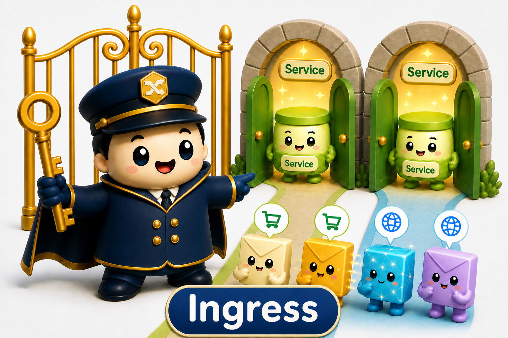
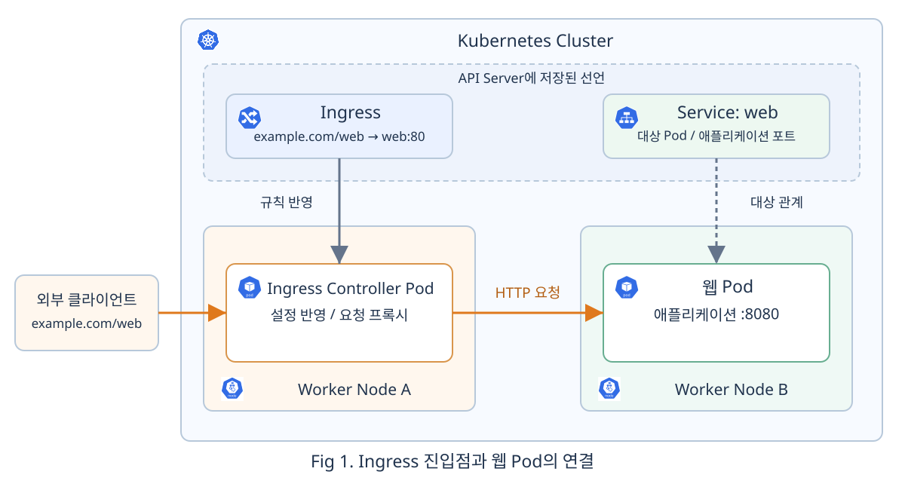
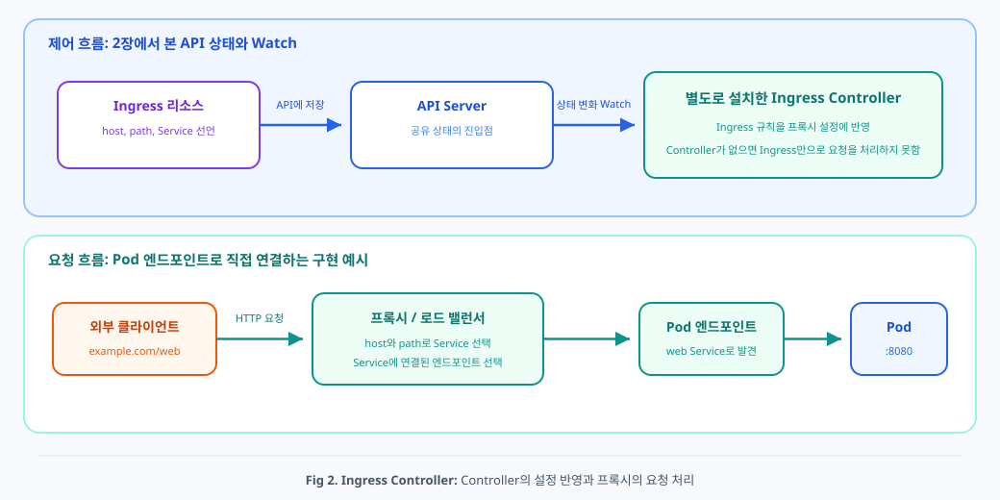
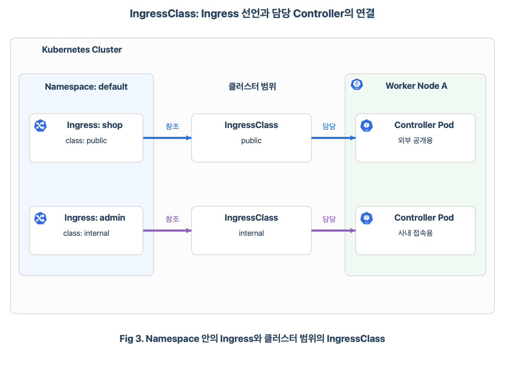
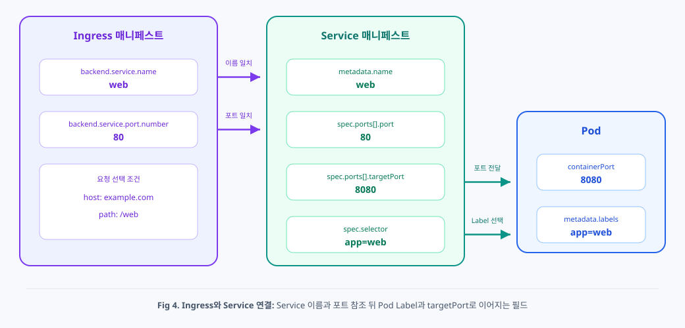
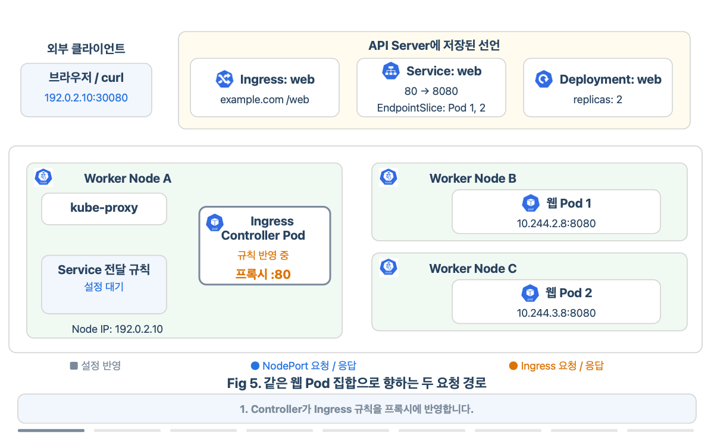
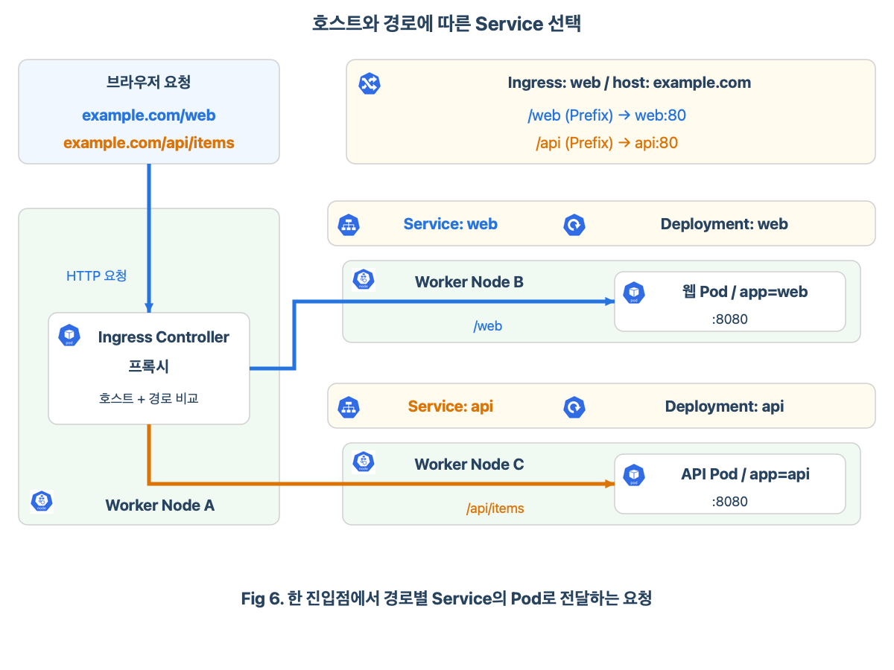
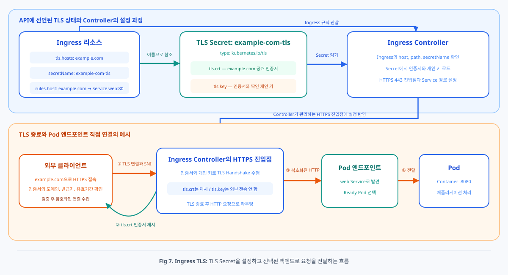

# Chap07. Ingress와 HTTPS: 외부 요청을 Service로 연결하기

> 16장 연재의 일곱째 글입니다. 6장에서 비교한 Service 타입을 바탕으로, Ingress가 외부 HTTP와 HTTPS 요청을 Service에 연결하는 방법을 살펴봅니다.

## 들어가며

<div align="center">


</div>

6장에서는 Pod가 교체되어도 같은 Service 주소로 요청을 보내고, 외부 사용자에게 접속할 진입점을 제공하는 방법을 살펴보았습니다. 이제 쇼핑몰의 웹 화면과 상품 API를 함께 공개한다고 가정해 보겠습니다. 사용자가 하나의 사이트에 접속하더라도 `/web` 요청은 웹 애플리케이션으로, `/api` 요청은 상품 API로 보내야 합니다.

이때 필요한 것은 요청한 이름과 경로를 보고 알맞은 Service를 선택하는 규칙입니다. 로그인이나 결제 정보를 주고받는다면, 사용자와 사이트 사이의 통신을 HTTPS로 보호할 방법도 필요합니다. Ingress는 이런 요청 전달 규칙과 HTTPS 설정을 선언해 여러 애플리케이션을 하나의 진입점으로 연결할 수 있게 합니다.

## 1. 외부 HTTP 요청을 나누는 Ingress

외부 요청이 클러스터에 도달한 뒤에는 어느 애플리케이션에 보낼지 결정해야 합니다. Service로 연결할 대상을 HTTP 요청의 내용에서 고르는 과정부터 살펴보겠습니다.

### 1.1 Service 다음에 필요한 HTTP 규칙

<div align="center">


</div>

6장에서 Service에 요청을 보내면 준비된 Pod 중 하나가 요청을 처리했습니다. 웹 화면을 제공하는 Pod들과 상품 정보를 반환하는 Pod들이 따로 있다면, 각 집합을 `web`과 `api` Service로 묶을 수 있습니다. 이제 외부 사용자가 어느 쪽에 요청할지 구분할 기준이 필요합니다.

각 Service를 `LoadBalancer` 타입으로 공개할 수도 있지만, 사용자는 같은 사이트 안에서 화면을 열고 상품을 조회하기를 기대합니다. 이때는 하나의 공개 주소로 들어온 요청을 읽고, 요청한 이름과 경로에 맞춰 목적지를 나누는 편이 자연스럽습니다.

<div align="center">



</div>

**Ingress**(인그레스)는 클러스터 외부에서 들어오는 HTTP와 HTTPS 요청을 호스트나 URL 경로에 따라 어떤 Service로 전달할지 선언하는 API 리소스입니다. 예를 들어 하나의 진입점에서 `example.com/web`은 `web` Service로, `example.com/api`는 `api` Service로 보낼 수 있습니다. Ingress가 요청 조건에 맞는 Service를 선택하면, 그 Service에 연결된 Pod 집합이 실제 요청 대상이 됩니다. [[1]](#ref-1)

`http://example.com/web`에서 **호스트**는 접속할 사이트의 이름인 `example.com`이고, **경로**는 그 사이트 안에서 요청한 위치인 `/web`입니다. 브라우저가 보내는 HTTP 요청에는 이 정보가 들어 있으므로, 같은 IP와 포트로 도착한 요청도 서로 다른 애플리케이션으로 나눌 수 있습니다.

위 그림에서 입구의 안내자가 요청을 서로 다른 Service의 문으로 안내하는 모습은, 호스트와 경로에 따라 요청 대상을 나누는 역할을 나타냅니다. 이 규칙이 실제 요청 경로로 이어지는 구조는 Fig 1과 같습니다.

<div align="center">



</div>

Fig 1에서 Service와 Ingress는 Kubernetes API에 저장되는 선언형 리소스입니다. Service는 Pod 집합의 안정적인 접근점을 선언하고, Ingress는 호스트와 URL 경로에 따른 HTTP 요청 전달 규칙을 선언합니다. 실제 요청을 처리할 프록시나 로드 밸런서는 **Ingress Controller**가 이 선언을 읽어 구성합니다. 여기서 프록시는 클라이언트의 요청을 받아 다른 서버로 전달하는 프로그램입니다. 회색 화살표는 API 정보의 관찰과 설정 반영을, 주황색 화살표는 실제 애플리케이션 요청을 나타냅니다.

### 1.2 선언을 구현하는 Ingress Controller

2장에서 원하는 상태를 API에 기록하면 Controller가 실제 상태에 반영하는 흐름을 보았습니다. Ingress에도 같은 방식이 적용됩니다. 다만 여기서는 Pod 수를 맞추는 대신, 요청을 받아 전달할 프로그램의 설정을 맞춥니다.

<div align="center">



</div>

Fig 2의 위쪽에서는 사용자가 제출한 Ingress가 API Server에 저장되고, Controller가 변경 사항을 확인해 프록시나 로드 밸런서의 설정을 바꿉니다. `/web` 요청을 `web` Service에 연결하겠다는 선언이 실제 요청 처리 규칙으로 준비되는 과정입니다.

아래쪽에서는 외부 클라이언트의 요청이 준비된 프록시에 도착합니다. 프록시는 호스트와 경로를 비교하고, 선택한 Service에 연결된 Pod로 요청을 전달합니다. 이 요청마다 API Server를 거치는 대신, Controller가 미리 반영한 설정을 이용합니다. 애플리케이션의 응답도 프록시를 통해 클라이언트에 돌아갑니다.

Fig 1의 Worker Node A는 Controller와 프록시를 함께 Pod로 실행하는 구성입니다. 다른 구현에서는 클러스터 안의 Controller가 클라우드의 로드 밸런서를 설정하고, 실제 요청은 그 로드 밸런서가 처리합니다. Ingress Controller는 클러스터 환경에 맞게 별도로 준비하는 구성요소이며, 설치된 구현에 따라 요청을 처리하는 위치가 달라집니다. [[2]](#ref-2)

### 1.3 담당 Controller를 지정하는 IngressClass

클러스터에 외부 공개용 Controller와 사내 접속용 Controller가 함께 있다면, 새 Ingress를 어느 쪽에 맡길지도 정해야 합니다. **IngressClass**는 Ingress를 처리할 Controller를 구분하는 클러스터 범위의 리소스입니다. Ingress의 `spec.ingressClassName`에 클래스 이름을 적으면, 해당 클래스를 담당하는 Controller가 그 선언을 처리합니다. [[1]](#ref-1)

<div align="center">



</div>

Fig 3에서 같은 Namespace의 `shop`과 `admin` Ingress는 서로 다른 클래스를 참조합니다. `public`은 외부 공개용 Controller에, `internal`은 사내 접속용 Controller에 연결됩니다. 이 클래스 이름은 운영자가 정하는 값이며, 실제 공개 방식은 각 Controller의 진입점 설정으로 정해집니다. 화살표는 요청이 이동하는 경로가 아니라 선언을 담당할 구현을 구분하는 관계입니다.

예를 들어 `example-ingress`라는 IngressClass가 설치된 Controller를 가리킨다면, 애플리케이션의 Ingress에서는 그 이름을 참조하면 됩니다. 운영자가 기본 IngressClass를 정한 환경에서는 클래스 지정을 생략한 Ingress에도 기본값이 적용될 수 있습니다. 본문의 예시는 담당 구현을 드러내기 위해 `example-ingress`를 명시합니다.

IngressClass는 클러스터 전체에서 참조하지만, Ingress와 요청을 받을 Service는 Namespace 안에 있습니다. Controller의 Pod는 별도의 Namespace에서 실행하면서 설정과 권한에 따라 여러 Namespace의 Ingress를 처리할 수 있습니다. 각 Ingress가 참조하는 Service는 해당 Ingress와 같은 Namespace에서 찾습니다.

### 1.4 외부 진입점과 도메인의 연결

규칙을 처리할 Controller가 정해졌다면, 브라우저가 실제 요청을 보낼 주소를 마련해야 합니다. 프록시를 Pod로 실행하는 구성에서는 앞 장의 `LoadBalancer` 또는 `NodePort` Service로 프록시를 외부에 공개할 수 있습니다. 클라우드 로드 밸런서를 설정하는 구현에서는 그 로드 밸런서의 주소가 외부 진입점이 됩니다.

여기에는 역할이 다른 두 Service가 등장할 수 있습니다. **Controller의 프록시를 공개하는 Service**는 외부 요청을 진입점까지 전달하고, **애플리케이션의 Service**는 진입점이 선택할 웹 Pod 집합을 가리킵니다. 이 구성에서 `web`과 `api` Service는 내부용 `ClusterIP`로 두고, 외부 공개를 진입점에 모을 수 있습니다.

도메인의 DNS에는 `example.com`이 이 외부 진입점으로 연결되도록 주소를 등록합니다. 6장의 CoreDNS 조회가 클러스터 안의 Service 이름을 찾았다면, 여기서는 사용자의 브라우저가 사이트 이름으로 공개 주소를 찾습니다. Ingress의 `host`에는 그 주소에 도착한 HTTP 요청을 구분할 이름을 적습니다. 도메인의 주소 등록과 Ingress의 요청 규칙을 함께 맞추면, 브라우저가 찾아온 진입점에서 알맞은 애플리케이션을 선택할 수 있습니다.

학습 환경에서는 요청을 보내는 컴퓨터의 `/etc/hosts`에 IP와 도메인의 대응을 적어 공개 DNS 등록을 대신할 수 있습니다. 이 설정은 해당 컴퓨터가 이름으로 주소를 찾는 데 사용됩니다. 예를 들어 Node의 80번 포트에서 Ingress 요청을 받는 환경이라면 그 Node IP를 등록합니다. Controller가 다른 주소나 NodePort로 공개되어 있다면 실제 진입점의 주소와 포트에 맞춰 접속해야 합니다.

## 2. Ingress와 Service의 백엔드 참조

요청을 전달할 경로가 마련되었으므로, 이제 요청의 조건과 목적지 Service를 어떻게 짝지어 선언하는지 살펴보겠습니다.

<div align="center">


</div>

위 그림에서 안내자는 파란 꼬리표의 요청을 같은 꼬리표가 달린 Service로, 주황 꼬리표의 요청을 다른 Service로 안내합니다. 같은 색과 모양은 요청 조건과 목적지의 대응을 표현합니다. 실제 Ingress에는 호스트나 경로를 조건으로 적고, 그 조건에 맞는 요청을 보낼 **백엔드**(Backend), 즉 목적지 Service의 이름과 포트를 지정합니다.

### 2.1 Service 이름과 포트의 참조 관계

이 연결 중 하나를 매니페스트로 확인해 보겠습니다. 이번에는 `default` Namespace의 `app: web` Label을 가진 Pod에서 웹 애플리케이션이 8080번 포트로 요청을 받는 상황을 가정합니다. Service는 이 Namespace의 Pod를 선택하고, Ingress도 같은 Namespace에 두어 Service를 참조합니다.

<div align="center">



</div>

Fig 4은 Ingress의 `backend.service.name`과 `port`가 Service의 이름과 포트를 참조하고, Service의 Selector와 `targetPort`가 다시 Pod의 Label과 애플리케이션 포트로 이어지는 관계를 보여 줍니다. 이 관계를 매니페스트에 옮기면 다음과 같습니다.

```yaml
apiVersion: v1
kind: Service
metadata:
  name: web
  namespace: default
spec:
  type: ClusterIP
  selector:
    app: web
  ports:
  - name: http
    port: 80
    targetPort: 8080
```

- `metadata.name: web`과 `spec.ports[].port: 80`: Ingress가 백엔드로 참조할 Service 이름과 포트입니다.
- `spec.selector.app: web`: 요청을 전달할 Pod의 Label 조건입니다.
- `spec.ports[].targetPort: 8080`: 선택된 Pod의 실제 애플리케이션 포트입니다.

위 선언은 내부 접근점을 만드는 `ClusterIP` 구성입니다. 같은 웹 Pod를 Node IP로도 직접 호출하려면 Service를 `NodePort` 타입으로 공개할 수 있습니다. 기존 Deployment를 바탕으로 이런 Service를 처음 만들 때는 `kubectl expose`로 선택 조건과 포트를 지정하는 방법도 있습니다. `web` Deployment가 `app: web`인 Pod를 관리한다면 다음 명령으로 연결합니다. [[3]](#ref-3)

```bash
kubectl expose deployment web -n default --name web --type NodePort --port 80 --target-port 8080
```

```text
service/web exposed
```

위 YAML과 명령은 각각 ClusterIP 구성과 NodePort 구성을 만드는 예시입니다. `--port 80`은 Service의 포트이고, `--target-port 8080`은 애플리케이션의 수신 포트입니다. NodePort 구성에는 Node에서 직접 접속할 포트가 추가로 할당됩니다.

어느 구성을 사용하더라도 Ingress가 참조할 대상은 Service의 이름 `web`과 포트 `80`입니다. Node에 열린 `nodePort`는 외부에서 그 Service로 직접 접속할 때 사용합니다.

### 2.2 호스트와 백엔드의 선언

다음은 `example.com/web` 요청을 앞서 만든 `web:80`으로 보내는 Ingress입니다. `example-ingress` 클래스가 구성된 환경에서, 같은 `default` Namespace의 Service를 참조합니다.

```yaml
apiVersion: networking.k8s.io/v1
kind: Ingress
metadata:
  name: web
  namespace: default
spec:
  ingressClassName: example-ingress
  rules:
  - host: example.com
    http:
      paths:
      - path: /web
        pathType: Prefix
        backend:
          service:
            name: web
            port:
              number: 80
```

- `spec.ingressClassName`: 이 Ingress를 처리할 IngressClass를 지정합니다.
- `rules[].host`와 `http.paths[].path`, `pathType: Prefix`: 요청의 호스트와 경로를 비교해 적용할 규칙을 고릅니다.
- `backend.service.name`과 `port.number`: 요청을 보낼 Service 이름과 Service 포트입니다.

이때 Ingress가 참조하는 포트는 Service의 `80`이며, Pod의 수신 포트 `8080`과의 연결은 Service 선언에 담깁니다.

### 2.3 Service 선택 이후의 Pod 연결

Fig 4의 연결을 요청 하나로 따라가 보겠습니다. `example.com/web` 요청을 받은 프록시는 Ingress 규칙에서 `web:80`을 찾습니다. 해당 Service는 `app: web`인 Pod를 선택하고 실제 요청을 받을 포트를 `8080`으로 정해 두었으므로, 프록시는 이 관계를 바탕으로 준비된 웹 Pod에 요청을 보낼 수 있습니다.

실제 네트워크 경로는 Controller 구현에 따라 달라집니다. Service IP로 요청을 보내 Node의 전달 규칙을 이용할 수도 있고, EndpointSlice에 기록된 Pod 주소와 포트를 확인해 Pod로 직접 연결할 수도 있습니다. Fig 1과 Fig 2는 후자의 구성을 보여 줍니다. 두 방식 모두 Ingress 선언에서는 Service 이름과 Service 포트로 목적지를 지정합니다.

4장에서 본 준비 상태와 6장에서 본 대상 주소 갱신도 이 경로에 이어집니다. 웹 Pod가 교체되면 EndpointSlice Controller가 Service에 연결된 주소와 준비 상태를 갱신하고, 이를 사용하는 요청 경로에 변경 사항이 반영됩니다. Ingress의 호스트와 경로 규칙은 유지하면서 요청을 받을 Pod 집합을 바꿀 수 있습니다. [[4]](#ref-4)

### 2.4 NodePort 직접 요청과 Ingress 경유 요청

같은 웹 Pod에 도달하더라도, 어디로 요청을 보내느냐에 따라 거치는 경로가 달라집니다. Fig 5는 웹 Pod 두 개가 서로 다른 Node에서 실행 중이고, Node A의 80번 포트에는 Ingress 프록시가, 30080번 포트에는 웹 Service의 NodePort가 공개된 구성입니다.

<div align="center">



</div>

먼저 Controller가 Ingress 규칙을 프록시에 반영하고, kube-proxy는 Service와 EndpointSlice 정보를 이용해 Node의 전달 규칙을 설정합니다. 두 구성요소는 각자 변경 사항을 관찰하며 독립적으로 설정을 갱신합니다. 준비된 설정을 통해 실제 요청이 들어오는 두 경로를 비교해 보겠습니다.

앞의 NodePort 구성에서 Service 포트가 80, 자동 할당된 NodePort가 30080이라면 조회 결과는 다음과 같습니다. 주소와 할당 포트는 설명용 예시입니다.

```bash
kubectl get svc web -n default
```

```text
NAME   TYPE       CLUSTER-IP     EXTERNAL-IP   PORT(S)        AGE
web    NodePort   10.96.20.30    <none>        80:30080/TCP   5m
```

- `PORT(S)`의 `80:30080/TCP`: Service 포트 80과 Node에 열린 포트 30080을 나타냅니다.

Node IP가 `192.0.2.10`이라면 `http://192.0.2.10:30080/web` 요청은 Node의 Service 전달 규칙을 거쳐 웹 Pod로 갑니다. 이 경로에서는 Ingress의 호스트·경로 규칙을 비교하지 않고, 웹 애플리케이션이 `/web` 요청을 처리합니다. Fig 5에서는 웹 Pod 1이 요청을 받고, 응답은 기존 요청에 대응하는 경로로 클라이언트에 돌아갑니다.

반면 `http://example.com/web` 요청은 먼저 도메인이 가리키는 Ingress 진입점에 도착합니다. 예를 들어 그 진입점이 `192.0.2.10:80`에 공개되어 있다면, 요청을 보내는 컴퓨터의 `/etc/hosts`에 다음 대응을 둘 수 있습니다.

```text
192.0.2.10 example.com
```

이 경우 이름 조회 결과는 같은 Node IP이지만 접속할 포트는 Ingress의 HTTP 진입점인 80입니다. 요청에는 `example.com`이라는 호스트와 `/web`이라는 경로가 담기고, 프록시는 이를 비교해 `web:80`에 연결된 Pod를 선택합니다. Fig 5에서는 EndpointSlice에서 확인한 웹 Pod 2의 주소로 직접 전달하며, 응답도 프록시를 거쳐 돌아옵니다. 두 경로 모두 같은 웹 Pod 집합에서 대상을 선택하며, 이 예시에서는 각 요청이 서로 다른 Pod에 도착합니다.

Controller가 NodePort로 공개되어 있다면 URL에는 **Controller의 HTTP NodePort**를 적습니다. `/etc/hosts`는 이름과 IP를 연결하며 포트는 지정하지 않습니다.

따라서 애플리케이션 Service의 NodePort는 Pod 집합으로 바로 들어가는 통로이고, Ingress의 진입점은 요청 내용을 확인해 Service를 고르는 통로입니다. Ingress만으로 외부 요청을 받는 구성에서는 애플리케이션 Service를 앞의 YAML처럼 `ClusterIP`로 두어도 됩니다. 이 구분을 바탕으로 진입점 하나에 여러 Service를 연결할 수 있습니다.

## 3. 호스트와 경로에 따른 요청 분배

지금까지는 웹 Service 하나를 연결했습니다. 여기에 상품 API를 더하면 도입부의 쇼핑몰처럼 같은 사이트의 요청을 여러 애플리케이션으로 나눌 수 있습니다.

### 3.1 같은 사이트 안의 경로별 Service

`web` Deployment가 웹 화면을, `api` Deployment가 상품 조회를 처리하고, 각각 같은 이름의 Service로 묶여 있다고 가정하겠습니다. 앞의 Ingress에 `/api` 규칙을 더하면 `example.com`으로 들어오는 요청을 두 Service로 나눌 수 있습니다.

<div align="center">



</div>

Fig 6에서 두 요청은 같은 프록시에 도착하지만 이후 목적지가 달라집니다. `/web` 요청은 `web` Service에 연결된 웹 Pod로, `/api/items` 요청은 `api` Service에 연결된 API Pod로 갑니다. 각 Deployment는 해당 애플리케이션의 Pod를 유지하고, Service는 그 Pod 집합을 연결 대상으로 제공합니다. 이 그림도 프록시가 선택된 Pod 주소로 직접 전달하는 구현을 기준으로 합니다. 이 관계를 규칙으로 선언하면 다음과 같습니다.

```yaml
apiVersion: networking.k8s.io/v1
kind: Ingress
metadata:
  name: web
  namespace: default
spec:
  ingressClassName: example-ingress
  rules:
  - host: example.com
    http:
      paths:
      - path: /web
        pathType: Prefix
        backend:
          service:
            name: web
            port:
              number: 80
      - path: /api
        pathType: Prefix
        backend:
          service:
            name: api
            port:
              number: 80
```

- `paths`: 같은 호스트 안에서 구분할 경로와 목적지의 목록입니다.
- 각 `backend.service`: `/web` 요청은 `web:80`으로, `/api` 요청은 `api:80`으로 연결합니다.

브라우저가 `/web`으로 화면을 열면 웹 Pod가 응답합니다. 그 화면에서 상품 목록을 얻기 위해 `/api/items`를 요청하면 이번에는 API Pod가 응답합니다. 사용자는 같은 사이트 주소를 사용하고, 내부에서는 서로 다른 Deployment가 관리하는 애플리케이션이 각 요청을 처리합니다.

### 3.2 경로의 일치 기준과 우선순위

위 선언에서 `/api/items`가 `/api` 규칙에 포함되는 이유는 `pathType`이 `Prefix`이기 때문입니다. 경로를 어느 범위까지 같은 요청으로 볼지에 따라 다음 기준을 사용합니다. [[1]](#ref-1)

- **`Prefix`**: `/`로 나눈 경로 구간을 기준으로 앞부분을 비교합니다. `/web`은 `/web`과 `/web/item`에 맞지만 `/website`에는 맞지 않습니다.
- **`Exact`**: 경로 전체가 같아야 합니다. `/web` 규칙은 `/web` 요청에만 맞고 `/web/`이나 `/web/item`과는 구분됩니다.
- **`ImplementationSpecific`**: 경로를 비교하는 방식이 Controller 구현에 따라 정해집니다. 해당 구현의 기능을 사용할 때 그 문서에 맞춰 설정합니다.

하나의 Ingress 안에서 여러 경로가 맞으면 더 긴 경로가 우선합니다. `/`와 `/api`가 모두 `Prefix`라면 `/api/items`에는 `/api` 규칙이 적용됩니다. 길이가 같은 경로끼리는 `Exact`가 `Prefix`보다 우선하며, 두 방식 모두 대소문자를 구분합니다.

경로를 선택하는 일과 전달할 경로를 바꾸는 일도 구분해야 합니다. 위 예시에서 `/api/items`는 그대로 API 애플리케이션에 전달되므로 애플리케이션도 이 경로를 처리해야 합니다. 애플리케이션이 `/items`만 처리한다면, 전달 전에 경로를 바꾸는 **경로 재작성** 기능을 Controller에 맞춰 설정합니다.

### 3.3 서로 다른 호스트와 일치하지 않는 요청

경로 대신 사이트 이름으로 목적지를 나눌 수도 있습니다. 웹 화면은 `shop.example.com`, 상품 API는 `api.example.com`으로 제공하고 싶다면, 각 이름에 대한 `rules[].host`와 백엔드를 따로 선언합니다. 두 도메인의 DNS가 같은 진입점을 가리키더라도 HTTP 요청에 담긴 호스트 이름으로 목적지를 구분할 수 있습니다.

이름과 경로를 함께 선언한 규칙에서는 둘 다 맞아야 합니다. `example.com/web` 규칙만 있는 상태에서 진입점의 IP 주소로 직접 접속하면, 요청에 담긴 호스트가 `example.com`과 달라 해당 규칙을 선택하지 못할 수 있습니다. DNS로 주소를 찾는 단계와 진입점이 요청의 호스트를 비교하는 단계가 이어져야 하는 이유입니다.

어느 규칙에도 맞지 않는 요청을 보낼 곳은 `spec.defaultBackend`로 지정할 수 있습니다. 별도로 지정하지 않았다면 Controller의 기본 처리 방식에 따라 응답하며, 흔히 404 응답을 돌려줍니다. 예를 들어 `/web`과 `/api`만 선언했을 때 `/help` 요청은 이 기본 처리로 넘어갑니다. [[1]](#ref-1)

이제 요청의 목적지를 나눌 기준이 마련되었습니다. 같은 사이트에서 로그인 정보나 주문 내용을 주고받으려면, 브라우저에서 진입점까지 오는 통신도 보호해야 합니다.

## 4. TLS Secret과 HTTPS 연결

<div align="center">


</div>

### 4.1 인증서와 암호화 구간

**HTTPS**는 HTTP 요청과 응답을 **TLS**라는 보안 프로토콜로 보호하는 통신 방식입니다. 브라우저는 일반적으로 진입점의 443번 포트에 연결해 인증서를 확인하고, 암호화된 연결이 준비된 뒤 HTTP 요청을 보냅니다. 진입점에서 암호화를 풀어 요청을 처리하는 방식을 **TLS 종료**(TLS termination)라고 합니다. 여기서 종료하는 것은 암호화 구간이며, 요청은 이후 애플리케이션으로 계속 전달됩니다.

<div align="center">



</div>

Fig 7는 Ingress Controller가 Ingress의 TLS 설정과 Secret을 읽어 HTTPS 연결을 종료한 뒤, 선택된 Service 백엔드로 요청을 전달하는 흐름을 보여 줍니다. 이때 Secret에 저장한 인증서와 개인 키는 HTTPS 연결을 수립하는 데 사용됩니다.

HTTPS 진입점에는 도메인에 유효한 TLS 인증서와 그 인증서에 대응하는 개인 키가 필요합니다. 클라이언트는 인증서의 호스트 이름, 신뢰 관계, 유효기간을 확인합니다. 서버는 인증서를 제시하지만 개인 키를 외부로 전달하지 않습니다.

### 4.2 인증서와 개인 키를 보관하는 Secret

3장에서 민감한 설정을 Secret에 담았습니다. HTTPS 진입점에 필요한 인증서와 개인 키도 같은 방식으로 관리합니다. Kubernetes에서는 인증서와 개인 키를 `kubernetes.io/tls` 타입의 Secret에 저장할 수 있습니다. 다음은 인증서와 개인 키를 담는 Secret의 구조입니다.

```yaml
apiVersion: v1
kind: Secret
metadata:
  name: example-com-tls
  namespace: default
type: kubernetes.io/tls
data:
  tls.crt: "<Base64로 인코딩한 example.com 인증서>"
  tls.key: "<Base64로 인코딩한 인증서의 개인 키>"
```

- `type: kubernetes.io/tls`: TLS 인증서용 Secret 유형입니다.
- `data.tls.crt`와 `data.tls.key`: 인증서와 개인 키를 Base64로 인코딩한 값입니다.

인증서와 개인 키는 미리 준비한 값을 저장합니다. 접속을 계속 제공하려면 인증서가 만료되기 전에 갱신된 인증서와 키로 Secret 내용을 교체해야 합니다. 3장에서 설명했듯 Base64는 암호화가 아니므로 개인 키가 담긴 Secret의 조회 권한도 제한합니다. [[5]](#ref-5)

### 4.3 인증서 참조와 HTTPS 요청의 전달

Ingress는 `spec.tls[].secretName`으로 같은 Namespace의 TLS Secret을 참조합니다. 앞의 Ingress가 `default`에 있으므로 인증서 Secret도 `default`에 생성합니다. 다음은 3절의 두 경로를 유지하면서 `example-com-tls` 인증서 참조를 추가한 선언입니다.

```yaml
apiVersion: networking.k8s.io/v1
kind: Ingress
metadata:
  name: web
  namespace: default
spec:
  ingressClassName: example-ingress
  tls:
  - hosts:
    - example.com
    secretName: example-com-tls
  rules:
  - host: example.com
    http:
      paths:
      - path: /web
        pathType: Prefix
        backend:
          service:
            name: web
            port:
              number: 80
      - path: /api
        pathType: Prefix
        backend:
          service:
            name: api
            port:
              number: 80
```

- `spec.tls[].hosts`: HTTPS로 접속할 호스트 이름입니다.
- `spec.tls[].secretName`: 같은 Namespace에 있는 인증서 Secret을 참조합니다.

호스트와 경로로 `web:80` 또는 `api:80`을 선택하는 규칙은 앞의 HTTP 예시와 같습니다. 달라진 부분은 외부에서 HTTPS로 접속할 때 제시할 인증서를 지정했다는 점입니다.

인증서의 SAN, `spec.tls[].hosts`, `spec.rules[].host`, 클라이언트가 요청하는 이름이 모두 `example.com`과 맞아야 합니다. **SAN**(Subject Alternative Name)은 인증서가 유효한 호스트 이름을 기록하는 확장 필드입니다.

Fig 7에서 Controller는 먼저 Ingress가 참조하는 Secret을 읽어 HTTPS 진입점에 인증서와 개인 키를 설정합니다. 브라우저가 `https://example.com/web`에 접속하면, TLS 연결을 시작하면서 접속할 이름을 알리는 **SNI**(Server Name Indication)를 보냅니다. 여러 사이트를 처리하는 진입점은 이 이름에 맞는 인증서를 선택할 수 있습니다.

브라우저가 인증서를 확인하고 암호화된 연결을 맺으면 `/web` 요청을 보냅니다. 진입점은 이를 복호화한 뒤 앞에서 만든 호스트·경로 규칙으로 `web:80`을 선택하고, Fig 7의 예시에서는 준비된 Pod의 8080번 포트로 HTTP 요청을 전달합니다. 애플리케이션이 응답하면 진입점이 브라우저와의 TLS 연결을 통해 응답을 돌려줍니다. [[1]](#ref-1)

이 구성의 암호화 구간은 브라우저와 진입점 사이입니다. 진입점에서 Pod까지도 암호화해야 하는 환경에서는 Controller가 제공하는 백엔드 TLS 기능을 추가로 설정합니다. HTTP 접속을 HTTPS로 돌려보내는 리다이렉트 정책도 사용하는 Controller의 설정으로 확인합니다. 허용할 TLS 버전 역시 HTTPS 연결을 처리하는 서버에서 정합니다. 인증서와 TLS Secret은 접속할 사이트의 신원을 확인하는 데 사용하고, TLS 버전 설정은 연결에 사용할 보안 프로토콜을 정합니다.

## 5. 요청 경로를 따라가는 상태 확인

HTTPS까지 설정한 뒤 응답이 오지 않는다면, 브라우저에서 Pod까지의 경로 중 어디에서 멈췄는지 살펴봅니다. 5장에서 Pod의 상태와 이벤트로 원인을 좁혔듯, 여기서는 요청을 전달하는 리소스의 연결 관계를 확인합니다.

### 5.1 Ingress의 담당 클래스와 공개 주소

먼저 선언한 호스트와 담당 클래스가 맞는지 확인합니다. 다음은 4절의 HTTPS 설정을 반영한 환경에서 조회하는 예시이며, 출력의 주소는 설명용입니다.

```bash
kubectl get ingress web -n default
```

```text
NAME   CLASS             HOSTS         ADDRESS         PORTS     AGE
web    example-ingress   example.com   203.0.113.20    80, 443   5m
```

- `CLASS`: 규칙을 처리할 IngressClass입니다. 설치된 Controller가 담당하는 클래스인지 확인합니다.
- `HOSTS`: 브라우저가 요청할 이름입니다. 도메인의 DNS가 실제 진입점 주소로 연결되는지도 함께 확인합니다.
- `ADDRESS`: Controller가 보고한 진입점 주소입니다. 구현에 따라 IP나 호스트 이름으로 표시되며, 아직 주소를 보고하지 않았다면 비어 있을 수 있습니다.

주소가 비어 있거나 설정이 반영되지 않는다면 Controller의 실행 상태와 Ingress 이벤트를 살펴봅니다. 주소가 표시되더라도 실제 외부 접속에는 그 진입점까지의 네트워크 경로와 포트 허용이 필요합니다.

### 5.2 Service와 준비된 Pod의 연결

진입점에 요청이 도착했는데 애플리케이션 응답을 받지 못한다면, Ingress가 참조한 Service부터 확인합니다. `web` Service가 같은 Namespace에 있는지, 참조한 80번 포트가 선언되어 있는지 확인한 뒤 EndpointSlice와 Pod 준비 상태를 이어서 봅니다. [[6]](#ref-6)

예를 들어 웹 Pod는 실행 중이어도 4장의 준비 프로브가 실패하면 일반적인 요청 대상에서 빠집니다. 모든 웹 Pod가 준비되지 않았다면 Ingress 규칙이 맞아도 요청을 처리할 대상이 부족해집니다. 반대로 내부에서 `web` Service를 정상 호출할 수 있다면, 외부 호스트·경로 규칙과 진입점 설정으로 범위를 좁힐 수 있습니다.

애플리케이션의 Service가 `NodePort`라면 Node IP와 해당 NodePort로 직접 호출해 백엔드를 확인할 수도 있습니다. 이 호출은 Ingress를 우회하므로, 성공했다면 Service와 Pod의 요청 처리를 확인한 것입니다. Ingress의 호스트·경로 규칙은 Controller의 진입점으로 별도 요청을 보내 확인합니다.

요청 경로를 확인할 때는 응답 내용을 돌려주는 echo 서버를 사용하면 애플리케이션이 받은 호스트와 경로를 비교하기 쉽습니다. [Ingress 예제 자료](../Practice/Kubernetes/6.Ingress/)의 `echo` Deployment도 이런 용도이며, `echo-sound` Namespace의 `echo-service:8080`을 `example.org/echo`에 연결합니다. 이름과 포트는 다르지만 앞에서 설명한 Service 참조와 요청 전달 관계는 같습니다.

응답 성공 여부만 확인하려면 다음처럼 HTTP 상태 코드만 출력할 수 있습니다. [[7]](#ref-7)

```bash
curl -o /dev/null -s -w "%{http_code}\n" http://example.com/web
```

```text
200
```

`200`은 정상 응답 예시입니다. `-o /dev/null`은 본문을 버리고, `-s -w "%{http_code}\n"`은 진행 표시 없이 상태 코드를 출력합니다. 애플리케이션이 받은 요청 정보까지 확인하려면 `curl http://example.com/web`로 응답 본문을 읽습니다.

HTTP 404는 규칙 불일치로 진입점에서 반환될 수도 있고, 요청을 받은 애플리케이션에 해당 경로가 없어 반환될 수도 있습니다. 503도 준비된 백엔드가 없을 때 나타날 수 있으므로, 응답 코드와 함께 Controller의 이벤트·로그 및 애플리케이션 로그를 비교해야 어느 구간의 실패인지 알 수 있습니다.

### 5.3 HTTPS 연결과 인증서 확인

브라우저에서 인증서 오류가 발생한다면 HTTP 경로를 비교하기 전의 TLS 연결부터 살펴봅니다. 요청한 도메인이 인증서에 포함되는지, 인증서가 만료되지 않았는지, 클라이언트가 발급자를 신뢰하는지가 확인 기준입니다. 이어서 Ingress의 `secretName`이 같은 Namespace의 올바른 Secret을 가리키는지 확인합니다.

인증서 오류와 달리 연결 자체가 오래 기다리다 끝난다면, 도메인이 올바른 주소를 가리키는지와 진입점의 443번 포트까지 접근할 수 있는지를 먼저 확인합니다. 이처럼 연결 실패, 인증서 검증 실패, HTTP 응답 오류를 구분하면 처음부터 모든 설정을 다시 살피지 않고 문제가 발생한 구간에 집중할 수 있습니다.

## 다음 글로 넘어가기 전에

이번 글에서 다룬 내용은 이렇습니다. Ingress에 호스트와 경로별 Service를 선언하면 Controller가 이를 프록시나 로드 밸런서에 반영합니다. HTTPS 진입점은 TLS Secret의 인증서와 개인 키로 암호화된 연결을 처리하고, 선택한 백엔드로 요청을 전달합니다.

호스트와 경로는 목적지 Service를 고르는 기준이며, 그 Service에 연결된 준비된 Pod가 요청을 처리합니다. 문제가 생겼을 때도 진입점, 요청 규칙, 백엔드와 인증서를 나누어 보면 실패한 구간을 좁힐 수 있습니다.

Ingress는 안정화된 API로 유지되며, Kubernetes는 새로운 기능을 확장할 방식으로 Gateway API를 권장합니다. 이 연재에서는 기존 웹 요청 구조를 Ingress로 이해한 뒤, 14장에서 Kubernetes API 확장과 함께 Gateway API를 다룹니다. [[1]](#ref-1)

외부 요청이 애플리케이션에 도달하면 그 결과로 데이터가 쌓입니다. Pod가 교체되어도 주문이나 사용자 정보가 유지되어야 서비스를 이어갈 수 있습니다. 다음 글에서는 Pod와 데이터의 수명을 구분하고, 새 Pod에 기존 저장소를 연결하는 방법을 살펴봅니다.

## 참고문헌

- <a id="ref-1"></a>[1] [Kubernetes 공식 문서: Ingress](https://kubernetes.io/docs/concepts/services-networking/ingress/)
- <a id="ref-2"></a>[2] [Kubernetes 공식 문서: Ingress Controllers](https://kubernetes.io/docs/concepts/services-networking/ingress-controllers/)
- <a id="ref-3"></a>[3] [Kubernetes 공식 문서: kubectl expose](https://kubernetes.io/docs/reference/kubectl/generated/kubectl_expose/)
- <a id="ref-4"></a>[4] [Kubernetes 공식 문서: EndpointSlices](https://kubernetes.io/docs/concepts/services-networking/endpoint-slices/)
- <a id="ref-5"></a>[5] [Kubernetes 공식 문서: TLS Secrets](https://kubernetes.io/docs/concepts/configuration/secret/#tls-secrets)
- <a id="ref-6"></a>[6] [Kubernetes 공식 문서: Debug Services](https://kubernetes.io/docs/tasks/debug/debug-application/debug-service/)
- <a id="ref-7"></a>[7] [curl 공식 문서: 명령 옵션](https://curl.se/docs/manpage.html)
