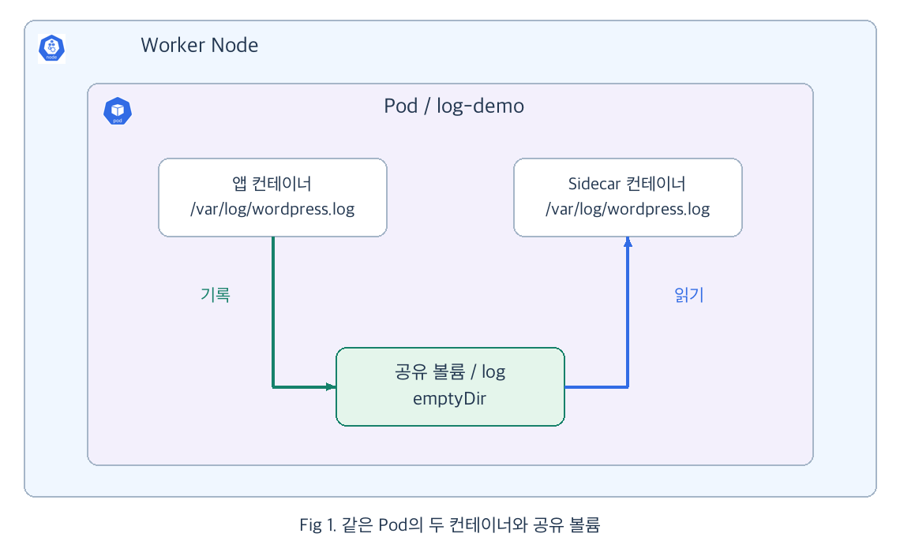
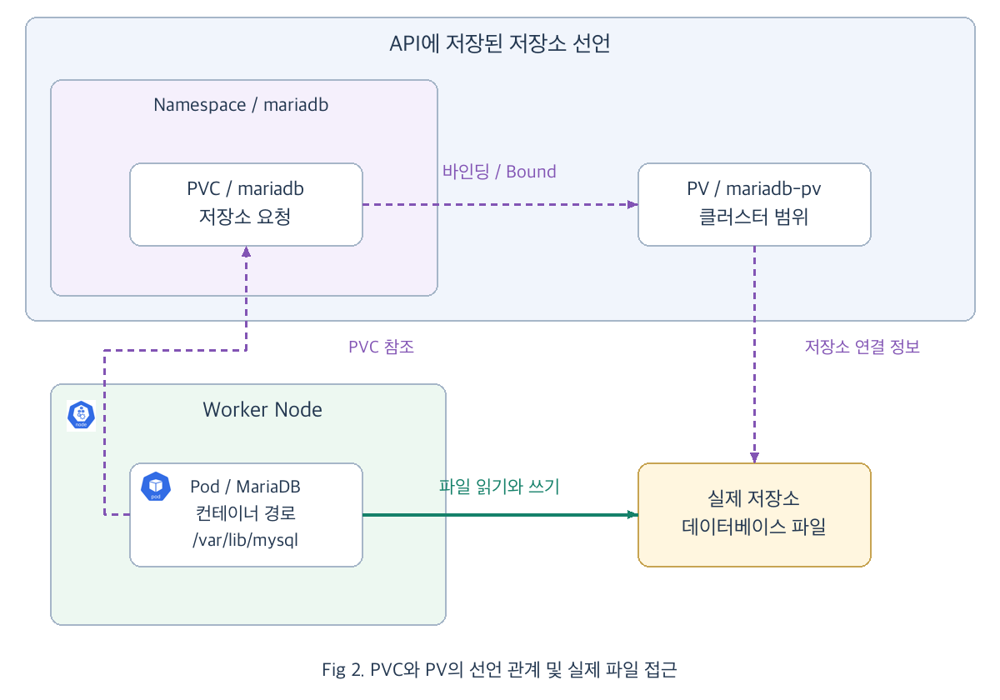
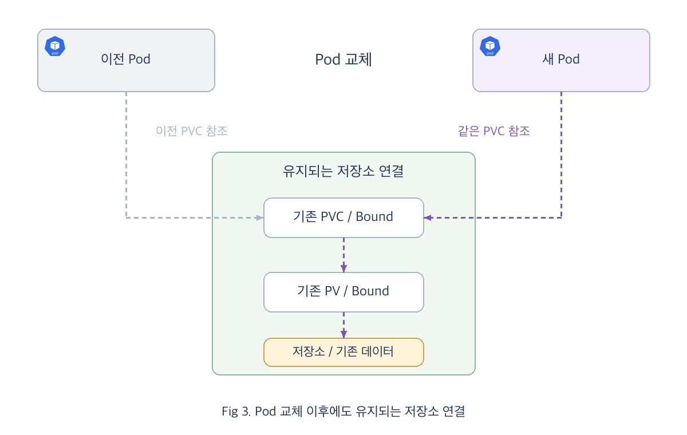
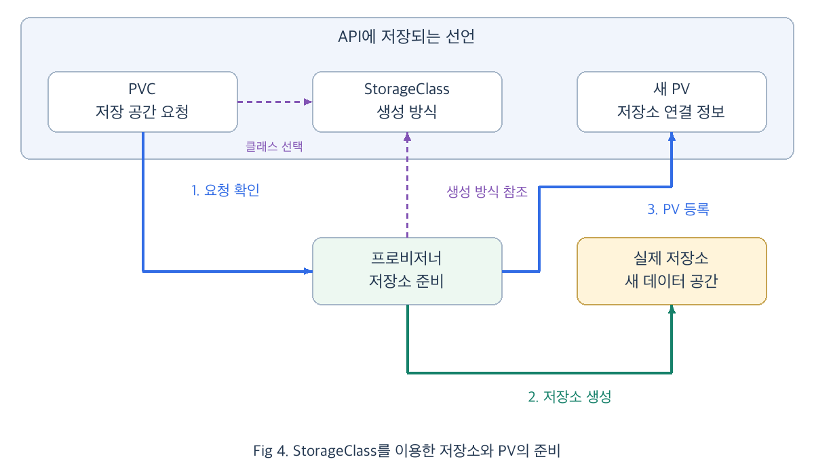
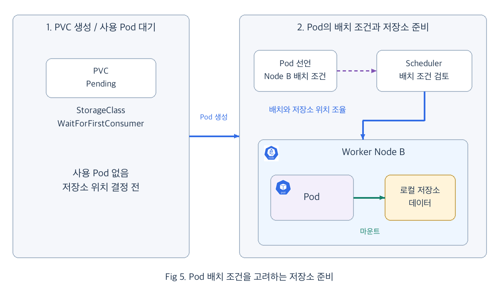

# Chap08. Pod 교체 이후의 데이터 보존: PV·PVC와 StorageClass

> 16장 연재의 여덟째 글입니다. 컨테이너와 Pod의 수명에 따른 데이터 보존 범위를 구분하고, PV·PVC와 StorageClass로 저장소를 연결하는 과정을 살펴봅니다. 이어서 공유 로그, 데이터베이스 복구와 저장소 생성 정책을 실습으로 확인합니다.

## 들어가며

<div align="center">


</div>

쇼핑몰에 등록한 상품이 서버를 다시 실행할 때마다 사라진다면 안심하고 사용할 수 없을 것입니다. 7장까지 만든 요청 경로를 통해 사용자는 애플리케이션에 접속할 수 있지만, 요청을 처리하며 쌓은 정보도 다음 실행까지 남아 있어야 합니다. 장애가 난 Pod를 새로 만들어 응답을 복구하더라도, 그동안 쌓은 정보가 사라졌다면 사용자는 이전 작업을 이어갈 수 없습니다.

Deployment는 필요한 Pod 수를 다시 채우고, Service는 새 Pod로 요청을 전달합니다. 그동안 기록한 데이터를 이어서 사용하려면 저장 공간도 Pod의 교체와 분리해 준비해야 합니다.

같은 Pod 안에서 잠시 공유할 파일과, Pod가 바뀌어도 남겨야 할 데이터는 필요한 저장 방식이 다릅니다. 파일이 남아야 하는 기간을 기준으로 저장 공간을 선택하면, 애플리케이션을 다시 실행할 때 어떤 데이터를 어디에서 이어받아야 하는지도 분명해집니다.

## 1. 컨테이너와 데이터의 수명

<div align="center">


</div>

기존 Pod가 떠나도 보관함의 파일은 남아 있고, 새 Pod는 같은 보관함에서 파일을 꺼내 사용합니다. 보관함은 Pod와 별도로 유지되는 저장소를 나타냅니다. 새 Pod가 기존 데이터를 이어받도록 하려면, Pod의 실행 설정에 같은 저장소를 연결하는 관계도 담아야 합니다.

5장에서 컨테이너 재시작과 Pod 교체를 구분했습니다. 파일도 어디에 기록했는지에 따라 두 상황에서 남아 있는 범위가 달라집니다.

### 1.1 컨테이너 내부의 파일과 볼륨

1장에서 살펴본 이미지는 애플리케이션을 실행하는 바탕입니다. 그 이미지로 만든 컨테이너에서 사용자가 새로 등록한 정보는 실행 중에 기록되는 데이터이므로, 다음 컨테이너에도 전달할 저장 공간이 필요합니다. 별도의 저장 공간을 연결하지 않은 경로에 쓴 변경분은 해당 컨테이너의 쓰기 영역에 남습니다. Kubernetes가 컨테이너를 새로 만들어 다시 실행하면 이 변경분을 이어서 사용할 수 없습니다. [[1]](#ref-1)

이때 **볼륨**(Volume)을 사용하면 컨테이너의 쓰기 영역과 다른 저장 공간을 연결할 수 있습니다. 예를 들어 볼륨을 `/data`에 연결하면 애플리케이션이 그 경로에 기록한 파일은 연결된 볼륨에 저장됩니다. 저장 공간을 컨테이너의 파일 경로로 사용할 수 있게 붙이는 작업을 **마운트**(mount)라고 합니다.

볼륨의 종류에 따라 저장 공간의 수명과 위치가 달라집니다. 따라서 먼저 그 파일을 컨테이너 재시작까지만 유지할지, Pod 교체 이후에도 유지할지 정해야 합니다.

### 1.2 같은 Pod에서 유지되는 emptyDir

3장에서 두 컨테이너가 공유한 `emptyDir`은 Pod를 위해 마련되는 빈 저장 공간입니다. 같은 Pod 안의 컨테이너가 다시 시작되어도 파일이 남지만, 해당 Pod가 Node에서 제거되면 그 공간도 함께 삭제됩니다. [[1]](#ref-1)

| 저장 위치 | 같은 Pod 안의 컨테이너 재시작 | Pod 삭제 후 새 Pod 생성 |
|---|---|---|
| 컨테이너의 쓰기 영역 | 변경분 소실 | 변경분 소실 |
| `emptyDir` | 유지 | 기존 데이터 소실 |
| Pod와 별도로 유지되는 영구 저장소 | 유지 | 같은 저장소에 다시 연결하면 사용 가능 |

임시 파일이나 같은 Pod의 컨테이너끼리 주고받을 로그에는 `emptyDir`을 사용할 수 있습니다. 기본적으로 Node의 저장 공간을 사용하며, `medium: Memory`로 지정하면 메모리에 파일을 보관합니다. 이 경우 기록한 파일도 메모리 사용량에 포함됩니다. [[1]](#ref-1)

예를 들어 오래 걸리는 계산 결과를 캐시 파일로 남겨 두면, 같은 Pod 안에서 컨테이너가 다시 시작되었을 때 그 결과를 재사용할 수 있습니다. Pod 자체를 교체하면 캐시를 다시 만들어야 하므로, 재생성 가능한 임시 데이터에 적합합니다. 주문 정보처럼 잃어서는 안 되는 데이터는 수명이 더 긴 저장소가 필요합니다. 먼저 공유 로그를 통해 볼륨을 연결하는 방식을 살펴보겠습니다.

## 2. 파일 공유와 Node의 저장 공간

3장의 사이드카 패턴을 파일 공유 관점에서 살펴보겠습니다. 앱 컨테이너가 로그 파일을 쓰고, 보조 컨테이너인 **Sidecar**가 그 파일을 읽으려면 두 컨테이너가 같은 저장 공간을 바라봐야 합니다. 각 컨테이너에 경로 이름만 같게 만드는 것으로는 파일이 공유되지 않으므로, 하나의 볼륨을 두 컨테이너에 연결합니다.

<div align="center">



</div>

Fig 1에서 왼쪽 앱 컨테이너는 `/var/log/wordpress.log`에 로그를 씁니다. 오른쪽 Sidecar도 같은 볼륨을 `/var/log`에 마운트했으므로 그 파일을 읽을 수 있습니다. 앱이 쓰는 내용이 공유 볼륨에 쌓이고, Sidecar는 이를 읽어 자신의 표준 출력으로 전달합니다.

### 2.1 볼륨 선언과 컨테이너의 마운트 경로

다음 Pod는 일정한 간격으로 로그를 쓰는 컨테이너와 그 내용을 읽는 컨테이너를 함께 실행합니다.

```yaml
apiVersion: v1
kind: Pod
metadata:
  name: log-demo
spec:
  containers:
  - name: app
    image: busybox:stable
    command:
    - /bin/sh
    - -c
    - while true; do echo 'WordPress is running...' >> /var/log/wordpress.log; sleep 5; done
    volumeMounts:
    - name: log
      mountPath: /var/log
  - name: sidecar
    image: busybox:stable
    command:
    - /bin/sh
    - -c
    - until [ -f /var/log/wordpress.log ]; do sleep 1; done; tail -f /var/log/wordpress.log
    volumeMounts:
    - name: log
      mountPath: /var/log
      readOnly: true
  volumes:
  - name: log
    emptyDir: {}
```

- `volumes`: Pod에서 사용할 `log` 볼륨을 `emptyDir`로 선언합니다.
- 두 `volumeMounts`의 `name: log`: 같은 볼륨을 선택합니다.
- `mountPath`: 선택한 볼륨을 각 컨테이너의 `/var/log`에서 사용합니다.

Sidecar는 앱이 파일을 만든 뒤 읽기를 시작합니다. 이 구성에서는 컨테이너가 시작되는 순서에 의존하지 않고 공유할 파일이 준비되었는지 확인합니다.

Sidecar의 `mountPath`를 `/logs`로 바꾸면 같은 파일을 `/logs/wordpress.log`에서 읽습니다. 컨테이너마다 보이는 경로가 달라도 같은 `log` 볼륨을 선택하면 파일을 공유합니다.

### 2.2 공유와 영구 보존의 구분

이 Pod 안에서 Sidecar만 재시작하면 공유 로그는 남아 있습니다. 그러나 Pod를 삭제하고 다시 만들면 새 `emptyDir`이 생기므로 기존 로그는 사라집니다. 공유는 두 컨테이너가 같은 파일을 사용할 수 있다는 뜻이고, 보존 기간은 선택한 저장소에 따라 결정됩니다.

데이터베이스도 마운트 경로를 통해 파일을 사용하지만, Pod가 바뀌어도 같은 저장 공간에 다시 접근할 수 있어야 합니다. 저장 위치를 Pod 바깥에 두면 어떤 차이가 생기는지 살펴보겠습니다.

### 2.3 Node의 디렉터리를 연결하는 hostPath

**`hostPath`**는 Pod가 실행되는 Node의 파일이나 디렉터리를 컨테이너에 연결합니다. Node의 `/mnt/data/mariadb`를 컨테이너의 `/var/lib/mysql`에 마운트했다면, 데이터베이스가 쓴 파일은 Node의 해당 디렉터리에 남습니다. Pod를 삭제해도 그 디렉터리가 유지되고 새 Pod가 같은 Node의 같은 경로를 연결하면 데이터를 다시 읽을 수 있습니다. [[1]](#ref-1)

[캐시 비교 예제](../Practice/Kubernetes/1.Persistent-Volume/cache-demo.md)는 이 차이를 보여 줍니다. `emptyDir`에 둔 계산 결과는 Pod 교체 후 다시 계산해야 하지만, `hostPath`에 둔 결과는 같은 Node의 디렉터리에서 다시 읽습니다. 다만 다른 Node의 동일한 경로는 별개의 저장 공간입니다. Node 자체의 디스크가 손실되면 그곳의 데이터도 영향을 받습니다.

`hostPath`는 컨테이너에 Node의 파일 접근 권한을 주므로 필요한 디렉터리만 연결해야 합니다. 여러 Node 사이에서 Pod를 교체할 운영 환경에서는 외부 디스크나 공유 파일 저장소를 연결하거나, 로컬 저장소에 맞는 Node 배치 조건을 함께 사용합니다. 이후 복구 문제의 `hostPath`는 단일 Node 학습 환경을 전제로 합니다.

애플리케이션마다 Node 경로나 저장 장치 정보를 직접 적기보다, 필요한 저장 공간을 요청하고 Kubernetes가 준비된 저장소와 연결하게 할 수 있습니다. 이때 사용하는 리소스가 PV와 PVC입니다.

## 3. PV와 PVC를 통한 영구 저장소 연결

애플리케이션 입장에서는 필요한 용량과 사용 조건을 정하고, 실행할 때 그 저장소를 연결할 수 있으면 됩니다. Kubernetes는 저장소 자체의 정보와 애플리케이션의 요청을 나누어 관리합니다.

### 3.1 저장소와 저장소 요청의 관계

데이터베이스에 필요한 것은 일정한 용량의 저장 공간이고, 클러스터가 준비해야 할 것은 그 조건에 맞는 실제 저장 장치입니다. 이 두 역할을 선언으로 나눈 것이 **PVC**(PersistentVolumeClaim)와 **PV**(PersistentVolume)입니다. PVC에는 애플리케이션이 필요한 저장 조건을 적고, PV에는 실제 저장소의 연결 정보와 용량, 접근 조건을 적습니다. PV는 클러스터 전체에서 관리하고 PVC는 Namespace 안에서 관리합니다. 조건이 맞는 PV와 PVC가 일대일로 연결되는 과정을 **바인딩**(binding)이라고 하며, 연결이 완료되면 `Bound` 상태가 됩니다. [[2]](#ref-2)

<div align="center">


</div>

3장에서 Pod가 같은 Namespace의 ConfigMap이나 Secret을 이름으로 참조했던 것처럼, 저장소도 사용할 PVC의 이름을 Pod에 적어 연결합니다. 저장소 종류에 맞는 볼륨 구성요소와 Kubelet이 해당 Node에서 저장소를 사용할 수 있도록 준비하면, 컨테이너는 마운트한 경로에서 파일을 읽고 씁니다.

<div align="center">



</div>

Fig 2의 위쪽은 API에 저장된 선언입니다. `mariadb` Namespace의 PVC가 `mariadb-pv`와 연결되고, PV에는 사용할 실제 저장소의 정보가 담깁니다. 아래쪽 Pod가 PVC를 참조해 볼륨을 마운트하면 MariaDB는 `/var/lib/mysql`에서 데이터 파일을 사용합니다. 보라색 점선은 선언의 참조 관계이고, 초록색 경로는 실행 중인 애플리케이션의 파일 접근입니다. 파일 내용은 실제 저장소에 기록됩니다.

이 그림은 저장소의 종류와 무관한 연결 관계를 나타냅니다. 실제 저장소는 Node의 디스크일 수도 있고 외부 스토리지일 수도 있으며, 위치에 따라 새 Pod가 연결할 수 있는 Node도 달라집니다.

### 3.2 PV와 PVC 선언의 연결

앞의 그림에서 데이터베이스가 사용할 저장소를 미리 등록하는 PV 선언은 다음과 같습니다. 실습 자료처럼 하나의 Node에 남아 있는 데이터 디렉터리를 사용합니다.

```yaml
apiVersion: v1
kind: PersistentVolume
metadata:
  name: mariadb-pv
spec:
  capacity:
    storage: 250Mi
  accessModes:
  - ReadWriteOnce
  persistentVolumeReclaimPolicy: Retain
  storageClassName: standard
  hostPath:
    path: /mnt/data/mariadb
    type: Directory
```

- `hostPath.path`: 실제 파일이 있는 Node의 디렉터리입니다. `Directory`는 해당 디렉터리가 이미 존재해야 한다는 조건입니다.
- `capacity.storage`: 이 PV가 제공한다고 선언한 용량입니다. `250Mi`는 250메비바이트입니다.
- `storageClassName`: PVC와 맞출 저장소 클래스 이름입니다. 여기서는 `standard`라는 이름으로 분류합니다.
- `persistentVolumeReclaimPolicy: Retain`: PVC가 삭제된 뒤에도 저장소를 남겨 두는 정책입니다.

이 선언의 `250Mi`는 저장소를 연결할 때 비교하는 용량입니다. `hostPath` 디렉터리에 그 크기의 디스크나 파일 사용 제한을 자동으로 만드는 설정은 아니므로, 실제 여유 공간은 Node의 디스크에서 확인합니다.

다음은 이 저장소를 요청하는 PVC입니다. `mariadb` Namespace가 만들어져 있는 상태에서 사용합니다.

```yaml
apiVersion: v1
kind: PersistentVolumeClaim
metadata:
  name: mariadb
  namespace: mariadb
spec:
  storageClassName: standard
  volumeName: mariadb-pv
  accessModes:
  - ReadWriteOnce
  resources:
    requests:
      storage: 250Mi
```

- `volumeName`: 기존 데이터를 가진 `mariadb-pv`를 연결 대상으로 지정합니다.
- `storageClassName`, `accessModes`, `requests.storage`: 지정한 PV와 비교할 클래스, 접근 모드, 필요한 용량입니다.

2절에서는 `volumes`에 `emptyDir`을 선언했지만, 영구 저장소를 사용할 때는 그 자리에 `persistentVolumeClaim`을 선언하고 `claimName`에 PVC 이름인 `mariadb`를 적습니다. 컨테이너는 앞에서와 같이 `volumeMounts`로 데이터 경로에 연결하므로, 애플리케이션은 평소처럼 파일을 읽고 쓸 수 있습니다. PV와 PVC를 연결하는 일은 Control Plane이 처리하고, 실행 Node에서 볼륨을 사용할 수 있게 준비하는 일은 Kubelet과 해당 저장소를 지원하는 구성요소가 처리합니다. [[2]](#ref-2)

### 3.3 용량과 접근 조건

PVC는 필요한 용량과 접근 모드, StorageClass 등의 조건으로 사용할 PV를 찾습니다. 요청한 용량이 PV의 용량을 넘거나 조건이 맞지 않으면 연결을 기다립니다.

접근 모드는 저장소를 어느 범위에서 연결할지 나타냅니다. 지원 여부는 저장소와 드라이버에 따라 달라집니다. [[2]](#ref-2)

- **`ReadWriteOnce`(RWO)**: 하나의 Node에서 읽고 쓰는 방식입니다. 이 장의 데이터베이스 실습에서 사용합니다.
- **`ReadOnlyMany`(ROX)**: 여러 Node에서 읽기 용도로 연결하는 방식입니다.
- **`ReadWriteMany`(RWX)**: 여러 Node에서 읽고 쓰는 방식입니다. 여러 웹 Pod가 공유 파일을 다루는 상황 등에 사용합니다.
- **`ReadWriteOncePod`(RWOP)**: 클러스터 전체에서 하나의 Pod만 사용하도록 제한하는 방식입니다. 이를 지원하는 CSI 볼륨에서 사용합니다.

**CSI**(Container Storage Interface)는 Kubernetes와 저장소 드라이버를 연결하는 표준 인터페이스입니다. 실제로 어떤 저장 장치를 연결하고 어떤 접근 모드를 쓸 수 있는지는 설치한 드라이버가 지원해야 합니다.

`ReadWriteOnce`의 기준은 Pod 수가 아니라 Node 수입니다. 따라서 같은 Node의 여러 Pod가 저장소에 접근할 수 있으며, 하나의 데이터베이스 데이터 디렉터리를 사용할 실행 개수는 별도로 관리해야 합니다. 읽기 전용으로 파일을 연결하려면 2절의 예처럼 컨테이너 마운트에도 `readOnly: true`를 지정합니다.

Namespace의 역할도 구분됩니다. PV는 클러스터 범위이지만, Pod가 참조할 PVC는 그 Pod와 같은 Namespace에 있어야 합니다. 데이터베이스 Pod를 다시 만들 때는 저장소 조건뿐 아니라 기존 PVC의 이름과 Namespace도 유지해야 같은 요청에 다시 연결됩니다.

### 3.4 Pod 교체와 저장소의 유지

5장에서는 새 Pod가 이전 Pod의 역할을 이어받는 과정을 살펴보았습니다. 저장된 파일까지 이어받으려면 새 Pod가 기존 PVC를 참조해야 합니다. Deployment가 삭제되어도 별도로 만든 PVC가 유지되면 PV와의 연결도 남습니다. 같은 PVC를 참조하도록 Deployment를 다시 만들면 새 Pod는 기존 데이터에 접근할 수 있습니다.

<div align="center">



</div>

Fig 3에서는 Pod만 교체되고 가운데의 PVC와 PV는 그대로 남습니다. 새 Pod가 같은 Namespace의 기존 PVC를 참조하면 이미 연결된 저장소를 다시 사용할 수 있습니다. 회색 점선은 이전 Pod의 참조, 보라색 점선은 새 Pod가 이어받는 참조 관계입니다. 파일을 새 Pod로 복사하는 대신, 새 Pod가 기존 파일이 있는 저장소를 마운트하는 흐름입니다.

PVC까지 삭제되는 상황에서는 PV의 **회수 정책**(reclaim policy)을 확인해야 합니다. `Retain`은 저장소를 남겨 관리자가 재사용 여부를 결정하게 하고, 이를 지원하는 저장소에서 `Delete`는 PV와 실제 저장소의 삭제로 이어집니다. 기존 PVC가 삭제된 `Retain` PV는 이전 연결 기록이 남은 `Released` 상태가 될 수 있습니다. [[2]](#ref-2)

이때 PV의 상태는 저장소가 어떤 연결 단계에 있는지 알려 줍니다.

- `Available`: PVC에 연결되지 않아 사용할 수 있는 상태입니다.
- `Bound`: 특정 PVC와 연결된 상태입니다.
- `Released`: 이전 PVC가 삭제되어 해제되었지만, 재사용을 위한 정리가 남은 상태입니다.

`Retain`으로 남은 저장소를 다른 PVC에 연결할 때는 이전 사용이 끝났는지와 데이터를 계속 사용할지를 확인합니다. 새 PVC를 같은 이름으로 만드는 것만으로 이전 연결 기록이 바뀌지는 않으므로, 복구 문제에서는 재사용 준비가 끝난 PV를 선택합니다.

기존 저장소를 다시 사용하는 방법을 이해했다면, 새 애플리케이션이 저장 공간을 요청할 때 준비하는 과정도 자동화할 수 있습니다.

## 4. StorageClass를 통한 저장소 준비

PV를 미리 만들어 PVC와 연결하는 방식을 **정적 프로비저닝**이라고 합니다. 애플리케이션이 많아지면 요청마다 저장소를 준비하는 작업도 늘어납니다. 이때 **StorageClass**에 저장소 생성 방식을 정해 두면 PVC 요청에 따라 필요한 저장소를 준비할 수 있습니다. [[3]](#ref-3)

<div align="center">


</div>

### 4.1 PVC 요청에서 저장소 생성까지의 흐름

7장에서 Ingress의 선언을 Controller가 실제 요청 처리 설정에 반영했던 것처럼, 저장소도 생성 방법을 선언하면 이를 처리할 구성요소가 필요합니다. 사용자가 StorageClass를 선택한 PVC를 생성하면 저장소 준비를 담당하는 **프로비저너**(provisioner)가 요청을 확인합니다. 프로비저너가 실제 저장소와 이를 나타내는 PV를 준비하고 PVC와 연결하면, Pod는 앞에서 본 것과 같은 방식으로 볼륨을 사용합니다. 이 과정을 **동적 프로비저닝**이라고 합니다. [[4]](#ref-4)

<div align="center">



</div>

Fig 4의 위쪽에는 PVC가 요청한 저장 공간과 StorageClass의 생성 방식이 선언되어 있습니다. 프로비저너는 API를 통해 이 요청과 설정을 확인하고, 해당 방식으로 실제 저장소를 준비한 뒤 그 연결 정보를 담은 PV를 등록합니다. 준비된 PV와 PVC가 바인딩되면 Fig 2에서 본 Pod의 저장소 연결로 이어집니다. 그림의 보라색 점선은 설정의 참조 관계이고, 실선은 요청 확인과 저장소 준비 작업을 나타냅니다.

이때 StorageClass는 저장소 자체가 아니라 생성 방법을 담은 클러스터 범위의 리소스입니다. 같은 클래스로 두 PVC를 만들면 각각의 요청에 맞는 PV와 저장 공간을 준비하며, 클래스 이름이 같다는 이유로 같은 데이터 디렉터리를 공유하지는 않습니다. [[3]](#ref-3)

예를 들어 `rancher.io/local-path` 방식은 설치된 Local Path Provisioner가 Node의 로컬 저장 공간을 준비합니다. StorageClass에는 그 프로비저너를 선택하는 이름이 들어가며, 실제 생성 작업을 수행할 구성요소도 클러스터에 설치되어 있어야 합니다. [[5]](#ref-5)

| 준비 방식 | 실제 저장소와 PV의 준비 시점 | 애플리케이션의 연결 방법 |
|---|---|---|
| 정적 프로비저닝 | 관리자가 미리 준비 | 조건에 맞는 PVC를 연결 |
| 동적 프로비저닝 | PVC와 사용 조건에 따라 준비 | StorageClass를 선택한 PVC를 사용 |

애플리케이션은 두 방식 모두 PVC를 참조합니다. 달라지는 것은 그 요청을 만족할 저장소를 언제, 누가 준비하는가입니다. 동적 생성 시 StorageClass의 `reclaimPolicy`가 새 PV에 적용되며, 생략하면 기본값은 `Delete`입니다. 데이터를 남겨야 하는 요청에는 생성 방식뿐 아니라 회수 정책도 함께 검토합니다. [[3]](#ref-3)

### 4.2 Pod 배치와 WaitForFirstConsumer

저장소가 특정 Node나 영역에서만 사용 가능하다면 저장소 생성 위치와 Pod 실행 위치가 맞아야 합니다. `volumeBindingMode: WaitForFirstConsumer`는 PVC를 사용할 Pod가 생길 때까지 바인딩이나 저장소 생성을 늦춰, Pod의 배치 조건과 함께 위치를 결정하도록 합니다. [[3]](#ref-3)

기본 모드인 **`Immediate`**는 PVC가 생성되면 사용 Pod를 기다리지 않고 바인딩이나 프로비저닝을 시작합니다. 반면 **`WaitForFirstConsumer`**에서는 Scheduler가 Pod의 실행 조건과 저장소의 위치를 함께 고려합니다. 예를 들어 Pod가 Node B에서 실행되어야 한다면, 그 Node에서 사용할 수 있는 저장소를 선택하거나 준비해야 합니다.

<div align="center">



</div>

Fig 5는 Node의 로컬 저장 공간을 준비하는 경우입니다. 왼쪽처럼 PVC만 있을 때에는 사용할 위치를 아직 정하지 않습니다. 오른쪽처럼 PVC를 참조하는 Pod가 생기면 Scheduler가 배치 조건을 검토하고, 프로비저너는 그 위치에 맞춰 저장소를 준비합니다. 저장소 연결과 배정이 완료된 뒤 Kubelet이 볼륨을 준비하면 Pod의 컨테이너가 파일을 사용할 수 있습니다. Node B라는 위치는 이 예의 배치 조건에 따른 결과이며, 저장소 준비와 Pod 배정을 함께 조율하는 것이 핵심입니다.

따라서 이 모드의 PVC를 먼저 만들었을 때 `Pending`으로 보이는 것은 사용 Pod를 기다리는 상태일 수 있습니다. Pod를 만든 뒤에도 연결되지 않는다면 PVC 이벤트와 Pod의 배정 조건을 함께 확인해야 합니다.

### 4.3 기본 StorageClass와 명시적 선택

PVC에서 `storageClassName`을 생략하면 기본 StorageClass가 적용될 수 있습니다. 특정 방식을 사용하려면 이름을 명시하고, 클래스 없이 준비된 PV를 사용하려면 `storageClassName: ""`를 지정합니다. 생략과 빈 문자열은 서로 다른 선택입니다. [[3]](#ref-3)

기본 클래스에는 `storageclass.kubernetes.io/is-default-class: "true"`라는 annotation을 붙입니다. **Annotation**은 리소스에 부가 정보를 기록하는 키와 값이며, 이 키는 어떤 클래스를 기본으로 사용할지 알립니다.

기본 클래스가 여러 개라면 Kubernetes는 가장 최근에 생성된 기본 클래스를 선택합니다. 실습에서는 의도한 하나만 기본으로 남겨 선택을 명확하게 만듭니다. 이미 바인딩된 PVC는 기존 저장소를 계속 사용하지만, 클래스가 미지정된 채 남아 있던 PVC에는 나중에 생긴 기본 클래스가 적용될 수 있습니다. 클래스 없는 PV를 계속 사용하려는 요청에는 빈 문자열을 명시하는 이유입니다. [[3]](#ref-3)

기본값을 바꾸기 전에 기존 저장소를 재사용할 요청인지 새 저장소를 만들 요청인지 구분해야 합니다. 다음 문제에서는 이 두 상황을 나누어 확인합니다.

## 5. 문제: 공유 로그와 데이터베이스 복구

이제 파일을 함께 읽는 상황, 남아 있는 데이터를 다시 연결하는 상황, 새 저장 공간을 준비하는 상황을 각각 확인하겠습니다. 공유 로그에서는 볼륨의 연결을, 데이터베이스 복구에서는 데이터의 수명을, 기본 클래스 변경에서는 새 저장소의 준비 방식을 판단합니다. 각 문제는 독립된 학습 환경에서 진행하며, 아래 출력은 결과를 읽기 위한 예시입니다.

### 5.1 두 컨테이너의 로그 공유

[Sidecar 실습](../Practice/Kubernetes/4.Sidecar/Questions.bash)의 `default` Namespace에는 `wordpress` Deployment가 있습니다. 준비 스크립트는 이 컨테이너가 5초마다 `/var/log/wordpress.log`에 문장을 쓰도록 구성합니다. 여기에 `busybox:stable` 이미지를 사용하는 `sidecar`를 추가해 같은 파일을 읽게 만드는 것이 목표입니다.

두 컨테이너가 하나의 볼륨을 공유하도록 설정하고, Sidecar 로그에서 앱이 기록한 문장을 확인합니다. 이 문제의 저장 기간은 같은 Pod가 유지되는 동안입니다.

### 5.2 기존 PV를 이용한 MariaDB 복구

[PV 실습](../Practice/Kubernetes/1.Persistent-Volume/Questions.bash)에서는 데이터베이스 Deployment가 삭제되었지만 저장소가 남아 있습니다. `mariadb` Namespace에 `ReadWriteOnce`, 250Mi 조건의 PVC를 만들고 기존 PV를 연결한 뒤, 제공된 Deployment가 그 PVC를 사용하도록 복구합니다.

이 실습을 처음 준비할 때는 [준비 스크립트](../Practice/Kubernetes/1.Persistent-Volume/LabSetUp.bash)의 초기 PVC에도 `storageClassName: standard`와 `volumeName: mariadb-pv`를 지정합니다. 원본의 생략된 클래스는 환경의 기본값을 따르므로, 처음부터 의도한 PV에 데이터를 기록하도록 맞추는 것입니다.

준비 스크립트는 PVC도 삭제하고 PV의 이전 연결 기록을 비워 `Available`로 돌려놓습니다. 본문의 해설은 `mariadb-pv`가 `Retain`, `storageClassName: standard`로 준비된 이 상태를 기준으로 합니다. `hostPath` 저장소를 사용하므로 단일 Node 학습 환경에서 진행합니다.

### 5.3 기본 StorageClass의 변경

[StorageClass 실습](../Practice/Kubernetes/2.Storage-Class/Questions.bash)에서는 `rancher.io/local-path`를 사용하는 `local-storage`를 만들고, 바인딩 모드를 `WaitForFirstConsumer`로 지정합니다. 처음에는 기본 클래스로 두지 않고, 이후 기본값을 변경해 기본 클래스가 하나만 남도록 합니다.

Local Path Provisioner가 설치된 환경을 사용합니다. 원문 문제의 `WaitForFirstCustomer` 표기는 `WaitForFirstConsumer`로 고쳐 사용하며, 기존 Deployment와 PVC는 수정하지 않습니다.

## 6. 해설과 코드: 저장소 연결의 확인

각 문제에서는 선언이 적용되었는지와 파일을 실제로 사용할 수 있는지를 함께 확인합니다. 공유 로그는 컨테이너 간 파일 전달을, MariaDB는 저장소 재연결을, StorageClass는 새 요청의 준비 방식을 검증합니다.

### 6.1 공유 볼륨과 Sidecar의 추가

기존 `wordpress` Deployment의 앱 컨테이너 설정을 유지하면서 볼륨과 Sidecar를 추가합니다. 다음 내용을 `sidecar-patch.yaml`로 저장합니다. 기존 Deployment에 병합할 패치입니다.

```yaml
spec:
  template:
    spec:
      volumes:
      - name: log
        emptyDir: {}
      containers:
      - name: wordpress
        volumeMounts:
        - name: log
          mountPath: /var/log
      - name: sidecar
        image: busybox:stable
        command:
        - /bin/sh
        - -c
        - until [ -f /var/log/wordpress.log ]; do sleep 1; done; tail -f /var/log/wordpress.log
        volumeMounts:
        - name: log
          mountPath: /var/log
          readOnly: true
```

이 패치를 적용하면 이름이 `wordpress`인 기존 컨테이너에는 마운트가 추가되고, `sidecar` 컨테이너가 새로 들어갑니다. 앱 이미지와 로그를 쓰는 명령은 기존 설정을 사용합니다.

```bash
kubectl patch deployment wordpress -n default --type=strategic --patch-file sidecar-patch.yaml
kubectl rollout status deployment/wordpress -n default
kubectl logs -n default deployment/wordpress -c sidecar --tail=3
```

로그가 쌓인 뒤의 출력 예시는 다음과 같습니다.

```text
WordPress is running...
WordPress is running...
WordPress is running...
```

이 문장이 Sidecar의 출력에서 보이면 앱이 기록한 파일을 다른 컨테이너가 읽고 있는 것입니다. 파일은 공유되지만 `emptyDir`에 있으므로 다음 Pod로 보존할 데이터에는 다른 저장소를 선택해야 합니다.

### 6.2 기존 PV의 상태와 PVC 연결

MariaDB 복구에서는 사용할 PV부터 확인합니다.

```bash
kubectl get pv mariadb-pv
```

```text
NAME         CAPACITY   ACCESS MODES   RECLAIM POLICY   STATUS      CLAIM   STORAGECLASS   VOLUMEATTRIBUTESCLASS   REASON   AGE
mariadb-pv   250Mi      RWO            Retain           Available           standard       <unset>                          10m
```

- `STATUS: Available`: 다른 PVC에 연결되지 않아 요청을 받을 수 있습니다.
- `STORAGECLASS: standard`: 새 PVC에서 일치시킬 클래스입니다.
- `RECLAIM POLICY: Retain`: PVC가 삭제된 뒤에도 저장소를 남기는 설정입니다.

다음 내용을 `mariadb-pvc.yaml`로 저장합니다. 기본 StorageClass가 무엇인지에 관계없이, 실습에서 남겨 둔 PV와 클래스 조건을 명시합니다.

```yaml
apiVersion: v1
kind: PersistentVolumeClaim
metadata:
  name: mariadb
  namespace: mariadb
spec:
  accessModes:
  - ReadWriteOnce
  resources:
    requests:
      storage: 250Mi
  storageClassName: standard
  volumeName: mariadb-pv
```

- `volumeName`: 복구에 사용할 기존 PV를 지정합니다.
- `storageClassName`과 용량·접근 모드: 지정한 PV와 맞아야 하는 연결 조건입니다.

PVC를 적용한 뒤 연결 결과를 확인합니다. `volumeName`으로 지정해도 클래스와 용량 등의 조건은 맞아야 하며, 지정한 PV가 이미 다른 PVC에 연결되어 있다면 기다립니다.

```bash
kubectl apply -f mariadb-pvc.yaml
kubectl get pvc mariadb -n mariadb
```

```text
NAME      STATUS   VOLUME       CAPACITY   ACCESS MODES   STORAGECLASS   VOLUMEATTRIBUTESCLASS   AGE
mariadb   Bound    mariadb-pv   250Mi      RWO            standard       <unset>                 5s
```

- `STATUS: Bound`와 `VOLUME: mariadb-pv`: 새 저장소 대신 의도한 기존 PV에 연결되었습니다.

만약 PV가 `Released`라면 이전 PVC가 삭제되었는지, 사용 중인 Pod가 없는지와 보존할 데이터를 먼저 확인합니다. `claimRef`는 PV에 남아 있는 이전 PVC의 연결 기록입니다. 이 조건을 확인한 복구 대상에서만 이전 `claimRef`를 정리한 뒤 새 PVC를 연결합니다. 본문의 준비 스크립트는 이 정리를 마친 상태를 제공합니다. [[2]](#ref-2)

### 6.3 MariaDB의 재실행과 데이터 유지 확인

PVC 연결이 끝나면 실습에서 제공한 `~/mariadb-deploy.yaml`을 다음 내용으로 수정합니다. 빈 `claimName`을 `mariadb`로 채우고, 4장에서 배운 준비 검사를 추가해 데이터베이스가 조회 요청을 받을 수 있는지도 확인합니다.

```yaml
apiVersion: apps/v1
kind: Deployment
metadata:
  name: mariadb
  namespace: mariadb
spec:
  replicas: 1
  selector:
    matchLabels:
      app: mariadb
  template:
    metadata:
      labels:
        app: mariadb
    spec:
      containers:
      - name: mariadb
        image: mariadb:10.6
        env:
        - name: MYSQL_ROOT_PASSWORD
          value: rootpass
        readinessProbe:
          exec:
            command:
            - /bin/sh
            - -c
            - MYSQL_PWD="$MYSQL_ROOT_PASSWORD" mariadb -uroot -e 'SELECT 1' >/dev/null
          periodSeconds: 5
        volumeMounts:
        - name: mariadb-storage
          mountPath: /var/lib/mysql
      volumes:
      - name: mariadb-storage
        persistentVolumeClaim:
          claimName: mariadb
```

- `claimName: mariadb`: 같은 Namespace에 만든 PVC를 참조합니다.
- `mountPath: /var/lib/mysql`: MariaDB가 데이터 파일을 기록하는 경로에 저장소를 연결합니다.

준비 검사는 데이터베이스 조회가 성공하는지 확인합니다. 따라서 배포 완료를 확인한 뒤 데이터 검증을 진행할 수 있습니다. 이미지와 비밀번호는 원본 실습 설정을 유지합니다. 기존 데이터베이스에 접속할 때는 저장된 데이터의 버전과 계정 설정에 맞춰야 합니다.

```bash
kubectl apply -f ~/mariadb-deploy.yaml
kubectl rollout status deployment/mariadb -n mariadb
```

애플리케이션이 시작되면 기존 테이블을 조회해 복구를 확인합니다. 준비 스크립트에는 확인용 업무 데이터가 없으므로, 직접 보존 과정을 비교하려면 먼저 다음과 같이 작은 테이블과 기록을 만듭니다. MariaDB가 접속을 받을 준비를 마친 뒤 실행합니다.

```bash
kubectl exec -i -n mariadb deployment/mariadb -- sh -c \
  'MYSQL_PWD="$MYSQL_ROOT_PASSWORD" mariadb -uroot' <<'SQL'
CREATE DATABASE IF NOT EXISTS storage_lab;
CREATE TABLE IF NOT EXISTS storage_lab.checkpoint (
  id INT PRIMARY KEY,
  message VARCHAR(40)
);
REPLACE INTO storage_lab.checkpoint VALUES (1, 'retained');
SQL
```

그다음 Deployment만 삭제하고 같은 파일로 다시 생성합니다. PVC와 PV는 유지합니다.

```bash
kubectl delete deployment mariadb -n mariadb
kubectl wait -n mariadb --for=delete pod -l app=mariadb --timeout=120s
kubectl apply -f ~/mariadb-deploy.yaml
kubectl rollout status deployment/mariadb -n mariadb
kubectl exec -n mariadb deployment/mariadb -- sh -c \
  'MYSQL_PWD="$MYSQL_ROOT_PASSWORD" mariadb -uroot -N -e "SELECT message FROM storage_lab.checkpoint WHERE id=1;"'
```

새 데이터베이스 프로세스가 접속을 받을 준비를 마친 뒤 조회한 출력 예시입니다.

```text
retained
```

기록이 다시 조회되면 새 Pod가 기존 저장소의 데이터를 사용하고 있음을 확인할 수 있습니다. Pod 이름이나 실행 상태만 보는 것보다 저장했던 내용을 읽는 것이 복구 결과의 직접적인 근거입니다.

### 6.4 StorageClass의 생성과 기본값 변경

마지막 문제는 기존 PV 복구와 별도로 진행합니다. 다음 내용을 `local-storage.yaml`로 저장합니다.

```yaml
apiVersion: storage.k8s.io/v1
kind: StorageClass
metadata:
  name: local-storage
  annotations:
    storageclass.kubernetes.io/is-default-class: "false"
provisioner: rancher.io/local-path
reclaimPolicy: Delete
volumeBindingMode: WaitForFirstConsumer
```

- `provisioner`: 설치된 Local Path Provisioner가 처리할 저장소 방식입니다.
- `volumeBindingMode`: 사용할 Pod의 배치 조건과 함께 저장소를 준비합니다.
- 기본 클래스 annotation: 처음에는 `false`로 두고, 확인 후 기본값을 변경합니다.

현재 기본 클래스가 `local-path`인 실습 환경에서는 다음 순서로 적용합니다. 다른 이름의 기본 클래스가 있다면 먼저 조회해 실제 이름을 사용합니다.

```bash
kubectl apply -f local-storage.yaml
kubectl get storageclass
kubectl patch storageclass local-path --type=merge \
  -p '{"metadata":{"annotations":{"storageclass.kubernetes.io/is-default-class":"false"}}}'
kubectl patch storageclass local-storage --type=merge \
  -p '{"metadata":{"annotations":{"storageclass.kubernetes.io/is-default-class":"true"}}}'
kubectl get storageclass
```

최종 출력 예시는 다음과 같습니다.

```text
NAME                      PROVISIONER             RECLAIMPOLICY   VOLUMEBINDINGMODE      ALLOWVOLUMEEXPANSION   AGE
local-path                rancher.io/local-path   Delete          WaitForFirstConsumer   false                  1d
local-storage (default)   rancher.io/local-path   Delete          WaitForFirstConsumer   false                  1m
```

- `(default)`: 기본 클래스로 선택된 항목입니다. 이 표시가 의도한 클래스 하나에만 있는지 확인합니다.

이 문제에서는 기존 PVC와 Deployment를 바꾸지 않습니다. 이후 새 PVC에서 클래스를 생략하면 변경한 기본값을 사용할 수 있습니다. 바인딩 모드 때문에 사용 Pod가 생길 때까지 기다릴 수 있다는 점도 함께 기억해야 생성 지연과 오류를 구분할 수 있습니다.

### 6.5 저장소 연결 지연의 확인

데이터베이스가 시작되지 않는다면 먼저 PVC 연결과 Pod 실행을 나누어 확인합니다. 다음 명령으로 각 상태와 이벤트를 함께 살펴볼 수 있습니다.

```bash
kubectl get pvc -n mariadb
kubectl describe pvc mariadb -n mariadb
kubectl describe pods -n mariadb -l app=mariadb
```

- **PVC가 `Pending`인 경우**: 요청한 PV의 용량·접근 모드·클래스가 맞는지, 이미 다른 PVC에 연결되어 있는지 확인합니다. 동적 생성이라면 해당 프로비저너의 동작과 이벤트를 확인합니다.
- **`WaitForFirstConsumer`로 기다리는 경우**: PVC를 사용할 Pod가 있는지와 그 Pod를 배정할 수 있는 Node가 있는지 확인합니다.
- **PVC가 `Bound`인데 컨테이너가 시작되지 않는 경우**: Pod 이벤트에서 마운트 실패를 확인합니다. 이 실습에서는 Node의 데이터 디렉터리와 접근 권한이 원인이 될 수 있습니다.

저장소 연결을 마친 뒤에는 준비 상태와 실제 데이터 조회까지 확인합니다. 이 순서로 보면 저장소를 찾지 못한 상황과, 저장소는 연결되었지만 애플리케이션이 준비되지 못한 상황을 구분할 수 있습니다.

## 다음 글로 넘어가기 전에

이번 글에서 다룬 내용은 이렇습니다. 애플리케이션을 다시 실행하는 일과 그동안 쌓인 데이터를 되살리는 일은 함께 준비해야 합니다. 실행 중 잠시 필요한 파일은 Pod의 수명에 맞춰 보관하고, 계속 남아야 할 데이터는 실행 환경과 분리된 저장소에 기록하면 Pod를 교체해도 작업을 이어갈 수 있습니다.

애플리케이션이 필요한 저장 조건을 요청하고 클러스터가 그 요청에 맞는 저장소를 연결하도록 나누면, 기존 데이터를 재사용하거나 새로운 공간을 준비하는 과정을 일관되게 관리할 수 있습니다. 저장소의 위치와 삭제 정책까지 확인해야 의도한 기간 동안 데이터를 유지할 수 있습니다.

복구를 확인할 때는 Pod의 실행 상태뿐 아니라 올바른 저장소에 연결되었는지와 기존 데이터를 읽을 수 있는지를 확인해야 합니다. 데이터가 유지되어도 실행에 필요한 메모리가 부족하면 애플리케이션은 안정적으로 동작하기 어렵습니다. 다음 글에서는 컨테이너가 요청할 CPU와 메모리, 실행 중 사용 제한을 살펴봅니다.

## 참고문헌

- <a id="ref-1"></a>[1] [Kubernetes 공식 문서: 볼륨과 emptyDir, hostPath](https://kubernetes.io/docs/concepts/storage/volumes/)
- <a id="ref-2"></a>[2] [Kubernetes 공식 문서: PV·PVC의 바인딩과 회수 정책](https://kubernetes.io/docs/concepts/storage/persistent-volumes/)
- <a id="ref-3"></a>[3] [Kubernetes 공식 문서: StorageClass와 바인딩 모드](https://kubernetes.io/docs/concepts/storage/storage-classes/)
- <a id="ref-4"></a>[4] [Kubernetes 공식 문서: 동적 볼륨 프로비저닝](https://kubernetes.io/docs/concepts/storage/dynamic-provisioning/)
- <a id="ref-5"></a>[5] [Local Path Provisioner 공식 저장소](https://github.com/rancher/local-path-provisioner)
