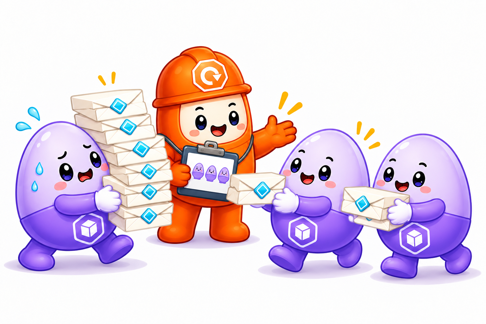

# Chap10. 부하에 따른 Pod 수 조절: HPA

> 16장 연재의 10번째 글입니다. 자원 사용량을 기준으로 Pod 수를 조절하는 원리를 살펴보고, 부하를 주고 거두는 실험으로 자동 확장과 축소를 확인합니다.

## 들어가며

<div align="center">


</div>

평소에는 빠르게 열리던 쇼핑몰도 할인 행사가 시작되면 응답이 느려질 수 있습니다. 요청을 처리하느라 서버의 CPU 사용량이 높아졌다면, 같은 애플리케이션을 여러 개 실행해 일을 나누는 방법을 생각할 수 있습니다. 반대로 행사가 끝나고 이용자가 줄어들면 늘려 둔 실행 개수를 조정해 자원을 돌려줄 수 있어야 합니다.

9장에서는 Pod 하나가 실행될 자리를 확보하고 사용할 자원의 범위를 정했습니다. 이제 그 Pod를 얼마나 실행할지까지 부하에 맞춰 조절해 보겠습니다. 사용량을 관찰하는 과정이 실행 개수의 변경으로 이어지고, 새로 준비된 Pod가 기존 요청 처리에 합류하는 흐름이 이번 장의 중심입니다.

## 1. 부하와 Pod 수의 연결

### 1.1 원하는 실행 개수의 자동 조절

<div align="center">



</div>

봉투가 쌓인 Pod 곁으로 같은 역할의 Pod들이 합류해 요청을 나누어 맡습니다. 이 장에서는 HPA가 사용량을 보고 필요한 개수를 판단하고, Deployment와 ReplicaSet의 관리 흐름이 그 개수를 실행에 반영합니다. 그림 속 Deployment가 새 일손을 맞이하는 모습은 요청을 처리할 Pod가 늘어나는 결과를 나타냅니다.

3~5장에서 Deployment는 선언한 개수를 유지하며, Pod가 사라지면 부족한 수를 다시 채웠습니다. 그런데 모든 Pod가 정상이어도 접속자가 늘면 현재 개수로는 처리량이 부족할 수 있습니다. 이 경우에는 원래 개수를 회복하는 데서 더 나아가, 유지할 개수를 부하에 맞게 바꿔야 합니다.

**HPA**(HorizontalPodAutoscaler)는 관찰한 사용량과 목표값을 비교해 워크로드의 원하는 Pod 수를 조절하는 리소스입니다. 여기서 수평 확장은 같은 역할의 Pod를 추가해 처리 능력을 늘리는 방법을 뜻합니다. 이 글에서는 Deployment를 대상으로 CPU 사용률에 따라 실행 개수를 조절합니다. [[1]](#ref-1)

사용자는 HPA에 대상 Deployment와 목표 사용률, 최소·최대 Pod 수를 선언합니다. Control Plane의 **HPA Controller**는 이 설정에 따라 주기적으로 사용량을 확인하고, Kubernetes API를 통해 대상 Deployment의 원하는 개수를 변경합니다. 이후 Deployment와 ReplicaSet의 관리 흐름으로 Pod가 추가되거나 줄어듭니다.

### 1.2 사용량 수집과 요청 처리의 연결

9장에서는 `kubectl top`으로 사용량을 읽고 사람이 선언값을 조정했습니다. HPA Controller는 그 사용량을 주기적으로 읽어 자동으로 판단합니다. **Metrics Server**가 각 Node의 Kubelet에서 모은 CPU·메모리 사용량을 Kubernetes API를 통해 조회하는 경로입니다. Metrics Server 자체도 클러스터 안에서 Pod로 실행됩니다. [[2]](#ref-2)

부하가 커져 원하는 Pod 수가 늘어나면 Scheduler가 새 Pod의 실행 위치를 정합니다. 배정된 Node의 Kubelet은 컨테이너 런타임을 통해 애플리케이션을 실행합니다. 4장에서 살펴본 준비 상태를 갖춘 Pod는 Service의 요청 전달 대상에 포함되어 기존 Pod와 함께 요청을 처리합니다.

새 Pod에도 Deployment 템플릿의 Label이 붙으므로, 기존 Service의 Selector가 그 Pod를 찾을 수 있습니다. EndpointSlice에 준비된 Pod의 주소가 반영되면 요청 전달 대상도 늘어납니다. 6~7장에서 만든 접속 주소와 Ingress 규칙은 유지하면서 요청을 처리할 곳이 추가되는 것입니다.

이처럼 요청을 나눌 준비는 기존 구성에 갖춰져 있습니다. HPA에는 언제 얼마나 늘릴지 판단할 기준을 정해 주면 됩니다.

## 2. CPU 사용률과 확장 기준

### 2.1 CPU 요청량을 기준으로 한 사용률

CPU 사용률 목표를 설정할 때 기준이 되는 값은 컨테이너의 **`requests.cpu`**입니다. 컨테이너가 하나인 Pod에서 요청량이 `100m`, 실제 사용량이 `50m`라면 사용률은 50%입니다. 같은 Pod가 `80m`를 사용하면 80%가 됩니다. CPU 제한량이 `200m`로 설정되어 있어도 이 사용률의 기준은 요청량인 `100m`입니다. [[3]](#ref-3)

다음은 이번 실습에서 사용할 Apache 컨테이너의 자원 설정 부분입니다.

```yaml
resources:
  requests:
    cpu: 100m
  limits:
    cpu: 200m
```

- **`requests.cpu: 100m`**: 배치에 필요한 CPU 요청량이며, CPU 사용률 계산의 기준입니다.
- **`limits.cpu: 200m`**: 컨테이너가 사용할 수 있는 CPU의 상한입니다.

목표를 50%로 두면 Pod당 평균 CPU 사용량을 `50m` 수준으로 맞추도록 실행 개수를 조절합니다. 실제 요청량을 지나치게 크게 잡으면 같은 부하에서도 사용률이 낮게 계산됩니다. 9장의 자원 설정은 실행 위치뿐 아니라 확장의 판단에도 영향을 주는 셈입니다.

### 2.2 목표 사용률과 필요한 Pod 수

Pod 두 개가 각각 CPU를 `100m`씩 요청하고, 평균 `80m`를 사용한다고 가정하겠습니다. 평균 사용률은 80%이므로 목표인 50%보다 높습니다. HPA의 기본 계산은 현재 Pod 수에 사용률의 비율을 곱하고, 소수점이 나오면 올림하는 방식입니다. [[1]](#ref-1)

```text
필요한 Pod 수 = 현재 Pod 수 × (현재 평균 사용률 ÷ 목표 사용률), 소수점 올림
             = 2 × (80 ÷ 50)
             = 3.2 → 4개
```

이 예에서는 현재 전체 CPU 사용량이 `160m`입니다. 요청을 네 Pod가 고르게 나누고 전체 작업량이 유지된다면, Pod당 사용량은 약 `40m`로 낮아질 수 있습니다. 실제 계산에서는 아직 준비되지 않은 Pod와 수집되지 않은 사용량을 고려해 조정 폭을 보수적으로 판단합니다. 따라서 위 계산은 필요한 개수를 구하는 기본 원리로 이해하고, 실제 결과는 HPA와 Pod의 상태를 함께 보며 확인합니다.

확장할 수 있는 범위는 최소·최대 Pod 수로 제한합니다. 계산 결과가 여섯 개여도 최대 개수를 네 개로 정했다면 그 범위 안에서 조절합니다. 부하가 거의 없어져도 최소 개수만큼은 유지합니다.

### 2.3 짧은 부하 변화와 축소 안정화

요청이 잠시 줄 때마다 Pod를 없앴다가 곧바로 다시 만들면 애플리케이션을 시작하고 종료하는 일이 잦아집니다. **축소 안정화 구간**은 최근에 계산한 필요 개수를 함께 고려해 이런 변동을 완화합니다. 설정한 시간 범위에서 가장 큰 필요 개수를 사용하므로, 잠깐 사용량이 낮아졌다고 바로 축소하지 않습니다. [[1]](#ref-1)

예를 들어 최근 30초 안에 네 개가 필요하다는 판단이 남아 있다면, 지금 계산한 결과가 한 개여도 네 개를 유지할 수 있습니다. 낮은 부하가 이어져 이전 판단이 시간 범위에서 빠지면 축소가 가능해집니다. 관찰 주기와 축소 정책도 함께 작용하므로, 이 시간은 부하를 멈춘 뒤 정확히 그만큼 기다리는 타이머와는 구분됩니다.

이제 사용률의 기준과 개수의 범위를 선언하고, 부하 변화가 실제 실행 개수에 어떻게 반영되는지 확인해 보겠습니다.

## 3. 문제: CPU 부하에 따른 자동 확장과 축소

### 3.1 대상 애플리케이션과 요구사항

[HPA 실습 문제](../Practice/Kubernetes/8.HPA/Questions.bash)는 기존 Apache Deployment에 자동 확장을 추가하는 상황입니다. Apache Pod는 내부 Service를 통해 요청을 받고 있으며, 별도의 부하 생성 Pod가 이 Service에 반복해서 접속합니다. 7장의 외부 진입점을 거치기 전에 클러스터 내부에서 요청을 만들어, 애플리케이션의 부하와 실행 개수 변화에 집중하는 구성입니다.

- **대상**: `autoscale` Namespace의 `apache-deployment` Deployment입니다.
- **자원 기준**: Apache 컨테이너의 CPU 요청량은 `100m`, 제한량은 `200m`입니다.
- **HPA 이름**: 대상과 같은 Namespace에 `apache-server`로 생성합니다.
- **확장 조건**: 평균 CPU 사용률 목표는 50%, Pod 수는 최소 한 개에서 최대 네 개입니다.
- **축소 조건**: 축소 안정화 구간을 30초로 설정합니다.

확인할 결과는 부하를 주었을 때 사용률과 실행 개수가 증가하고, 부하를 거두면 사용률이 내려간 뒤 개수가 줄어드는 흐름입니다. 부하 생성 Pod도 같은 Namespace에 있으므로, Apache Pod만 구분해서 관찰해야 합니다. 3장에서 배운 Label을 사용해 `app=apache`에 해당하는 Pod를 조회하면 요청을 보내는 쪽과 처리하는 쪽이 섞이지 않습니다.

### 3.2 실습 환경과 사용량 확인

저장소 루트에서 [환경 준비 스크립트](../Practice/Kubernetes/8.HPA/LabSetUp.bash)를 실행하면 Namespace, Metrics Server, Apache Deployment와 Service를 준비합니다.

```bash
bash Practice/Kubernetes/8.HPA/LabSetUp.bash
```

이 스크립트에는 Killercoda 실습 환경을 위해 Kubelet 인증서 검증을 생략하는 Metrics Server 설정이 포함되어 있습니다. 기존 클러스터에 Metrics Server가 설치되어 있다면 해당 설치·패치 부분을 다시 적용하지 않고 준비된 구성을 사용합니다. 인증서 검증 생략 옵션은 테스트용이며, 운영 환경에서는 신뢰할 수 있는 인증서로 수집 경로를 구성합니다. [[4]](#ref-4)

애플리케이션이 실행된 뒤에는 사용량이 실제로 조회되는지 확인합니다.

```bash
kubectl get deployment apache-deployment -n autoscale
kubectl top pods -n autoscale -l app=apache
```

다음은 사용량 조회가 가능한 상태의 출력 예시입니다.

```text
NAME                                 CPU(cores)   MEMORY(bytes)
apache-deployment-6b7b8f6c97-k2m4p     2m           8Mi
```

- **`CPU(cores)`**: 현재 수집된 CPU 사용량입니다. 이 예에서는 요청량 `100m`에 비해 사용량이 낮습니다.

Metrics Server와 새 Pod가 막 실행된 직후에는 측정값이 준비되는 데 시간이 걸릴 수 있습니다. 사용량 조회가 가능해지면 그 값을 기준으로 판단할 HPA를 연결합니다.

## 4. 해설: HPA 선언과 부하 변화의 확인

### 4.1 Deployment와 확장 조건의 연결

다음 내용을 `hpa.yaml`로 저장합니다. Deployment에는 실행할 애플리케이션의 구성이 있고, HPA에는 그 Deployment를 얼마나 실행할지 판단하는 조건이 들어갑니다.

```yaml
apiVersion: autoscaling/v2
kind: HorizontalPodAutoscaler
metadata:
  name: apache-server
  namespace: autoscale
spec:
  scaleTargetRef:
    apiVersion: apps/v1
    kind: Deployment
    name: apache-deployment
  minReplicas: 1
  maxReplicas: 4
  metrics:
  - type: Resource
    resource:
      name: cpu
      target:
        type: Utilization
        averageUtilization: 50
  behavior:
    scaleDown:
      stabilizationWindowSeconds: 30
```

- **`scaleTargetRef`**: 같은 Namespace 안에서 개수를 조절할 Deployment를 가리킵니다.
- **`minReplicas` / `maxReplicas`**: 유지할 Pod 수의 하한과 상한을 정합니다.
- **`metrics`의 `cpu`, `Utilization`, `averageUtilization`**: CPU 요청량 대비 평균 사용률을 기준으로 삼고 목표를 50%로 설정합니다.
- **`scaleDown.stabilizationWindowSeconds`**: 축소 판단에 최근 30초의 필요 개수를 반영합니다.

이 선언을 적용한 뒤 HPA가 대상을 찾고 사용률을 읽는지 확인합니다.

```bash
kubectl apply -f hpa.yaml
kubectl get hpa apache-server -n autoscale
```

부하가 적을 때의 출력 예시입니다.

```text
NAME            REFERENCE                      TARGETS       MINPODS   MAXPODS   REPLICAS   AGE
apache-server   Deployment/apache-deployment   cpu: 2%/50%   1         4         1          1m
```

- **`TARGETS`**: 현재 사용률과 목표 사용률입니다. 여기서는 현재 2%, 목표 50%입니다.
- **`REPLICAS`**: HPA가 관찰한 대상의 현재 Pod 수입니다. 요청을 받을 준비가 된 개수는 Deployment와 Pod 상태에서 함께 확인합니다.

이후에는 HPA가 개수를 조절하므로, 같은 Deployment에 고정된 `replicas`를 반복 적용하거나 수동으로 개수를 바꾸는 작업을 피합니다. 서로 다른 설정이 원하는 개수를 번갈아 덮어쓸 수 있기 때문입니다. [[1]](#ref-1)

### 4.2 부하 증가와 새 Pod의 합류

[부하 생성 스크립트](../Practice/Kubernetes/8.HPA/LoadTest.bash)는 별도의 Deployment를 만들고 Apache Service에 HTTP 요청을 반복해서 보냅니다. Service 뒤의 Apache Pod가 요청을 처리하면서 CPU 사용량이 높아지도록 하는 구성입니다.

한 터미널에서 HPA의 변화를 관찰합니다.

```bash
kubectl get hpa apache-server -n autoscale -w
```

다른 터미널에서 부하를 시작합니다.

```bash
bash Practice/Kubernetes/8.HPA/LoadTest.bash start
```

사용률이 목표보다 충분히 높아지면 HPA가 원하는 개수를 늘립니다. 새 Pod가 실행되는 동안에는 사용률과 준비된 개수가 서로 다른 속도로 바뀌므로, 애플리케이션 상태도 함께 확인합니다. [[3]](#ref-3)

```bash
kubectl get deployment apache-deployment -n autoscale
kubectl get pods -n autoscale -l app=apache
kubectl top pods -n autoscale -l app=apache
```

다음은 확장 중 Deployment의 출력 예시입니다.

```text
NAME                READY   UP-TO-DATE   AVAILABLE   AGE
apache-deployment   2/4     4            2           5m
```

- **`READY: 2/4`**: 원하는 개수는 네 개이며, 그중 두 개가 준비된 상태입니다.

나머지 Pod도 준비되면 Service의 전달 대상에 합류합니다. 요청이 여러 Pod에 나뉜 뒤에는 각 Pod의 CPU 사용량과 HPA의 판단도 다시 바뀝니다. 실습 환경과 부하의 세기에 따라 최종 개수는 달라질 수 있으므로, 항상 네 개까지 늘어나는지를 정답 기준으로 삼기보다 사용률과 개수의 변화를 연결해 봅니다.

### 4.3 부하 중단과 실행 개수의 감소

요청이 충분히 분산되는 것을 확인했다면 부하 생성 Deployment를 삭제합니다.

```bash
bash Practice/Kubernetes/8.HPA/LoadTest.bash stop
kubectl get hpa apache-server -n autoscale -w
```

Apache Pod의 CPU 사용량이 낮아지면 필요한 개수도 작게 계산됩니다. 앞서 설정한 안정화 구간을 거쳐 축소 판단이 반영되면 Deployment가 유지할 개수가 줄고, 불필요해진 Pod가 종료됩니다. 낮은 부하가 계속되는 경우 최소 개수인 한 개까지 줄어드는 흐름을 관찰할 수 있습니다.

확장과 축소를 살펴본 뒤에도 개수가 예상과 다르다면, 사용량을 읽는 단계와 Pod를 실행하는 단계를 구분해서 확인하면 원인을 찾기 쉽습니다.

## 5. 자동 확장이 멈춘 지점의 확인

### 5.1 사용률을 읽지 못하는 경우

HPA 출력의 사용률이 `<unknown>`이면 먼저 HPA의 상세 상태를 확인합니다.

```bash
kubectl describe hpa apache-server -n autoscale
kubectl top pods -n autoscale -l app=apache
```

`describe`의 **Events**에는 메트릭 조회 실패나 요청량 누락처럼 판단에 필요한 정보가 표시됩니다. `top`도 사용량을 반환하지 못한다면 Metrics Server의 수집 경로부터 확인합니다. 사용량은 조회되는데 HPA가 CPU 사용률을 계산하지 못한다면 대상 컨테이너의 CPU 요청량을 살펴봅니다. Pod 전체의 CPU 사용률을 기준으로 삼을 때에는 관련 컨테이너들에 요청량이 설정되어 있어야 합니다. [[1]](#ref-1)

### 5.2 개수는 늘었지만 요청 처리가 늘지 않는 경우

원하는 개수는 증가했는데 준비된 개수가 따라오지 못하면 Pod의 상태를 확인합니다.

```bash
kubectl get pods -n autoscale -l app=apache -o wide
kubectl describe pod <확인할-Pod-이름> -n autoscale
```

새 Pod가 `Pending`이고 이벤트에 자원 부족이 표시된다면, 9장에서 다룬 것처럼 요청량을 수용할 Node가 없는 상황입니다. Pod 하나의 요청량에 확장할 개수를 곱한 만큼의 자리를 마련해야 하므로, HPA의 최대 개수와 Node 용량은 함께 계획합니다. 이때에는 Node 용량 확보나 기존 자원 배치를 검토해야 합니다. 실행 중인데 준비되지 않았다면 애플리케이션의 시작 과정과 준비 검사를 확인합니다.

한편 Pod가 모두 준비되었는데도 부하가 계속 높고 개수가 상한에 도달했다면, 정한 확장 범위가 충분한지 판단해야 합니다. 사용량 조회, 원하는 개수, 실행과 준비 상태를 구분해 보면 확장 조건을 바꿀지 실행 환경을 보완할지 결정할 수 있습니다.

## 다음 글로 넘어가기 전에

이번 글에서 다룬 내용은 이렇습니다.

애플리케이션을 일정한 개수로 유지하는 데서 더 나아가, 관찰한 부하에 맞춰 실행 개수를 조절할 수 있게 되었습니다. CPU 요청량은 사용률을 해석하는 기준이 되고, 개수의 범위와 축소 안정화는 자원을 지나치게 늘리거나 짧은 변화에 흔들리는 것을 조절합니다. 확장의 효과를 확인하려면 개수가 바뀌는 것과 새 Pod가 실제 요청 처리에 합류하는 것을 함께 살펴야 합니다.

Pod가 늘어날수록 실행할 자리도 중요해집니다. 특정 작업을 위해 남겨 둔 Node가 있다면, 늘어난 Pod가 아무 곳에나 배치되지 않도록 해야 합니다. 다음 글에서는 Node의 용도에 맞춰 Pod의 배치를 제한하고 허용하는 방법을 살펴보겠습니다.

## 참고문헌

- <a id="ref-1"></a>[1] [Kubernetes 공식 문서 — Horizontal Pod Autoscaling](https://kubernetes.io/docs/concepts/workloads/autoscaling/horizontal-pod-autoscale/)
- <a id="ref-2"></a>[2] [Kubernetes 공식 문서 — Resource metrics pipeline](https://kubernetes.io/docs/tasks/debug/debug-cluster/resource-metrics-pipeline/)
- <a id="ref-3"></a>[3] [Kubernetes 공식 문서 — HorizontalPodAutoscaler Walkthrough](https://kubernetes.io/docs/tasks/run-application/horizontal-pod-autoscale-walkthrough/)
- <a id="ref-4"></a>[4] [Kubernetes SIGs — Metrics Server](https://github.com/kubernetes-sigs/metrics-server)
