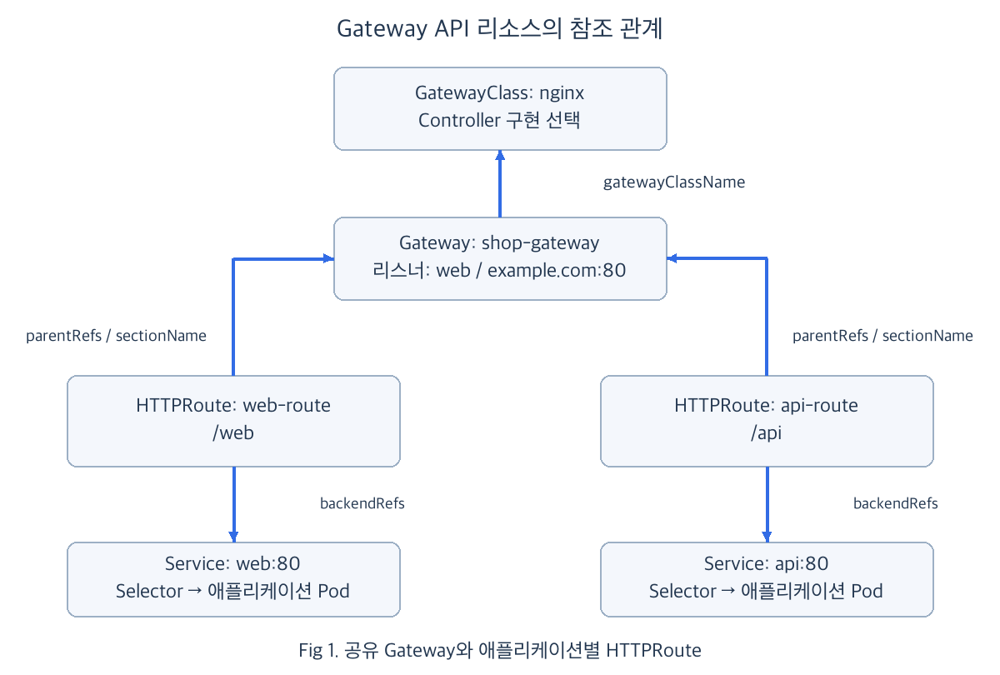
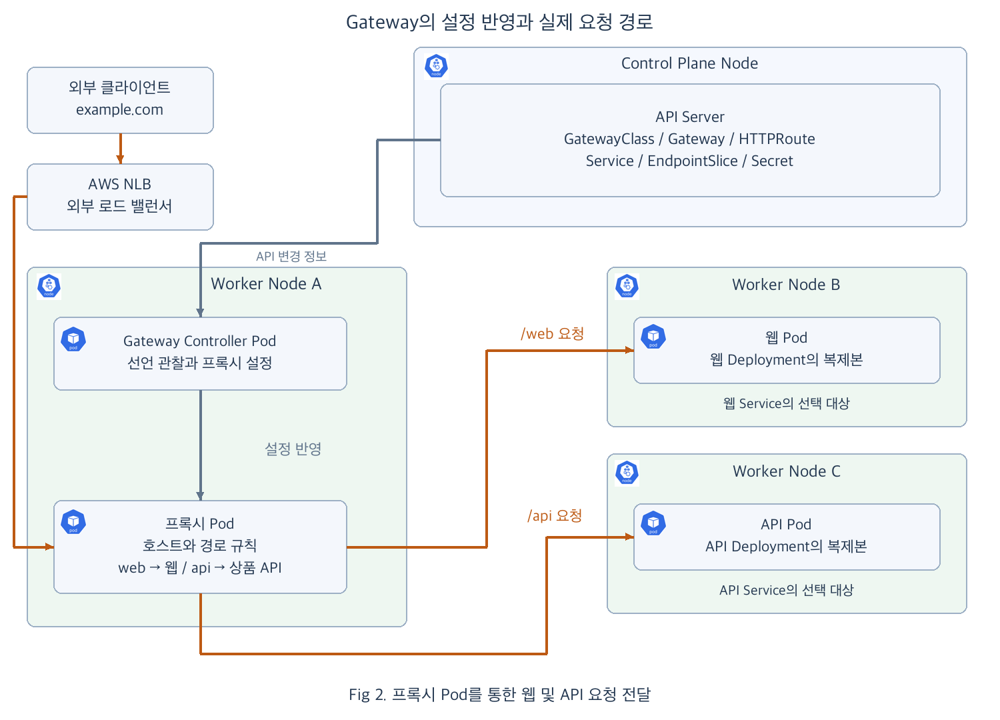

<!-- 16장 재편 이전의 상세 초안입니다. 본문의 장 번호와 예고는 당시 구성을 보존합니다. -->

# Chap08. Kubernetes API의 확장: CRD와 Gateway API

> 15주 연재의 여덟째 글입니다. CRD로 Kubernetes에 새로운 리소스 종류를 추가하는 방법을 이해하고, 그 사례로 Gateway API를 살펴봅니다. 이어서 기존 Ingress의 HTTPS 구성을 Gateway와 HTTPRoute로 나누어 선언하고 검증합니다.

## 들어가며

<div align="center">


</div>

7장에서는 하나의 사이트로 들어온 요청을 Ingress로 나누고 HTTPS 접속을 구성했습니다. 쇼핑몰의 `/web`은 웹 화면으로, `/api`는 상품 정보 API로 연결할 수 있게 되었습니다. 이제 웹 화면에 새 경로를 추가하거나 상품 API를 새 버전으로 바꾸더라도, 공통으로 사용하는 접속 주소와 인증서는 그대로 유지하고 싶습니다.

진입점을 설정하는 일과 애플리케이션의 요청 경로를 바꾸는 일을 별도로 관리하면 어떨까요? **Gateway API**는 이러한 설정을 여러 리소스로 나누어 연결하는 Kubernetes의 확장 API입니다. Gateway에 요청을 받을 진입점을 선언하고, HTTPRoute에 요청을 어느 Service로 보낼지 선언하면 하나의 진입점을 여러 경로가 공유할 수 있습니다. [[1]](#ref-1)

이번에도 `example.com`의 웹 화면과 상품 API를 예로 사용합니다. 익숙한 요청을 다른 방식으로 선언하면서, 그 설정을 읽는 프로그램과 실제 요청을 처리하는 프로그램이 어떻게 협력하는지 살펴보겠습니다.

## 1. 진입점과 요청 경로의 역할 분리

같은 주소에서 여러 애플리케이션을 제공하려면 공통으로 유지할 설정과 애플리케이션마다 바꿀 설정을 구분해야 합니다. HTTPS 포트와 인증서는 진입점에서 관리하고, `/web`과 `/api`의 전달 대상은 각 경로에서 관리하는 식입니다.

### 1.1 GatewayClass와 Gateway 및 HTTPRoute의 관계

Gateway API에서는 먼저 사용할 구현을 선택한 뒤, 진입점과 요청 경로를 연결합니다. Fig 1은 각 선언이 참조하는 대상을 보여 줍니다.

<div align="center">



</div>

- **GatewayClass**: Gateway를 처리할 Controller 구현을 지정합니다. Gateway가 이 클래스의 이름을 참조하면 해당 구현이 진입점을 구성합니다. [[2]](#ref-2)
- **Gateway**: 요청을 받을 포트와 프로토콜, 호스트 이름 등을 선언합니다. 이 접속 조건을 묶은 설정을 **리스너**(listener)라고 하며, HTTPS 리스너에는 인증서도 연결합니다. [[3]](#ref-3)
- **HTTPRoute**: 어느 Gateway의 리스너를 사용할지 정하고, 요청한 호스트와 경로에 따라 전달할 Service를 선언합니다. [[4]](#ref-4)

Fig 1에서 `web-route`와 `api-route`는 같은 `shop-gateway`를 참조합니다. 두 경로는 진입점을 공유하지만 각각 `web`과 `api` Service를 대상으로 삼습니다. 웹 화면의 경로를 바꿀 때는 `web-route`를 수정하고, 공통 접속 포트를 바꿀 때는 Gateway를 수정할 수 있습니다.

그림의 연결선은 리소스 사이의 참조 관계입니다. 이 선언을 실제 요청 처리로 연결하려면, 먼저 API Server가 새로운 리소스 종류를 다룰 수 있도록 준비해야 합니다.

### 1.2 Kubernetes API의 확장과 CRD

앞 장에서 사용한 Pod, Deployment, Service와 Ingress는 Kubernetes가 기본으로 제공하는 리소스입니다. API Server는 이 리소스들의 종류와 필드 구조를 알고 있어, 사용자가 제출한 매니페스트를 받아 저장할 수 있습니다. Gateway API의 리소스도 같은 방식으로 관리하려면 먼저 클러스터에 새로운 리소스 종류를 알려 주어야 합니다.

<div align="center">


</div>

이때 사용하는 것이 **CRD**(CustomResourceDefinition, 사용자 정의 리소스 정의)입니다. CRD에는 추가할 리소스의 이름과 API 버전, 사용할 필드의 구조 등을 선언합니다. 이를 등록하면 API Server가 그 종류의 리소스를 받아 저장하고 조회할 수 있게 됩니다. Gateway API는 GatewayClass, Gateway, HTTPRoute 등의 CRD를 제공하므로, 사용자는 이 정의들을 설치해 Kubernetes API를 확장합니다. [[5]](#ref-5)

<div align="center">


</div>

위 그림에서 퍼즐 구멍이 뚫린 설계판은 CRD가 정의하는 리소스의 구조를, 그 구멍에 맞는 블록은 정의된 형식에 따라 작성한 리소스를 나타냅니다. 사용자는 이 형식에 맞춰 필요한 설정을 선언합니다.

CRD로 등록한 종류에 맞춰 사용자가 생성한 개별 리소스는 **Custom Resource**(사용자 정의 리소스)라고 합니다. 예를 들어 Gateway의 CRD는 `Gateway`라는 종류를 정의하고, 뒤에서 만들 `shop-gateway`는 그 정의에 따라 HTTPS 포트와 인증서를 지정하는 실제 리소스입니다. 하나의 Gateway CRD를 등록한 클러스터에서 서로 다른 이름과 설정의 Gateway를 여러 개 만들 수 있습니다.

| 구분 | Gateway API에서의 역할 |
|---|---|
| CRD | `Gateway`라는 리소스 종류와 필드 구조를 API에 등록 |
| Custom Resource | `shop-gateway`처럼 사용할 진입점의 설정을 선언 |
| Controller | 저장된 선언을 읽어 프록시나 로드 밸런서에 반영 |

CRD 설치로 리소스를 저장할 수 있게 되었다면, 다음에는 그 설정을 실제 동작으로 구현할 프로그램이 필요합니다. Deployment의 선언을 컨트롤러가 읽어 Pod 관리로 이어 갔듯이, Gateway API에서도 별도의 Controller가 선언한 진입점과 요청 경로를 구성합니다.

### 1.3 선언을 실제 구성으로 바꾸는 Gateway Controller

**Gateway Controller**는 Gateway API 리소스를 관찰하고, 그 내용을 프록시나 로드 밸런서의 설정에 반영하는 프로그램입니다. GatewayClass의 `spec.controllerName`은 이 일을 담당할 구현을 식별합니다. 클래스 이름은 사용자가 Gateway에서 선택하는 이름이고, `controllerName`은 설치된 Controller가 자신이 처리할 클래스인지 판단하는 기준입니다. 이 구현이 GatewayClass, Gateway와 HTTPRoute를 함께 처리하며, 리소스마다 별도의 Controller를 사용자가 설치하는 구조는 아닙니다. [[2]](#ref-2)

이 글에서는 Controller와 요청 처리용 프록시를 각각 Pod로 실행하는 구성을 기준으로 살펴봅니다. 예를 들어 NGINX Gateway Fabric은 Gateway 선언에 따라 NGINX 실행용 Deployment와 Service를 만들고, 생성된 프록시에 설정을 전달합니다. 다른 구현은 클라우드 로드 밸런서를 직접 구성하거나 기존 장비의 설정을 바꾸기도 합니다. [[6]](#ref-6) [[3]](#ref-3)

따라서 Gateway와 HTTPRoute의 관계는 공통 API로 설명하고, Pod 생성과 외부 진입점의 구성은 선택한 Controller 구현에 맞춰 이해해야 합니다.

## 2. 하나의 Gateway와 두 애플리케이션 경로

먼저 `web`과 `api` Service가 각각 웹 화면과 상품 API의 Pod를 선택하고 있다고 가정하겠습니다. 두 Service의 접근 포트는 모두 80이며, 각 Pod 집합은 별도의 Deployment가 유지합니다. 이제 외부 요청을 받을 Gateway와 두 HTTPRoute를 연결합니다.

이 예시의 Gateway, HTTPRoute, Service와 인증서 Secret은 3장에서 살펴본 Namespace 중 기본 `default`에 함께 둡니다.

### 2.1 HTTP 진입점의 선언

여기서는 설치된 Controller가 수락한 GatewayClass의 이름을 `nginx`라고 하겠습니다. 이 클래스가 처리할 Gateway에 `example.com`의 HTTP 요청을 받을 리스너를 선언합니다.

```yaml
apiVersion: gateway.networking.k8s.io/v1
kind: Gateway
metadata:
  name: shop-gateway
spec:
  gatewayClassName: nginx
  listeners:
  - name: web
    protocol: HTTP
    port: 80
    hostname: example.com
    allowedRoutes:
      namespaces:
        from: Same
```

- `gatewayClassName`: 진입점을 구성할 구현을 GatewayClass 이름으로 선택합니다.
- `listeners`: `web`이라는 이름의 리스너에 호스트와 HTTP 수신 포트 80을 지정합니다.
- `allowedRoutes.namespaces.from: Same`: Gateway와 같은 Namespace에 있는 Route가 이 진입점에 연결될 수 있도록 합니다.

Gateway가 준비되면 이 리스너에 요청 경로를 붙일 수 있습니다. Gateway 쪽의 연결 허용 조건과 Route 쪽의 연결 대상이 함께 맞아야 합니다. [[3]](#ref-3) [[4]](#ref-4)

### 2.2 HTTPRoute의 Gateway 및 Service 참조

다음은 같은 진입점에 웹 화면과 상품 API의 경로를 각각 연결하는 선언입니다. 하나의 HTTPRoute에도 여러 경로 규칙을 둘 수 있지만, 여기서는 애플리케이션별로 경로를 관리하는 관계를 보여 주기 위해 두 리소스로 나눕니다. [[7]](#ref-7)

```yaml
apiVersion: gateway.networking.k8s.io/v1
kind: HTTPRoute
metadata:
  name: web-route
spec:
  parentRefs:
  - name: shop-gateway
    sectionName: web
  hostnames:
  - example.com
  rules:
  - matches:
    - path:
        type: PathPrefix
        value: /web
    backendRefs:
    - name: web
      port: 80
---
apiVersion: gateway.networking.k8s.io/v1
kind: HTTPRoute
metadata:
  name: api-route
spec:
  parentRefs:
  - name: shop-gateway
    sectionName: web
  hostnames:
  - example.com
  rules:
  - matches:
    - path:
        type: PathPrefix
        value: /api
    backendRefs:
    - name: api
      port: 80
```

- `parentRefs.name`과 `sectionName`: 두 Route를 `shop-gateway`의 `web` 리스너에 연결합니다.
- `hostnames`와 `matches.path`: `example.com`으로 들어온 요청을 `/web`과 `/api` 경로로 구분합니다.
- `backendRefs.name`과 `port`: 선택한 요청을 전달할 Service 이름과 **Service의 포트**를 지정합니다.

`/web/items` 요청은 `web` Service에, `/api/products` 요청은 `api` Service에 연결됩니다. 여기서는 요청 경로를 그대로 전달하므로 각 애플리케이션이 해당 경로를 처리합니다. `PathPrefix`는 경로 구간을 기준으로 비교하므로 `/web`과 `/web/items`는 일치하고 `/website`는 일치하지 않습니다. [[4]](#ref-4)

두 Route의 선언을 따로 저장해도 Controller는 같은 Gateway에 연결된 규칙을 모아 프록시를 구성합니다. 이 관계가 실제 실행 환경에 반영되는 과정을 살펴보겠습니다.

## 3. 선언에서 프록시 구성까지의 제어 흐름

매니페스트를 API Server에 저장한 뒤에는 여러 구성요소가 협력합니다. Gateway 설정의 반영, 프록시 Pod의 실행, 요청 대상 주소의 갱신은 서로 연결되어 있지만 각각 다른 주체가 담당합니다.

### 3.1 리소스 관찰과 프록시 실행

사용자가 `kubectl apply`로 Gateway와 HTTPRoute를 제출하면 API Server가 선언을 저장합니다. Gateway Controller는 API Server를 통해 자신이 담당할 GatewayClass와 Gateway, 연결된 Route의 변화를 확인합니다. GatewayClass를 Gateway가 참조하고, HTTPRoute가 다시 Gateway의 리스너를 참조하는 관계를 따라 설정을 모읍니다.

Gateway Controller는 리스너가 Route 연결을 허용하는지, 호스트 조건이 맞는지, 백엔드 Service와 포트가 존재하는지 확인합니다. 유효한 설정을 수락한 뒤 선택한 구현에 맞게 요청 처리 환경을 준비합니다. [[2]](#ref-2) [[4]](#ref-4)

프록시를 Deployment로 만드는 구성에서는 앞 장에서 배운 Pod 실행 과정이 다시 사용됩니다. 각 주체의 역할은 다음과 같습니다.

- **Gateway Controller**: API Server에 프록시용 Deployment와 진입용 Service를 생성하고, 프록시의 리스너와 요청 전달 설정을 관리합니다.
- **Deployment Controller와 ReplicaSet Controller**: 프록시 Deployment의 선언에 따라 ReplicaSet과 필요한 Pod를 생성하고 개수를 유지합니다.
- **Scheduler**: API에 등록된 새 Pod를 실행할 Node를 선택해 배정 결과를 기록합니다.
- **Kubelet과 컨테이너 런타임**: 해당 Node에 배정된 Pod를 확인하고 프록시 컨테이너를 실행합니다.

이때 각 Controller와 Scheduler는 API Server를 통해 상태를 확인하고 결과를 기록합니다. Kubelet도 API Server에서 자신의 Node에 배정된 Pod를 확인합니다. Gateway Controller가 만든 Deployment 선언이 기존 Pod 관리 과정을 통해 실행되는 것입니다. [[6]](#ref-6) [[8]](#ref-8)

프록시가 실행되면 Gateway Controller가 모은 리스너와 경로 설정을 적용합니다. NGINX Gateway Fabric에서는 프록시 Pod 안의 NGINX Agent가 설정을 받아 NGINX 프로세스에 반영합니다. 이러한 전달 방법은 구현에 따라 달라지며, 사용자 요청은 준비된 프록시가 처리합니다. [[6]](#ref-6)

### 3.2 백엔드 주소와 외부 진입점의 준비

프록시가 `/web`을 처리하려면 `web` Service가 선택한 Pod 중 어디에 연결할지 알아야 합니다. **EndpointSlice Controller**는 Service의 Selector와 Pod 상태를 관찰해 Pod 주소와 준비 상태를 EndpointSlice에 기록합니다. Gateway Controller는 API Server에서 이 정보를 읽어 프록시의 백엔드 목록에 반영할 수 있습니다. [[9]](#ref-9)

프록시가 준비된 Pod IP로 직접 연결하는 구현에서는 이 백엔드 목록으로 대상을 선택합니다. Service 가상 IP를 사용하는 구현이라면 **kube-proxy**가 Node 운영체제에 설정한 전달 규칙을 통해 Pod에 연결됩니다. Pod 사이의 실제 IP 통신은 클러스터 네트워크가 제공합니다. 어떤 경로를 사용하든 HTTPRoute의 `backendRefs`는 Service를 참조합니다. [[3]](#ref-3) [[10]](#ref-10)

외부 클라이언트가 프록시에 도달하려면 별도의 진입점도 준비되어야 합니다. 프록시 앞에 `LoadBalancer` Service를 두는 구성에서는 해당 Service를 담당하는 클라우드 연동 Controller가 외부 로드 밸런서를 구성합니다. AWS에서는 설치한 연동 방식에 따라 AWS Load Balancer Controller 같은 구현이 이 역할을 맡습니다. Gateway Controller가 HTTP 규칙을 구성하는 일과 외부 로드 밸런서 Controller가 진입점을 연결하는 일을 구분할 수 있습니다. [[11]](#ref-11)

이 과정에서 **진입용 Service는 프록시 Pod를 선택**하고, **백엔드 Service는 웹이나 API Pod를 선택**합니다. Fig 2는 AWS NLB를 통해 프록시 Pod에 들어온 요청을 애플리케이션 Pod로 직접 전달하는 구성을 보여 줍니다.

<div align="center">



</div>

Fig 2에서는 Gateway Controller Pod와 프록시 Pod를 Worker Node A에, 애플리케이션 Pod를 Worker Node B와 C에 배치했습니다. Node 위치는 실행 관계를 구분하기 위한 예시입니다. 회색 선은 설정 반영을, 주황색 선은 실제 요청 전달을 나타냅니다. Gateway와 HTTPRoute는 API에 저장된 선언이며, 주황색 경로에서 요청을 받아 처리하는 주체는 프록시와 애플리케이션입니다.

프록시 배치와 백엔드 정보 갱신, 외부 진입점 준비는 독립적으로 진행되면서 변경을 계속 반영합니다. 필요한 정보와 실행 환경이 갖춰지면 외부 주소로 요청을 받을 수 있습니다.

### 3.3 Controller의 처리 결과

Controller는 설정을 읽은 결과를 Gateway와 HTTPRoute의 `status`에 기록합니다. 이 정보로 선언의 수락과 프록시 구성의 진행 상태를 구분할 수 있습니다. [[3]](#ref-3) [[4]](#ref-4)

| 대상과 상태 조건 | 확인할 결과 |
|---|---|
| GatewayClass의 `Accepted` | 사용할 Controller가 클래스를 수락했는지 |
| Gateway의 `Accepted`와 `Programmed` | Gateway 구성을 수락하고 요청 처리 환경에 반영했는지 |
| HTTPRoute의 `Accepted` | 지정한 Gateway 리스너에 Route가 수락되었는지 |
| HTTPRoute의 `ResolvedRefs` | 참조한 Service와 포트 등을 유효하게 확인했는지 |

HTTPRoute의 상태는 연결한 부모별로 기록됩니다. 참조한 Service 이름이나 포트가 잘못되면 해당 Route의 상태에서 확인하고, 주소가 준비되지 않았다면 Gateway와 외부 진입점의 구성을 확인합니다. Controller의 설정 반영 결과를 확인한 뒤에는 실제 요청이 애플리케이션에 도달하는 흐름을 살펴볼 수 있습니다.

## 4. 외부 요청과 구성 변경의 처리 흐름

선언이 준비된 뒤에는 프록시가 설정된 규칙으로 요청을 처리합니다. 이 흐름을 실제 호출과, 호출 대상이 바뀌는 상황으로 나누어 보겠습니다.

### 4.1 주소 조회부터 애플리케이션 응답까지

외부 클라이언트가 `http://example.com/web/items`를 호출하면 먼저 DNS에서 `example.com`의 접속 주소를 알아냅니다. 도메인의 DNS 레코드는 준비된 외부 진입점을 가리키도록 설정해야 합니다. 여기서 조회하는 것은 외부에 공개한 도메인의 주소이며, 6장에서 설명한 CoreDNS의 클러스터 내부 Service 이름 조회와는 사용 위치가 다릅니다.

Fig 2에서 요청은 AWS NLB를 거쳐 프록시 Pod에 도달합니다. 그림은 NLB의 Pod IP 대상 방식을 사용하며, 프록시는 `example.com`의 `/web` 경로에 해당하는 규칙을 선택합니다. `/api/products`라면 같은 진입점에서 상품 API의 규칙을 선택합니다. [[11]](#ref-11)

프록시는 선택한 Service에 대응하는 준비된 Pod 중 하나에 요청을 전달합니다. 그림에서는 웹 Pod 또는 API Pod의 IP로 직접 연결합니다. 애플리케이션의 응답은 프록시가 받아 클라이언트에 돌려줍니다. API Server와 Gateway Controller는 이 요청마다 중간에서 전달하는 대신, 프록시가 사용할 설정을 유지합니다.

이처럼 **Gateway와 HTTPRoute의 선언은 요청 처리 전에 설정으로 반영되고, 실제 요청은 그 설정을 사용하는 프록시에서 처리됩니다.**

### 4.2 경로 변경과 Pod 교체의 반영

웹 화면에 `/shop`이라는 경로를 추가하려면 `web-route`의 조건을 수정합니다. Gateway Controller가 API의 변경을 확인해 프록시에 새 규칙을 반영하면 이후 요청부터 해당 경로를 사용할 수 있습니다. Gateway의 접속 주소나 리스너를 함께 바꾸지 않고 경로를 관리하는 것입니다.

반대로 경로는 그대로인데 웹 Pod가 교체되면 애플리케이션의 Deployment와 ReplicaSet이 새 Pod를 유지하고, Kubelet이 보고한 준비 상태가 EndpointSlice에 반영됩니다. Gateway Controller가 변경된 백엔드 정보를 프록시에 전달하면 새 연결의 대상으로 새 Pod를 사용할 수 있습니다. Service 가상 IP를 쓰는 구성에서는 kube-proxy가 그 뒤의 전달 규칙을 갱신합니다. [[9]](#ref-9) [[10]](#ref-10)

경로 변경은 HTTPRoute에서, Pod 교체는 백엔드 주소와 준비 상태에서 출발하지만 둘 다 실제 요청 처리 설정에 반영됩니다. 클라이언트는 같은 사이트 주소를 사용하면서 변경된 구성으로 요청을 보낼 수 있습니다.

## 5. HTTPS 진입점과 요청 비중의 확장

기본 요청 흐름이 연결되었으므로, 같은 진입점에 HTTPS를 적용하고 새 버전으로 보낼 요청의 비중도 조절해 보겠습니다.

### 5.1 Gateway의 TLS 인증서 연결

7장에서 준비한 `example-com-tls` Secret을 Gateway와 같은 Namespace에 둡니다. 앞의 `shop-gateway`를 다음과 같이 바꾸면 리스너가 443번 포트에서 HTTPS 연결을 받습니다. 리스너 이름 `web`은 유지하므로 두 HTTPRoute의 `sectionName`도 그대로 사용할 수 있습니다. [[12]](#ref-12)

```yaml
apiVersion: gateway.networking.k8s.io/v1
kind: Gateway
metadata:
  name: shop-gateway
spec:
  gatewayClassName: nginx
  listeners:
  - name: web
    protocol: HTTPS
    port: 443
    hostname: example.com
    tls:
      mode: Terminate
      certificateRefs:
      - kind: Secret
        name: example-com-tls
    allowedRoutes:
      namespaces:
        from: Same
```

- `protocol: HTTPS`와 `port: 443`: 암호화된 연결을 받을 진입점으로 바꿉니다.
- `tls.mode: Terminate`와 `certificateRefs`: 진입점에서 TLS를 종료하며 사용할 인증서 Secret을 연결합니다.

Gateway Controller는 Secret의 인증서와 개인 키를 읽어 프록시의 TLS 설정에 반영합니다. 외부 클라이언트가 HTTPS로 연결하면 프록시가 인증서를 제시하고 암호화된 연결을 수립합니다. 이후 복호화한 HTTP 요청의 호스트와 경로를 비교해 `web` 또는 `api`의 백엔드로 전달합니다. 이 예시의 프록시와 애플리케이션 사이에서는 HTTP를 사용합니다. [[12]](#ref-12)

인증서는 Gateway에서 공유하고 웹과 API의 경로는 HTTPRoute에서 따로 관리하므로, 요청 경로를 바꾸는 작업과 HTTPS 진입점을 관리하는 작업을 나눌 수 있습니다.

### 5.2 기존 버전과 새 버전의 요청 분배

웹 화면의 새 버전을 일부 요청으로 확인하고 싶다면 `web-v2` Service와 이를 위한 별도 Deployment를 준비할 수 있습니다. `web`은 기존 버전의 Pod만, `web-v2`는 새 버전의 Pod만 선택하도록 Label과 Selector를 구분합니다.

다음은 기존 `web-route`를 두 백엔드에 요청을 나누도록 바꾼 선언입니다. `api-route`는 그대로 유지합니다.

```yaml
apiVersion: gateway.networking.k8s.io/v1
kind: HTTPRoute
metadata:
  name: web-route
spec:
  parentRefs:
  - name: shop-gateway
    sectionName: web
  hostnames:
  - example.com
  rules:
  - matches:
    - path:
        type: PathPrefix
        value: /web
    backendRefs:
    - name: web
      port: 80
      weight: 90
    - name: web-v2
      port: 80
      weight: 10
```

- `backendRefs[].weight`: 같은 규칙에 연결된 백엔드 사이의 요청 비중을 정합니다. 여기서는 기존 버전과 새 버전의 상대 비중이 90 대 10입니다.

Controller가 이 선언을 반영하면 프록시는 `/web` 요청의 전달 대상을 두 Service의 비중에 따라 선택합니다. 충분한 요청에서 기존 버전 약 90%, 새 버전 약 10%를 기대할 수 있으며, 적은 요청 횟수에서는 비율이 달라질 수 있습니다. 여기서 가중치는 **Service 사이의 요청 비중**이고, 각 Service 뒤에서 실행할 Pod 개수는 해당 Deployment가 관리합니다. [[13]](#ref-13)

## 6. 문제 설명: 기존 Ingress의 HTTPS 구성 이전

진입점과 요청 경로를 나누는 방법을 익혔으므로, 이번에는 이미 운영 중인 설정에서 두 역할을 찾아 옮겨 보겠습니다. [Gateway API 실습 문제](../../Practice/Kubernetes/13.Gateway-API/Questions.bash)를 바탕으로, 기존 웹 애플리케이션은 유지하면서 Ingress의 HTTPS 구성을 Gateway와 HTTPRoute로 이전하는 과제입니다.

### 6.1 기존 환경과 이전 대상

실습 환경에는 `default` Namespace의 Ingress `web`, TLS Secret `web-tls`, Service `web-service`와 웹 Pod 두 개가 준비되어 있습니다. 기존 접속 호스트는 `gateway.web.k8s.local`이며, `/`로 들어온 요청은 `web-service`의 80번 포트로 전달됩니다. 사용할 GatewayClass 이름은 `nginx-class`입니다.

[환경 구성 파일](../../Practice/Kubernetes/13.Gateway-API/LabSetUp.bash)은 이 리소스들과 Gateway API CRD를 생성합니다. 다만 이 파일의 GatewayClass는 `example.net/nginx-gateway-controller`라는 예시 식별자만 선언하고, 실제 Gateway Controller를 설치하지 않습니다. 선언 구조를 연습한 뒤 HTTPS 응답까지 확인하려면, 설치된 Controller가 수락한 GatewayClass가 필요합니다. 아래 해설은 그 클래스가 `nginx-class`라는 이름으로 준비된 환경을 기준으로 합니다.

### 6.2 작성할 리소스와 완료 조건

다음 조건을 만족하는 두 매니페스트를 작성합니다.

- **Gateway `web-gateway`**: `nginx-class`를 사용하고, `gateway.web.k8s.local`의 HTTPS 요청을 443번 포트에서 받습니다. 기존 `web-tls` Secret으로 TLS를 종료합니다.
- **HTTPRoute `web-route`**: 위 Gateway의 HTTPS 리스너에 연결하고, 같은 호스트의 `/` 경로를 `web-service:80`으로 전달합니다.
- **유지할 대상**: 기존 Deployment, Service와 TLS Secret을 재사용하며, 새 진입점의 확인이 끝날 때까지 기존 Ingress를 유지합니다.

선언을 작성한 뒤에는 Gateway와 HTTPRoute의 연결 관계를 확인합니다. 실제 Controller와 외부 진입점이 준비된 환경에서는 상태 조건과 HTTPS 응답까지 확인해야 이전 결과를 판단할 수 있습니다.

## 7. 해설과 코드: HTTPS 진입점과 요청 경로의 분리

기존 설정에서 인증서와 접속 조건은 Gateway로, 요청 조건과 목적지는 HTTPRoute로 옮기면 됩니다. 먼저 이전할 값을 확인한 뒤 각각의 파일로 나누어 선언하겠습니다. 아래 명령 출력은 이해를 위한 예시이며, 실제 클러스터에서 수집한 결과가 아닙니다.

### 7.1 기존 설정과 Controller의 확인

기존 Ingress와 Service를 조회해 호스트, 인증서 이름, 목적지 포트를 확인합니다. Secret은 종류와 존재 여부를 확인하고, GatewayClass에서는 Controller의 수락 상태를 확인합니다.

```bash
kubectl get ingress web -n default -o yaml
kubectl get service web-service -n default
kubectl get secret web-tls -n default
kubectl get gatewayclass nginx-class
```

Ingress에서 옮길 핵심 값은 다음과 같습니다.

```yaml
spec:
  tls:
  - hosts:
    - gateway.web.k8s.local
    secretName: web-tls
  rules:
  - host: gateway.web.k8s.local
    http:
      paths:
      - path: /
        pathType: Prefix
        backend:
          service:
            name: web-service
            port:
              number: 80
```

- `tls.secretName`: Gateway에서 재사용할 인증서 Secret입니다.
- `rules.host`와 `paths`: HTTPRoute가 비교할 요청 조건입니다.
- `backend.service`: HTTPRoute에서 참조할 기존 Service와 포트입니다.

GatewayClass 조회 결과는 다음과 같이 읽습니다.

```text
NAME          CONTROLLER                                   ACCEPTED   AGE
nginx-class   gateway.nginx.org/nginx-gateway-controller     True       10m
```

- `ACCEPTED: True`: 해당 Controller가 클래스를 수락했습니다. 이 환경에서 Gateway 구성을 처리할 구현이 연결된 상태입니다.

클래스가 예시 식별자만 갖고 상태가 비어 있다면, 먼저 실제 Controller와 그 구현에 맞는 GatewayClass를 준비합니다. 설치된 클래스 이름이 다르면 아래 Gateway의 `gatewayClassName`에도 그 이름을 사용합니다.

### 7.2 Gateway의 HTTPS 설정

다음 내용을 `web-gateway.yaml`로 저장합니다. 기존 인증서는 유지하고, HTTPS 진입점만 별도의 리소스로 선언합니다.

```yaml
apiVersion: gateway.networking.k8s.io/v1
kind: Gateway
metadata:
  name: web-gateway
  namespace: default
spec:
  gatewayClassName: nginx-class
  listeners:
  - name: https
    protocol: HTTPS
    port: 443
    hostname: gateway.web.k8s.local
    tls:
      mode: Terminate
      certificateRefs:
      - kind: Secret
        name: web-tls
    allowedRoutes:
      namespaces:
        from: Same
```

- `gatewayClassName`: 앞에서 수락 상태를 확인한 구현을 선택합니다.
- `listeners`: `https` 리스너가 지정한 호스트의 443번 HTTPS 연결을 받습니다.
- `tls.certificateRefs`: 기존 `web-tls`를 연결하며, `Terminate` 설정에 따라 프록시가 TLS 연결을 종료합니다.
- `allowedRoutes`: 같은 Namespace의 HTTPRoute가 이 리스너를 사용하도록 합니다.

이제 인증서와 접속 포트는 Gateway가 관리합니다. 요청을 어느 애플리케이션으로 보낼지는 다음 HTTPRoute에서 연결합니다.

### 7.3 HTTPRoute의 요청 조건과 백엔드 연결

다음 내용을 `web-route.yaml`로 저장합니다. `parentRefs`는 방금 선언한 리스너를, `backendRefs`는 기존 Service를 가리킵니다.

```yaml
apiVersion: gateway.networking.k8s.io/v1
kind: HTTPRoute
metadata:
  name: web-route
  namespace: default
spec:
  parentRefs:
  - name: web-gateway
    sectionName: https
  hostnames:
  - gateway.web.k8s.local
  rules:
  - matches:
    - path:
        type: PathPrefix
        value: /
    backendRefs:
    - name: web-service
      port: 80
```

- `parentRefs`: `web-gateway`의 `https` 리스너에 요청 규칙을 연결합니다.
- `hostnames`와 `matches.path`: 기존 호스트와 `/` 접두 경로를 유지합니다.
- `backendRefs`: 기존 `web-service`의 80번 포트를 목적지로 지정합니다.

[원본 해설](../../Practice/Kubernetes/13.Gateway-API/SolutionNotes.bash)도 이 두 리소스로 HTTPS와 기본 경로를 이전합니다. 다만 환경 구성 파일의 기존 Ingress에는 `rewrite-target: /`도 있습니다. 위 HTTPRoute는 요청 경로를 그대로 전달하므로 `/` 호출은 같아도 `/items` 같은 하위 경로의 동작은 달라질 수 있습니다.

기존처럼 모든 일치 경로를 `/`로 바꾸어 보내야 한다면, 아래 `filters`를 같은 규칙의 `matches`와 `backendRefs` 사이에 추가합니다. 이 기능은 사용하는 Controller의 경로 재작성 지원을 확인한 뒤 적용합니다. [[14]](#ref-14)

```yaml
    filters:
    - type: URLRewrite
      urlRewrite:
        path:
          type: ReplaceFullPath
          replaceFullPath: /
```

- `ReplaceFullPath`와 `replaceFullPath`: 백엔드에 전달할 전체 경로를 `/`로 바꿉니다.

이렇게 요청 조건뿐 아니라 기존 설정이 경로를 바꾸던 동작까지 확인해야 애플리케이션의 응답을 유지할 수 있습니다.

### 7.4 선언 적용과 상태 확인

두 파일을 적용하면 Controller가 Gateway의 접속 조건과 HTTPRoute의 규칙을 읽어 프록시를 구성합니다.

```bash
kubectl apply -f web-gateway.yaml -f web-route.yaml
kubectl wait --for=condition=Programmed gateway/web-gateway -n default --timeout=180s
kubectl describe gateway web-gateway -n default
kubectl describe httproute web-route -n default
```

```text
gateway.gateway.networking.k8s.io/web-gateway created
httproute.gateway.networking.k8s.io/web-route created
gateway.gateway.networking.k8s.io/web-gateway condition met
```

`describe`에서는 Gateway의 `Accepted`와 `Programmed`, `https` 리스너의 `ResolvedRefs`, HTTPRoute의 부모별 `Accepted`와 `ResolvedRefs`가 `True`인지 확인합니다. 각각 선언의 수락, 실행 구성 반영, 인증서나 백엔드 참조의 유효성을 판단하는 근거입니다. 상태가 `False`라면 같은 조건의 `Reason`과 `Message`에서 원인을 좁힙니다.

예를 들어 HTTPRoute에서 `ResolvedRefs=False`와 `BackendNotFound`가 보이면 `backendRefs`의 Service 이름과 Namespace부터 확인합니다. 대기 명령이 시간 초과되면 GatewayClass 수락 상태와 Gateway의 조건을 확인해 Controller 처리와 외부 진입점 준비 중 어느 부분이 지연되는지 살펴봅니다.

### 7.5 새 진입점의 HTTPS 응답 확인

Controller가 구성을 반영했다면 새 진입점으로 요청을 보내 봅니다. 아래 명령은 Gateway가 클라이언트에서 접근 가능한 443번 포트의 주소를 제공하는 환경을 기준으로 합니다. 주소는 IP 또는 로드 밸런서의 DNS 이름일 수 있습니다.

```bash
kubectl get gateway web-gateway -n default -o wide
CH08_GATEWAY_ADDR=$(kubectl get gateway web-gateway -n default \
  -o jsonpath='{.status.addresses[0].value}')
curl -k -sS -o /dev/null -w '%{http_code}\n' \
  --connect-to "gateway.web.k8s.local:443:${CH08_GATEWAY_ADDR}:443" \
  https://gateway.web.k8s.local/
```

```text
200
```

- `200`: 새 진입점을 통해 애플리케이션의 정상 HTTP 응답을 받았습니다.

`--connect-to`는 DNS를 바꾸기 전에 새 주소로 접속하면서 요청의 호스트와 TLS 서버 이름을 유지합니다. 이 실습의 `-k`는 자체 서명 인증서의 검증을 생략하므로, 위 결과로 확인하는 범위는 HTTPS 연결과 요청 전달입니다. 운영 전환 전에는 접속 호스트가 SAN에 포함된 유효한 인증서와 신뢰 체인을 준비하고 `-k` 없이도 성공하는지 확인합니다. 원본 환경 구성 파일은 CN만 지정한 자체 서명 인증서를 생성하므로 이 검증용 인증서도 별도로 준비해야 합니다.

경로 재작성을 유지했다면 `/items` 같은 하위 경로도 호출해 이전과 같은 응답을 받는지 비교합니다. Gateway 주소가 비어 있으면 Controller와 진입용 Service 상태를 먼저 확인하고, NodePort로 노출한 환경에서는 실제 HTTPS NodePort를 접속 대상 포트로 사용합니다.

정상 응답과 인증서 검증이 끝나면 도메인의 접속 대상을 새 진입점으로 전환하고, 확인을 마친 뒤 기존 Ingress를 정리합니다. 이 과정에서 웹 Pod와 Service는 유지되고, 외부 요청을 받는 구성만 Gateway API로 바뀝니다.

## 다음 글로 넘어가기 전에

이번 글에서 다룬 내용은 이렇습니다. GatewayClass로 사용할 구현을 선택하고, Gateway로 공통 진입점을 선언하며, HTTPRoute로 각 애플리케이션의 요청 경로를 연결합니다. Gateway Controller는 이 선언과 백엔드 정보를 읽어 프록시를 구성하고, 실제 외부 요청은 프록시가 규칙에 맞춰 Pod로 전달합니다.

프록시 Pod를 실행하는 과정에는 Deployment와 ReplicaSet, Scheduler와 Kubelet이 참여합니다. EndpointSlice Controller는 연결 대상의 주소와 준비 상태를 갱신하고, 외부 로드 밸런서를 사용하는 환경에서는 해당 연동 Controller가 진입점을 준비합니다. 이렇게 구성된 진입점을 유지하면서 인증서와 애플리케이션 경로, 새 버전으로 보낼 요청 비중을 각각 관리할 수 있습니다.

실습에서는 기존 Ingress의 인증서와 요청 경로를 분리해 선언하고, Controller의 처리 결과와 실제 HTTPS 응답을 차례로 확인했습니다. 다음 글에서는 중요한 애플리케이션에 필요한 실행 환경을 확보하도록 Pod의 배치 조건을 정하는 방법을 살펴봅니다.

## 참고문헌

- <a id="ref-1"></a>[1] [Kubernetes 공식 문서: Gateway API](https://kubernetes.io/docs/concepts/services-networking/gateway/)
- <a id="ref-2"></a>[2] [Gateway API 공식 문서: GatewayClass](https://gateway-api.sigs.k8s.io/reference/api-types/gatewayclass/)
- <a id="ref-3"></a>[3] [Gateway API 공식 문서: Gateway](https://gateway-api.sigs.k8s.io/reference/api-types/gateway/)
- <a id="ref-4"></a>[4] [Gateway API 공식 문서: HTTPRoute](https://gateway-api.sigs.k8s.io/reference/api-types/httproute/)
- <a id="ref-5"></a>[5] [Kubernetes 공식 문서: 사용자 정의 리소스와 CRD](https://kubernetes.io/docs/concepts/extend-kubernetes/api-extension/custom-resources/)
- <a id="ref-6"></a>[6] [NGINX Gateway Fabric 공식 문서: Controller와 프록시 구조](https://docs.nginx.com/nginx-gateway-fabric/overview/gateway-architecture/)
- <a id="ref-7"></a>[7] [Gateway API 공식 문서: HTTP 요청 라우팅](https://gateway-api.sigs.k8s.io/guides/user-guides/http-routing/)
- <a id="ref-8"></a>[8] [Kubernetes 공식 문서: 클러스터 구성요소](https://kubernetes.io/docs/concepts/overview/components/)
- <a id="ref-9"></a>[9] [Kubernetes 공식 문서: EndpointSlice](https://kubernetes.io/docs/concepts/services-networking/endpoint-slices/)
- <a id="ref-10"></a>[10] [Kubernetes 공식 문서: Service 가상 IP와 프록시](https://kubernetes.io/docs/reference/networking/virtual-ips/)
- <a id="ref-11"></a>[11] [AWS Load Balancer Controller 공식 문서: NLB](https://kubernetes-sigs.github.io/aws-load-balancer-controller/latest/guide/service/nlb/)
- <a id="ref-12"></a>[12] [Gateway API 공식 문서: TLS 설정](https://gateway-api.sigs.k8s.io/guides/user-guides/tls/)
- <a id="ref-13"></a>[13] [Gateway API 공식 문서: 요청 비중 분배](https://gateway-api.sigs.k8s.io/guides/user-guides/traffic-splitting/)
- <a id="ref-14"></a>[14] [Gateway API 공식 문서: HTTP 경로 재작성](https://gateway-api.sigs.k8s.io/guides/user-guides/http-redirect-rewrite/)
