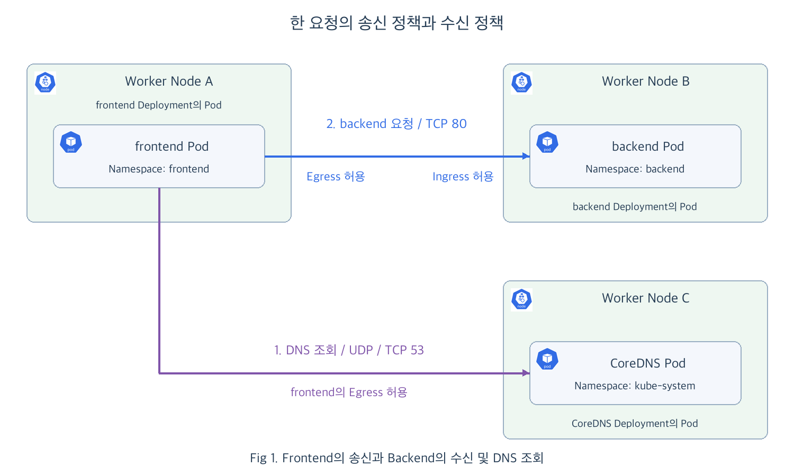

<!-- 16장 재편 이전의 상세 초안입니다. 본문의 장 번호와 예고는 당시 구성을 보존합니다. -->

# Chap10. NetworkPolicy와 Pod 통신 정책

> 15주 연재의 열째 글입니다. NetworkPolicy로 Pod에 들어오는 요청과 밖으로 나가는 통신을 제한합니다. frontend와 backend의 통신을 예로, 필요한 상대와 포트만 허용하는 정책이 실제 요청에 어떻게 적용되는지 살펴봅니다. 이어서 실습의 후보 정책을 비교하고, 수신과 송신을 제한하는 설정과 확인 코드를 작성합니다.

## 들어가며

<div align="center">


</div>

9장에서는 Taint와 Toleration으로 Pod가 배정될 수 있는 Node의 조건을 정했습니다. 이제 웹 화면을 만드는 frontend와 상품 정보를 제공하는 backend를 서로 다른 Namespace에서 운영한다고 가정해 보겠습니다. frontend는 backend를 호출해야 하지만, 관계없는 테스트 Pod까지 backend에 요청할 필요는 없습니다.

반대 방향도 생각할 수 있습니다. frontend가 필요한 상품 API와 DNS 서버에는 연결하되, 그 밖의 내부 시스템이나 외부 서버에는 임의로 연결하지 않게 하고 싶습니다. 관리 범위와 실행 위치를 나누는 것에 더해, 애플리케이션 사이에서 허용할 통신을 정할 차례입니다.

**NetworkPolicy**는 선택한 Pod가 어떤 상대와 어떤 포트로 통신할 수 있는지 선언하는 Kubernetes 리소스입니다. 이 글에서는 backend가 받을 요청을 제한한 뒤, frontend가 보낼 통신을 제한하면서 하나의 호출에 양쪽 정책이 어떻게 적용되는지 살펴보겠습니다. [[1]](#ref-1)

## 1. Pod 통신과 정책의 적용 방향

<div align="center">


</div>

Service가 backend의 접속 주소를 제공하면 frontend는 그 주소로 요청할 수 있습니다. 여기에 NetworkPolicy를 적용하면 요청을 받을 Pod와 보낼 Pod 각각에서 통신 범위를 정할 수 있습니다.

### 1.1 통신 예시와 Namespace의 관계

다음 세 Pod 집합이 각 Deployment를 통해 실행 중이라고 가정합니다. backend 애플리케이션은 TCP 80번 포트에서 요청을 받고, `backend-service`가 해당 Pod를 선택합니다.

| Namespace | Pod Label | 역할 |
|---|---|---|
| frontend | `app: frontend` | 상품 정보를 호출하는 웹 애플리케이션 |
| backend | `app: backend` | 상품 정보를 제공하는 API |
| tools | `app: test` | 상품 API에 접근할 필요가 없는 테스트 앱 |

frontend는 `http://backend-service.backend`로 상품 정보를 요청합니다. Namespace가 다르더라도 네트워크 경로가 있고 다른 제한이 없다면 통신할 수 있습니다. NetworkPolicy가 해당 Pod의 통신 방향을 제한하기 전에는, 그 방향의 통신을 NetworkPolicy로 차단하지 않습니다. [[1]](#ref-1)

원하는 상태는 frontend의 요청만 backend가 받는 것입니다. 어느 쪽 Pod에 어떤 방향의 정책을 적용할지부터 구분해 보겠습니다.

### 1.2 Ingress와 Egress의 구분

NetworkPolicy에서 **Ingress**는 선택한 Pod로 들어오는 통신이고, **Egress**는 선택한 Pod에서 시작하는 바깥 방향의 통신입니다. 여기서 Ingress는 수신 방향을 뜻하며, 7장에서 다룬 웹 요청 라우팅용 Ingress 리소스와 구분합니다.

<div align="center">



</div>

Fig 1에서 frontend가 backend에 요청하면 보내는 쪽에서는 Egress, 받는 쪽에서는 Ingress에 해당합니다. 둘은 같은 요청을 서로 다른 Pod의 관점에서 본 방향입니다. 먼저 backend에 수신 정책을 적용하고, 이후 frontend에 송신 정책을 추가하겠습니다.

### 1.3 선언과 실제 통신 제한의 연결

NetworkPolicy를 API Server에 저장하면 정책을 지원하는 네트워크 구성요소가 Pod와 Namespace의 Label, 정책의 변경을 확인해 통신 규칙을 반영합니다. 실제 패킷의 허용과 차단은 이 규칙을 적용하는 네트워크 구성요소가 수행합니다. 따라서 사용 중인 네트워크 플러그인에 NetworkPolicy 지원과 필요한 기능 설정이 갖춰져 있어야 합니다. [[1]](#ref-1)

이 과정에서도 선언을 저장하는 API Server와 실제 요청을 전달하거나 차단하는 주체가 나뉩니다. 정책이 반영된 뒤에는 설정한 상대와 포트 조건에 따라 Pod 통신이 허용됩니다.

## 2. Backend의 Ingress 제한

backend가 받을 요청을 정하려면 먼저 정책의 대상 Pod를 선택해야 합니다. 이후 그 Pod에 들어올 수 있는 출처와 목적지 포트를 선언합니다.

### 2.1 수신을 제한하는 기본 정책

다음 정책은 `backend` Namespace의 모든 Pod를 대상으로 Ingress를 제한하고, 아직 허용할 출처는 두지 않습니다.

```yaml
apiVersion: networking.k8s.io/v1
kind: NetworkPolicy
metadata:
  name: backend-default-deny
  namespace: backend
spec:
  podSelector: {}
  policyTypes:
  - Ingress
  ingress: []
```

- `metadata.namespace`와 `podSelector: {}`: backend Namespace의 모든 Pod를 정책 대상으로 선택합니다.
- `policyTypes: [Ingress]`와 `ingress: []`: 수신 방향을 제한하고 허용 규칙은 비워 둡니다.

다른 수신 허용 정책이 없는 상태라면 frontend와 tools Pod 모두 backend에 새 연결을 시작할 수 없습니다. 여기서 정책 대상은 **backend Pod**이며, 이 선언으로 frontend의 송신 방향까지 제한하는 것은 아닙니다. [[2]](#ref-2)

이 상태를 기준으로 필요한 통신만 추가해 보겠습니다.

### 2.2 Frontend의 요청만 허용하는 정책

다음 정책을 함께 적용하면 `frontend` Namespace에 있으면서 `app: frontend` Label이 붙은 Pod에서 backend의 TCP 80번 포트로 연결할 수 있습니다.

```yaml
apiVersion: networking.k8s.io/v1
kind: NetworkPolicy
metadata:
  name: backend-allow-frontend
  namespace: backend
spec:
  podSelector:
    matchLabels:
      app: backend
  policyTypes:
  - Ingress
  ingress:
  - from:
    - namespaceSelector:
        matchLabels:
          kubernetes.io/metadata.name: frontend
      podSelector:
        matchLabels:
          app: frontend
    ports:
    - protocol: TCP
      port: 80
```

- `spec.podSelector`: 수신 정책을 적용할 backend Pod를 선택합니다.
- `from`의 두 Selector: 같은 항목 안에서 Namespace와 Pod Label 조건을 함께 만족하는 출처를 선택합니다.
- `ports`: 선택한 출처가 backend의 TCP 80번 포트로 연결하도록 허용합니다.

`kubernetes.io/metadata.name`은 Kubernetes가 Namespace에 붙이는 이름 Label입니다. 따라서 Namespace 이름이 `frontend`인 범위를 선택할 때 별도의 `name: frontend` Label을 추가할 필요가 없습니다. 이 범위 안에서 다시 Pod의 `app: frontend` 조건을 확인합니다. [[1]](#ref-1) [[3]](#ref-3)

`backend-default-deny`는 기본적으로 비워 둔 허용 범위를 제공하고, `backend-allow-frontend`는 필요한 허용 경로를 추가합니다. 두 정책은 적용 순서로 덮어쓰지 않고 **허용한 통신을 합칩니다.** 나중에 더 넓은 허용 정책을 추가하면 접근할 수 있는 출처도 넓어집니다. [[1]](#ref-1)

### 2.3 Namespace와 Pod 조건의 조합

앞의 `namespaceSelector`와 `podSelector`는 한 출처 항목 안에 있으므로 두 조건을 동시에 만족해야 합니다. 들여쓰기를 바꾸어 별도의 항목으로 나누면 허용 범위가 달라집니다. [[3]](#ref-3)

| from 안의 구성 | 허용되는 출처 |
|---|---|
| 같은 항목에 Namespace와 Pod Selector | frontend Namespace의 app=frontend Pod |
| 서로 다른 항목에 두 Selector | frontend Namespace의 모든 Pod 또는 정책과 같은 backend Namespace의 app=frontend Pod |

제공된 NetworkPolicy 실습의 세 번째 후보는 두 Selector가 별도 항목인 형태입니다. 본문의 정책은 “frontend 애플리케이션만 호출”이라는 목적에 맞춰 한 항목으로 묶었습니다. Namespace의 이름 Label도 자동으로 존재하는 키를 사용했습니다. [[4]](#ref-4)

이렇게 출처와 수신 포트를 제한해도 frontend가 다른 곳으로 보내는 통신은 아직 별도입니다. 이제 요청을 보내는 쪽에서 목적지를 제한해 보겠습니다.

## 3. Frontend의 Egress와 DNS 허용

frontend는 backend를 호출하기 전에 Service 이름으로 접속 주소를 알아내야 합니다. 따라서 송신 정책에는 **backend 요청과 DNS 조회**라는 두 통신이 필요합니다.

### 3.1 Backend와 DNS 서버의 목적지 선언

다음 정책은 frontend의 송신 대상을 backend의 TCP 80번 포트와 클러스터 DNS 서버로 제한합니다. DNS는 `kube-system` Namespace에서 `k8s-app: kube-dns` Label을 가진 CoreDNS Pod가 처리하는 구성을 가정합니다.

```yaml
apiVersion: networking.k8s.io/v1
kind: NetworkPolicy
metadata:
  name: frontend-egress
  namespace: frontend
spec:
  podSelector:
    matchLabels:
      app: frontend
  policyTypes:
  - Egress
  egress:
  - to:
    - namespaceSelector:
        matchLabels:
          kubernetes.io/metadata.name: backend
      podSelector:
        matchLabels:
          app: backend
    ports:
    - protocol: TCP
      port: 80
  - to:
    - namespaceSelector:
        matchLabels:
          kubernetes.io/metadata.name: kube-system
      podSelector:
        matchLabels:
          k8s-app: kube-dns
    ports:
    - protocol: UDP
      port: 53
    - protocol: TCP
      port: 53
```

- `policyTypes: [Egress]`: 선택한 frontend Pod에서 시작하는 송신 통신을 제한합니다.
- 첫 번째 `to`와 `ports`: backend Namespace의 backend Pod에 TCP 80번 포트로 연결하도록 허용합니다.
- 두 번째 `to`와 `ports`: DNS Pod에 UDP와 TCP 53번 포트로 조회하도록 허용합니다.

이 정책은 `app: frontend` Pod의 송신 방향을 선택하고 필요한 목적지만 나열합니다. 별도의 기본 송신 차단 정책 없이도, 다른 송신 허용 정책이 없다면 나열한 범위만 사용할 수 있습니다. [[3]](#ref-3)

DNS 조회에는 UDP뿐 아니라 TCP도 사용될 수 있습니다. 여기서는 두 프로토콜을 모두 허용합니다. NodeLocal DNS처럼 Pod가 Node의 로컬 DNS 주소를 사용하는 환경은 조회 경로가 달라지므로, 실제 DNS 목적지와 네트워크 구현에 맞춘 정책이 필요합니다. [[5]](#ref-5)

### 3.2 DNS 조회와 애플리케이션 요청의 순서

Fig 1에서 frontend가 `backend-service.backend`로 요청하면 먼저 DNS 조회를 보냅니다. 송신 정책의 DNS 허용 규칙을 통해 접속 주소를 알아낸 뒤, 그 주소로 backend에 연결합니다. 이때 목적지 Pod와 포트에 맞는 backend 허용 규칙이 적용됩니다.

Service의 이름 조회와 Pod로의 전달 경로는 6장에서 배운 방식입니다. NetworkPolicy는 그 통신에서 허용할 Pod와 포트를 정합니다. 이 예시에서는 Service 포트와 실제 backend 수신 포트를 모두 80으로 맞췄습니다.

DNS 규칙이 빠지면 backend에 대한 송신 허용이 있어도 이름으로 주소를 알아내는 단계에서 실패할 수 있습니다. 반대로 DNS 조회가 성공해도 backend로 연결할 송신 규칙이나 backend의 수신 규칙이 맞지 않으면 애플리케이션 요청은 통과하지 못합니다.

## 4. 양방향 정책과 요청 결과

지금까지 backend의 Ingress와 frontend의 Egress를 각각 선언했습니다. 두 정책이 반영된 상태에서 하나의 호출이 허용되려면 보내는 쪽과 받는 쪽 조건을 모두 만족해야 합니다. [[1]](#ref-1)

### 4.1 송신과 수신 조건의 결합

frontend가 backend의 TCP 80번 포트로 요청하는 상황을 비교해 보겠습니다.

| frontend의 송신 조건 | backend의 수신 조건 | 새 연결 |
|---|---|---|
| 해당 통신 허용 | 해당 통신 허용 | 허용 |
| 해당 통신 허용 | 해당 출처 미허용 | 차단 |
| 해당 목적지 미허용 | 해당 통신 허용 | 차단 |

한쪽 방향에 해당 Pod를 선택하는 제한 정책이 없다면 그 방향은 NetworkPolicy로 제한하지 않습니다. 제한 정책을 적용한 쪽에서는 허용 규칙과 일치해야 합니다.

허용된 연결에 대한 응답은 함께 허용됩니다. frontend가 시작한 요청에 backend가 응답하는 것과, backend가 별도의 새 연결을 시작하는 것은 구분합니다. 응답을 받기 위해 같은 연결의 반대 방향 정책을 다시 나열할 필요는 없습니다. [[1]](#ref-1)

### 4.2 정책 적용 전후의 요청 비교

네트워크와 앱이 정상이고 본문 외의 정책이 없는 상황에서, 새 연결의 결과는 다음과 같습니다. DNS 서버에는 조회를 막는 별도 수신 정책이 없다고 가정합니다.

| 적용 상태 | frontend → backend:80 | tools → backend:80 | frontend → 그 밖의 외부 서버 |
|---|---|---|---|
| 정책 적용 전 | 허용 | 허용 | 경로가 있으면 허용 |
| backend 기본 수신 차단 | 차단 | 차단 | 경로가 있으면 허용 |
| frontend 출처 수신 허용 추가 | 허용 | 차단 | 경로가 있으면 허용 |
| frontend 송신 정책 추가 | DNS 조회 후 허용 | 차단 | 허용 목적지에 없어 차단 |

이 차이를 직접 확인하려면 허용할 요청뿐 아니라 차단할 요청도 준비해야 합니다. 다음 문제에서는 같은 Service를 여러 출처에서 호출하고, 정책을 추가할 때마다 결과를 비교합니다.

## 5. 문제: 필요한 Pod 통신만 허용하는 정책

`Practice/Kubernetes/11.Network-Policy` 실습은 frontend가 backend를 호출할 수 있도록 세 후보 중 가장 제한적인 정책을 고르는 문제입니다. 여기서는 후보의 실제 허용 범위를 확인한 뒤, 앞에서 배운 Egress까지 적용해 통신을 완성합니다. [[4]](#ref-4)

### 5.1 기존 구성과 목표

`frontend` Namespace에는 `app: frontend`인 `frontend-deployment`가 있고, `backend` Namespace에는 `app: backend`인 `backend-deployment`와 `backend-service`가 있습니다. backend는 nginx로 HTTP 80번 포트의 응답을 제공하고, frontend는 curl로 이를 호출합니다.

목표는 다음과 같습니다.

- backend의 TCP 80번 포트에는 **frontend Namespace의 app=frontend Pod**만 접근할 수 있습니다.
- 같은 Namespace라도 다른 Label인 Pod와, 같은 Label이라도 다른 Namespace인 Pod는 backend에 접근할 수 없습니다.
- frontend의 송신은 backend의 TCP 80번 포트와 DNS 조회에 필요한 통신만 허용합니다.

정책을 적용하기 전에는 테스트 요청이 성공해야 합니다. 그래야 정책을 적용한 뒤 발생한 차단을 애플리케이션이나 Service의 문제와 구분할 수 있습니다.

### 5.2 세 후보의 허용 범위

실습의 `network-policy-1.yaml`부터 `network-policy-3.yaml`을 비교합니다. 각 파일의 핵심 조건은 다음과 같습니다.

| 후보 | 정책 대상과 허용 조건 | 검토할 부분 |
|---|---|---|
| `policy-x` | backend의 모든 Pod에 `ingress: [{}]` | 출처와 포트 제한 없이 수신 허용 |
| `policy-y` | backend Pod에 `name: frontend` Namespace 또는 `172.16.0.0/16` 출처의 TCP 80 허용 | 추가 IP 대역까지 허용 |
| `policy-z` | backend Pod에 `name: frontend` Namespace 또는 같은 Namespace의 `app: frontend` Pod 허용 | Namespace와 Pod 조건이 별개 항목 |

세 번째 후보를 그대로 적용하면 목표를 만족할까요? `from` 안의 하이픈 위치와 실제 Namespace Label을 함께 확인해야 합니다. 또한 원본 설치 스크립트는 Namespace를 만들지만 `name: frontend` Label을 추가하지 않습니다. 이 조건까지 반영해 올바른 정책을 작성하고, DNS를 유지하는 송신 정책을 추가하는 것이 이번 문제입니다.

## 6. 해설과 코드: 수신 제한부터 송신 확인까지

먼저 통신 가능한 상태를 만들고, backend 수신 차단과 필요한 출처 허용을 차례로 적용합니다. 마지막으로 frontend의 송신을 제한하면 어느 쪽 정책 때문에 요청 결과가 달라지는지 구분할 수 있습니다.

### 6.1 애플리케이션과 비교 요청 준비

NetworkPolicy를 지원하고 기능이 활성화된 네트워크 플러그인이 있는 별도 학습 클러스터를 사용합니다. 기존 정책의 허용 규칙이 결과에 합쳐지지 않도록 `frontend`, `backend`, `tools` Namespace가 없는 환경에서 시작합니다. 아래 코드는 원본 실습의 Deployment와 Service를 구성하고 비교용 Pod를 추가합니다.

두 애플리케이션과 backend의 Service를 `network-apps.yaml`로 저장합니다.

```yaml
apiVersion: apps/v1
kind: Deployment
metadata:
  name: backend-deployment
  namespace: backend
spec:
  replicas: 1
  selector:
    matchLabels:
      app: backend
  template:
    metadata:
      labels:
        app: backend
    spec:
      containers:
      - name: backend
        image: nginx
        ports:
        - containerPort: 80
---
apiVersion: v1
kind: Service
metadata:
  name: backend-service
  namespace: backend
spec:
  selector:
    app: backend
  ports:
  - port: 80
    targetPort: 80
---
apiVersion: apps/v1
kind: Deployment
metadata:
  name: frontend-deployment
  namespace: frontend
spec:
  replicas: 1
  selector:
    matchLabels:
      app: frontend
  template:
    metadata:
      labels:
        app: frontend
    spec:
      containers:
      - name: frontend
        image: curlimages/curl
        command: ["sleep", "86400"]
```

- 각 Pod 템플릿의 `app` Label: NetworkPolicy가 선택할 애플리케이션을 구분합니다.
- Service의 `selector: {app: backend}`: TCP 80번 요청을 backend Pod로 전달합니다.

Namespace와 애플리케이션을 만든 뒤, 허용 조건을 일부만 만족하는 비교용 Pod와 별도 웹 서버를 추가합니다.

```bash
kubectl create namespace frontend
kubectl create namespace backend
kubectl create namespace tools
kubectl apply -f network-apps.yaml

kubectl run other-client -n frontend --image=curlimages/curl \
  --labels=app=other --command -- sleep 86400
kubectl run same-label-client -n tools --image=curlimages/curl \
  --labels=app=frontend --command -- sleep 86400

kubectl create deployment other-web -n tools --image=nginx
kubectl expose deployment other-web -n tools --port=80
kubectl rollout status deployment/backend-deployment -n backend
kubectl rollout status deployment/frontend-deployment -n frontend
kubectl rollout status deployment/other-web -n tools
kubectl wait -n frontend --for=condition=Ready pod/other-client --timeout=120s
kubectl wait -n tools --for=condition=Ready pod/same-label-client --timeout=120s
```

`other-client`는 Namespace만 일치하는 출처이고, `same-label-client`는 Pod Label만 일치하는 출처입니다. `other-web`은 frontend의 송신 제한을 비교할 별도 HTTP 서버입니다. 두 Deployment의 Pod에는 본문 정책과 같은 `app` Label을 붙였으며, backend Service도 이 Label로 대상 Pod를 선택합니다.

먼저 네 요청이 모두 HTTP 응답을 받는지 확인합니다. 이후에도 같은 명령을 다시 사용합니다.

```bash
kubectl exec -n frontend deploy/frontend-deployment -- \
  curl -sS --connect-timeout 3 --max-time 5 -o /dev/null -w '%{http_code}\n' \
  http://backend-service.backend
kubectl exec -n frontend other-client -- \
  curl -sS --connect-timeout 3 --max-time 5 -o /dev/null -w '%{http_code}\n' \
  http://backend-service.backend
kubectl exec -n tools same-label-client -- \
  curl -sS --connect-timeout 3 --max-time 5 -o /dev/null -w '%{http_code}\n' \
  http://backend-service.backend
kubectl exec -n frontend deploy/frontend-deployment -- \
  curl -sS --connect-timeout 3 --max-time 5 -o /dev/null -w '%{http_code}\n' \
  http://other-web.tools
```

각 명령에서 정상 응답을 받은 출력 예시는 다음과 같습니다.

```text
200
```

- `200`: 대상 HTTP 서버가 응답했습니다.

정책 적용 전부터 실패한다면 Pod의 준비 상태와 Service 대상을 먼저 확인합니다. 이 기준이 준비되면 정책만 바꿔 결과를 비교할 수 있습니다.

### 6.2 후보 수정과 Backend 수신 제한

세 번째 후보를 고치는 핵심은 두 Selector를 같은 항목으로 묶는 것입니다. Namespace 조건도 실제 존재하는 `kubernetes.io/metadata.name`으로 바꿉니다. 수정된 형태는 2.2절의 `backend-allow-frontend`와 같습니다. 원본 해설에서는 세 번째 후보를 그대로 선택하지만, 별도 항목인 두 Selector는 OR 조건이므로 본문의 목표에는 이 수정이 필요합니다.

2.1절의 YAML을 `backend-default-deny.yaml`, 2.2절의 YAML을 `backend-allow-frontend.yaml`로 저장합니다. 먼저 기본 수신 차단만 적용합니다.

```bash
kubectl apply -f backend-default-deny.yaml
```

정책이 반영된 뒤 6.1절의 요청을 다시 실행하면 backend로 향하는 세 요청이 차단됩니다. frontend에서 `other-web.tools`로 보내는 요청은 계속 성공합니다. 수신을 제한한 대상이 backend Pod이기 때문입니다.

이제 필요한 출처를 허용합니다.

```bash
kubectl apply -f backend-allow-frontend.yaml
kubectl describe networkpolicy backend-allow-frontend -n backend
```

`describe`에서는 정책 대상이 `app=backend`인지, 허용 출처 안에 Namespace와 Pod 조건이 함께 들어 있는지 확인합니다. 같은 요청을 다시 실행하면 정상 frontend만 backend에서 `200` 응답을 받습니다. 두 비교용 Pod의 요청은 계속 차단되어야 합니다.

차단 시에는 네트워크 구현에 따라 연결 시간 초과나 연결 오류가 나타납니다. 예를 들어 curl에서 다음과 같이 표시될 수 있습니다.

```text
curl: (28) Connection timed out after 3001 milliseconds
000
```

- `000`: HTTP 응답 코드를 받지 못했습니다. 함께 나온 연결 오류와 정책 적용 전후 결과를 비교합니다.

원본 후보를 이미 적용한 별도 실습 환경에서는 `policy-x`, `policy-y`, `policy-z`의 허용 범위도 합쳐집니다. 본문의 제한을 확인하려면 기존 후보를 제거하고 본문의 두 정책만 적용해야 합니다. 기본 차단 정책을 추가하는 것만으로 넓은 허용 정책을 취소할 수는 없습니다.

### 6.3 DNS를 유지하는 Frontend 송신 제한

지금은 frontend가 backend와 별도 웹 서버 모두에 요청할 수 있습니다. backend만 호출하도록 제한하려면 DNS 조회 경로도 함께 남겨야 합니다. 먼저 클러스터 DNS Pod의 Label과 frontend의 DNS 설정을 확인합니다.

```bash
kubectl get pods -n kube-system -l k8s-app=kube-dns --show-labels
kubectl exec -n frontend deploy/frontend-deployment -- cat /etc/resolv.conf
kubectl get service kube-dns -n kube-system
```

이 실습은 frontend의 DNS 조회가 `kube-dns` Service를 거쳐 `k8s-app=kube-dns` Pod로 전달되는 구성을 사용합니다. NodeLocal DNS를 사용하는 환경이라면 3.1절에서 설명한 것처럼 실제 DNS 경로에 맞춰 허용 대상을 조정해야 합니다.

3.1절의 YAML을 `frontend-egress.yaml`로 저장한 뒤 적용합니다.

```bash
kubectl apply -f frontend-egress.yaml
```

정책이 반영된 뒤 frontend에서 두 서버를 다시 호출합니다. backend 요청은 DNS 조회와 TCP 80번 통신이 모두 허용되어 성공하고, `other-web.tools` 요청은 DNS로 주소를 알아내더라도 그 Pod로 보낼 송신 규칙이 없어 차단됩니다.

| 확인 시점 | frontend → backend | other-client → backend | same-label-client → backend | frontend → other-web |
|---|---|---|---|---|
| 정책 없음 | 200 | 200 | 200 | 200 |
| backend 기본 차단 | 차단 | 차단 | 차단 | 200 |
| frontend 출처 허용 추가 | 200 | 차단 | 차단 | 200 |
| frontend 송신 제한 추가 | 200 | 차단 | 차단 | 차단 |

이 표는 정상 동작하는 앱과 본문의 정책을 전제로 한 예상 결과입니다. 정책 변경에는 반영 시간이 필요하므로, 적용 직후 한 번의 실패만으로 판단하지 않고 반영 후 새 요청을 비교합니다. 이렇게 성공하는 요청과 실패하는 요청을 함께 확인해야 의도한 통신 범위를 검증할 수 있습니다. [[2]](#ref-2)

### 6.4 학습 리소스 정리

비교를 마쳤다면 이번 실습에서 만든 세 Namespace를 삭제합니다. 각 Namespace 안의 Deployment, Service, Pod와 NetworkPolicy도 함께 정리됩니다.

```bash
kubectl delete namespace frontend backend tools
```

수신만 제한했을 때와 송신까지 제한했을 때의 차이를 확인했다면, 애플리케이션 간 통신을 출처와 목적지 양쪽에서 읽을 수 있습니다.

## 다음 글로 넘어가기 전에

이번 글에서 다룬 내용은 이렇습니다. NetworkPolicy는 선택한 Pod의 수신과 송신 방향에 필요한 통신을 허용합니다. backend에는 frontend에서 오는 요청만 허용하고, frontend에는 backend와 DNS 서버로 향하는 통신만 허용했습니다.

한 호출이 연결되려면 적용된 송신 정책과 수신 정책을 모두 통과해야 합니다. Namespace와 Pod Selector를 함께 사용하면 통신 상대를 구체적으로 고를 수 있으며, 여러 정책을 적용하면 허용 범위가 합쳐집니다. 이 선언은 정책을 지원하는 네트워크 구성요소가 실제 통신 규칙으로 반영합니다.

관리 범위와 실행 위치, 통신 상대를 정한 뒤에는 각 애플리케이션이 사용할 서버 자원의 양도 생각해야 합니다. 다음 글에서는 애플리케이션에 필요한 CPU와 메모리를 지정하고 사용량을 제한하는 방법을 살펴봅니다.

## 참고문헌

- <a id="ref-1"></a>[1] [Kubernetes 공식 문서: NetworkPolicy의 수신·송신 격리와 허용 규칙](https://kubernetes.io/docs/concepts/services-networking/network-policies/)
- <a id="ref-2"></a>[2] [Kubernetes 공식 문서: NetworkPolicy 선언과 통신 확인](https://kubernetes.io/docs/tasks/administer-cluster/declare-network-policy/)
- <a id="ref-3"></a>[3] [Kubernetes 공식 API 참조: NetworkPolicy](https://kubernetes.io/docs/reference/kubernetes-api/networking/network-policy-v1/)
- <a id="ref-4"></a>[4] [저장소 참고 자료: NetworkPolicy 실습](../../Practice/Kubernetes/11.Network-Policy/Preliminaries.md)
- <a id="ref-5"></a>[5] [Kubernetes 공식 문서: NodeLocal DNSCache](https://kubernetes.io/docs/tasks/administer-cluster/nodelocaldns/)
