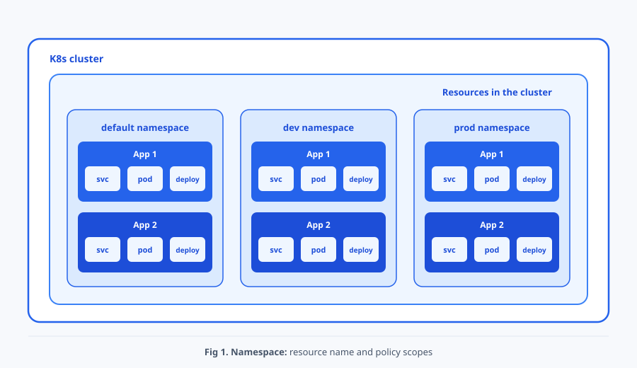

# 후속 초안. Namespace와 RBAC: 리소스 범위와 API 권한

> 9장을 Namespace와 Pod 배치 정책으로 재구성하기 전의 전체 본문을 보존한 후속 초안입니다. 정식 장 번호는 아직 정하지 않았습니다. Namespace로 리소스의 작업 범위를 나누고, RBAC으로 필요한 API 작업만 허용하는 방법을 살펴봅니다. 권한을 정의하고 주체에게 연결한 결과는 명령과 출력으로 확인합니다.

## 들어가며

<div align="center">


</div>

8장에서는 하나의 진입점에 여러 요청 경로를 연결하고, 이를 실제 프록시 설정으로 반영하는 과정을 살펴보았습니다. 이제 결제팀과 분석팀이 같은 클러스터에서 각자의 애플리케이션을 운영한다고 가정해 보겠습니다. 두 팀 모두 자신의 Pod 상태는 확인해야 하지만, 분석팀 계정에 결제 애플리케이션을 삭제하거나 인증서의 개인 키를 읽을 권한까지 줄 필요는 없습니다.

이런 환경에서는 리소스를 구분할 작업 범위와, 각 사용자가 수행할 수 있는 작업을 함께 정해야 합니다. Namespace로 팀과 환경의 리소스를 구분하고, RBAC으로 특정 주체에게 필요한 조회나 변경 작업을 허용할 수 있습니다. 어느 범위에 어떤 작업을 허용했는지 명확하면 운영 실수의 영향을 줄이고 권한 문제도 좁혀 찾을 수 있습니다.

## 1. Namespace의 범위

먼저 팀과 환경이 사용하는 리소스를 구분해 보겠습니다. **Namespace**는 하나의 클러스터에서 리소스 이름과 정책을 적용할 작업 범위를 논리적으로 나누는 리소스입니다. [[1]](#ref-1)

<div align="center">



</div>

Fig 1처럼 개발과 운영 환경을 `dev`와 `prod`로 나누면, 각 환경의 Pod와 Service를 별도로 조회하고 관리할 수 있습니다. 팀별로 나누고 싶다면 `payments`와 `analytics`처럼 Namespace를 정할 수도 있습니다.

Pod, Deployment, Service처럼 특정 Namespace에 속하는 것을 **Namespace 범위 리소스**라고 합니다. 반면 Node나 Namespace 자체는 클러스터 전체에서 관리하는 **클러스터 범위 리소스**입니다. 이 차이는 API 리소스 목록에서도 확인할 수 있습니다.

```bash
# API 리소스가 Namespace 범위인지 확인
kubectl api-resources --namespaced=true
kubectl api-resources --namespaced=false
```

다음은 각 목록에서 관련 항목만 발췌한 예시입니다.

```text
NAME          SHORTNAMES   APIVERSION   NAMESPACED   KIND
pods          po           v1           true         Pod
services      svc          v1           true         Service

NAME          SHORTNAMES   APIVERSION   NAMESPACED   KIND
nodes         no           v1           false        Node
namespaces    ns           v1           false        Namespace
```

- `NAMESPACED`: `true`인 리소스는 Namespace를 지정해 조회하고, `false`인 리소스는 클러스터 범위에서 조회합니다.

이 구분은 리소스의 관리 범위입니다. 서로 다른 Namespace의 Pod도 같은 Node에서 실행될 수 있습니다. 실제 작업에서는 명령이 어느 Namespace를 대상으로 하는지부터 정해야 합니다.

## 2. Namespace 생성과 작업 범위 선택

개발과 운영 리소스의 작업 범위를 `dev`와 `prod`로 만들어 보겠습니다. 아래 명령은 학습용 클러스터에 새 리소스를 만드는 실습이며, 같은 이름의 기존 Namespace가 없는 환경을 기준으로 합니다. 다음 매니페스트를 `namespaces.yaml`로 저장합니다.

```yaml
apiVersion: v1
kind: Namespace
metadata:
  name: dev
---
apiVersion: v1
kind: Namespace
metadata:
  name: prod
```

- `metadata.name`: `dev`와 `prod`라는 서로 다른 Namespace를 만듭니다. 이후 리소스의 소속을 지정할 때 이 이름을 사용합니다.

선언을 적용한 뒤 Namespace 목록과 현재 명령의 기본 작업 범위를 확인합니다.

```bash
# Namespace를 생성하고 현재 kubectl 작업 범위를 확인
kubectl apply -f namespaces.yaml
kubectl get namespaces
kubectl config view --minify -o jsonpath='{..namespace}'; echo
```

명령에 `-n` 또는 `--namespace`를 쓰면 해당 요청에만 Namespace가 적용됩니다. 생략하면 현재 kubeconfig 문맥의 Namespace를 사용하며, 별도 값이 없으면 일반적으로 `default`입니다. 반복해서 사용할 작업 범위는 문맥에 저장할 수 있습니다.

```bash
# 현재 문맥의 기본 Namespace를 dev로 바꾸고 명시적 범위와 비교
CH09_ORIGINAL_NAMESPACE=$(kubectl config view --minify -o jsonpath='{..namespace}')
: "${CH09_ORIGINAL_NAMESPACE:=default}"
kubectl config set-context --current --namespace=dev
kubectl get pods
kubectl get pods -n prod
kubectl get pods -A
```

`kubectl get pods`는 현재 문맥의 `dev`를, `-n prod`는 `prod`를 조회합니다. `-A`는 모든 Namespace의 Pod를 함께 보여 줍니다. 아래 출력은 아직 Pod를 만들기 전 `dev`를 조회한 예시입니다.

```text
No resources found in dev namespace.
```

이 결과는 조회한 범위에 Pod가 없다는 뜻입니다. 다른 Namespace의 Pod를 찾으려면 `-n`으로 그 범위를 지정해야 합니다. 실습 마지막에는 저장해 둔 원래 Namespace로 돌아갑니다.

## 3. 같은 이름과 Namespace 간 Service DNS

작업 범위를 나누면 같은 이름을 서로 다른 환경에서 사용할 수 있습니다. 리소스 이름은 같은 리소스 종류와 Namespace 안에서 고유해야 합니다. 따라서 `dev`와 `prod`에는 이름이 같은 `hello-nginx` Deployment와 `hello-svc` Service가 각각 존재할 수 있습니다.

```bash
# 두 Namespace에 이름이 같은 Deployment와 Service를 생성
for ns in dev prod; do
  kubectl create deployment hello-nginx -n "$ns" --image=nginx:1.28
  kubectl expose deployment hello-nginx -n "$ns" \
    --name=hello-svc --port=80 --target-port=80
done
kubectl get deployment,service,endpointslice -A
```

같은 Namespace의 Pod는 `hello-svc`라는 짧은 이름으로 Service를 찾습니다. 다른 Namespace에서는 `hello-svc.prod`처럼 Service와 Namespace를 함께 적습니다. 기본 클러스터 도메인이 `cluster.local`이면 전체 이름은 `hello-svc.prod.svc.cluster.local`입니다. [[2]](#ref-2)

```bash
# dev Pod에서 같은 Namespace와 prod Namespace의 Service DNS를 확인
kubectl run dns-check -n dev --image=busybox:1.36 --restart=Never \
  --command -- sleep 3600
kubectl wait -n dev --for=condition=Ready pod/dns-check --timeout=120s
kubectl exec -n dev dns-check -- nslookup hello-svc
kubectl exec -n dev dns-check -- nslookup hello-svc.prod
```

두 조회의 응답에서 확인할 부분은 다음과 같습니다. IP는 예시입니다.

```text
Name:      hello-svc.dev.svc.cluster.local
Address:   10.96.10.20

Name:      hello-svc.prod.svc.cluster.local
Address:   10.96.20.30
```

- `Name`: 짧은 이름 `hello-svc`는 조회한 Pod의 `dev`를 기준으로 해석되고, `hello-svc.prod`는 명시한 `prod`의 Service를 찾습니다.
- `Address`: 두 Service에 서로 다른 가상 IP가 할당되어 있습니다.

짧은 이름은 요청을 보내는 Pod의 Namespace를 기준으로 해석됩니다. Service의 Selector 역시 같은 Namespace의 Pod만 선택합니다. 이름이 같더라도 `dev/hello-svc`와 `prod/hello-svc`는 서로 다른 API 객체입니다.

## 4. 작업 범위와 API 권한의 연결

Namespace로 같은 이름의 리소스를 구분할 수 있어도, 누가 해당 리소스를 읽거나 바꿀지는 별도의 권한 정책으로 정해야 합니다. 예를 들어 분석팀 계정이 `payments`를 지정해 Pod 목록을 요청했을 때 허용할지 거부할지는 Namespace의 이름만으로 결정할 수 없습니다.

이를 위해 **RBAC**(Role-Based Access Control)을 사용합니다. RBAC은 허용할 리소스와 동작을 권한 집합으로 정의한 뒤, 그 권한을 사용자나 프로그램의 신원에 연결하는 방식입니다. 요청을 받은 API Server는 요청자의 신원을 확인한 뒤 연결된 권한으로 작업 허용 여부를 판단합니다.

## 5. 인증, 인가와 RBAC 주체

Kubernetes API Server는 요청의 **인증(Authentication)** 단계에서 요청자가 누구인지 확인하고, **인가(Authorization)** 단계에서 그 주체가 요청한 작업을 수행할 수 있는지 판단합니다. [[3]](#ref-3) 인증에 성공해도 인가 규칙이 없으면 요청은 `Forbidden`으로 거부될 수 있습니다.

RBAC의 주체는 다음 세 종류로 구분합니다.

- `User`: 인증 시스템이 제공하는 사람 또는 외부 프로그램의 사용자 이름입니다. Kubernetes에는 일반 사용자 객체를 만드는 API가 없습니다.
- `Group`: 인증된 사용자를 묶는 문자열입니다. 하나의 Binding으로 여러 사용자에게 권한을 연결할 수 있습니다.
- `ServiceAccount`: Pod와 자동화 프로그램이 사용할 수 있는 Namespace 범위의 Kubernetes 신원입니다. 전체 사용자 이름은 `system:serviceaccount:<Namespace>:<이름>`입니다.

어느 주체에게 권한을 줄지 정했다면, 허용할 작업과 이를 연결할 범위를 선택합니다.

- `Role`: 한 Namespace에서 허용할 API 그룹, 리소스, 동작을 정의합니다.
- `RoleBinding`: Role 또는 ClusterRole을 주체에게 연결하되 권한 범위를 RoleBinding의 Namespace로 제한합니다.
- `ClusterRole`: 클러스터 범위 리소스의 권한 또는 여러 Namespace에서 재사용할 권한 집합을 정의합니다.
- `ClusterRoleBinding`: ClusterRole을 클러스터 전체 범위에서 주체에게 연결합니다.[[4]](#ref-4)

권한은 합산됩니다. RBAC에는 다른 허용 규칙을 취소하는 명시적 deny 규칙이 없습니다. 따라서 필요한 주체에게 필요한 리소스와 동작만 주는 **최소 권한 원칙**을 적용해야 합니다.

예를 들어 Pod 상태와 로그를 확인하는 담당자에게는 그 두 조회 권한을 주면 됩니다. Secret 조회 권한은 인증서의 개인 키 같은 값까지 읽을 수 있게 하므로 별도로 판단해야 합니다. 이 기준에 따라 결제 애플리케이션의 상태를 확인할 계정에 필요한 권한만 연결해 보겠습니다. [[4]](#ref-4)

## 6. Role의 권한 정의와 RoleBinding의 주체 연결

실습에서는 Namespace와 RBAC 리소스를 만들 권한이 있는 계정을 사용합니다. 예시 결과는 새로 만든 ServiceAccount에 다른 Binding의 권한이 없는 상태를 기준으로 합니다. 먼저 현재 문맥이 학습용 클러스터인지 확인합니다.

```bash
# RBAC 실습 대상 클러스터와 현재 신원을 확인
kubectl config current-context
kubectl cluster-info
kubectl auth whoami
```

### 6.1 Namespace, Pod와 ServiceAccount 준비

로그를 조회할 Pod 하나와 권한을 비교할 두 ServiceAccount를 준비합니다. ServiceAccount는 인증에 사용할 신원이고, 조회 권한은 뒤에서 따로 연결합니다. 다음 선언을 `rbac-lab.yaml`로 저장합니다.

```yaml
apiVersion: v1
kind: Namespace
metadata:
  name: payments
  labels:
    payflow.io/team: payments
---
apiVersion: v1
kind: Pod
metadata:
  name: rbac-test
  namespace: payments
  labels:
    app: rbac-test
spec:
  containers:
  - name: app
    image: busybox:1.36
    command: ["sh", "-c", "while true; do echo rbac-test-running; sleep 30; done"]
---
apiVersion: v1
kind: ServiceAccount
metadata:
  name: payments-oncall
  namespace: payments
---
apiVersion: v1
kind: ServiceAccount
metadata:
  name: analytics-intern
  namespace: payments
```

- Pod와 ServiceAccount의 `metadata.namespace: payments`: 실습 대상과 두 주체의 소속 Namespace를 지정합니다.
- ServiceAccount의 `metadata.name`: `payments-oncall`은 권한을 받을 주체이고, `analytics-intern`은 권한이 없는 경우와 비교할 주체입니다.

BusyBox 컨테이너는 30초마다 로그를 남깁니다. 두 계정 모두 `payments`에 속하며, 이름만으로 팀이나 권한이 정해지지는 않습니다. 다음과 같이 적용하고 조회할 Pod가 준비되었는지 확인합니다.

```bash
# 실습 기반 리소스를 적용하고 Pod 준비 상태를 확인
kubectl apply -f rbac-lab.yaml
kubectl wait --for=condition=Ready pod/rbac-test -n payments --timeout=120s
kubectl get pod,serviceaccount -n payments
```

### 6.2 Role의 Pod 읽기 권한

준비한 Pod의 상태와 로그만 확인할 수 있도록 읽기 권한을 정의합니다. 다음 선언을 `payments-pod-reader-role.yaml`로 저장합니다.

```yaml
apiVersion: rbac.authorization.k8s.io/v1
kind: Role
metadata:
  name: payments-pod-reader
  namespace: payments
rules:
- apiGroups: [""]
  resources: ["pods", "pods/log"]
  verbs: ["get", "list", "watch"]
```

- `kind: Role`와 `metadata.namespace: payments`: 권한 규칙을 `payments` 범위에 정의합니다.
- `rules[].apiGroups`: 빈 문자열은 핵심 API 그룹을 뜻합니다.
- `rules[].resources: ["pods", "pods/log"]`: Pod와 로그 하위 리소스를 대상으로 합니다.
- `rules[].verbs`: `get`, `list`, `watch`만 허용합니다.

이 Role은 조회와 변경 감시를 허용합니다. 이제 `payments-pod-reader`라는 이름으로 이 권한 집합을 담당자 계정에 연결할 수 있습니다.

### 6.3 RoleBinding의 권한과 주체 연결

Role을 실제 계정이 사용하려면 RoleBinding으로 둘을 연결해야 합니다. `payments-oncall`에 앞의 읽기 권한을 주는 선언을 `payments-oncall-rolebinding.yaml`로 저장합니다.

```yaml
apiVersion: rbac.authorization.k8s.io/v1
kind: RoleBinding
metadata:
  name: payments-oncall-reader
  namespace: payments
subjects:
- kind: ServiceAccount
  name: payments-oncall
  namespace: payments
roleRef:
  apiGroup: rbac.authorization.k8s.io
  kind: Role
  name: payments-pod-reader
```

- `kind: RoleBinding`과 `metadata.namespace`: 연결된 권한을 `payments` Namespace에서 부여합니다.
- `subjects`: `payments` Namespace의 `payments-oncall` ServiceAccount를 선택합니다. 주체의 `namespace`는 신원 구분에 사용합니다.
- `roleRef`: `payments-pod-reader` Role을 연결합니다.

`subjects`가 권한을 받을 신원을 고르고, `roleRef`가 부여할 규칙을 고릅니다. 이 연결이 적용되기 전후를 비교하면 두 리소스의 역할을 확인할 수 있습니다.

### 6.4 권한 정의와 연결 결과 확인

Role과 RoleBinding을 적용하기 전후로 결과를 비교합니다. ServiceAccount 임퍼소네이션을 사용하는 명령은 현재 사용자에게 `serviceaccounts`에 대한 `impersonate` 권한이 있어야 합니다. 그 권한이 없으면 이 절의 `--as` 명령 자체가 `Forbidden`이므로 클러스터 관리자에게 실습용 권한을 요청하거나 9절의 토큰 방식을 사용합니다.

```bash
# Binding 전 거부를 확인한 뒤 Role과 RoleBinding을 적용
kubectl auth can-i list pods -n payments \
  --as=system:serviceaccount:payments:payments-oncall
kubectl apply -f payments-pod-reader-role.yaml
kubectl auth can-i list pods -n payments \
  --as=system:serviceaccount:payments:payments-oncall
kubectl apply -f payments-oncall-rolebinding.yaml
```

Role만 만든 상태에서는 주체와 연결되지 않아 두 결과가 모두 `no`입니다. RoleBinding까지 적용한 뒤 객체와 참조를 확인합니다.

```bash
# Role과 RoleBinding의 생성 및 참조를 확인
kubectl get role payments-pod-reader -n payments
kubectl get rolebinding payments-oncall-reader -n payments
kubectl get rolebinding payments-oncall-reader -n payments \
  -o jsonpath='{.roleRef.kind}/{.roleRef.name}{" -> "}{.subjects[0].namespace}/{.subjects[0].name}{"\n"}'
```

마지막 명령은 다음과 같이 권한 집합과 주체의 연결을 보여 줍니다.

```text
Role/payments-pod-reader -> payments/payments-oncall
```

선언이 연결되었으므로, 이제 이 주체가 허용한 작업만 수행할 수 있는지 확인할 수 있습니다.

## 7. `can-i`와 실제 허용·거부 검증

`kubectl auth can-i`로 특정 주체가 지정한 작업을 할 권한이 있는지 확인할 수 있습니다. 먼저 권한을 질의한 뒤 실제 Pod 목록과 로그를 요청해 결과를 비교하겠습니다.

```bash
# RoleBinding 주체와 비주체의 읽기 및 삭제 권한을 비교
kubectl auth can-i list pods -n payments \
  --as=system:serviceaccount:payments:payments-oncall
kubectl auth can-i list pods -n payments \
  --as=system:serviceaccount:payments:analytics-intern
kubectl auth can-i delete pods -n payments \
  --as=system:serviceaccount:payments:payments-oncall
kubectl auth can-i list pods -n kube-system \
  --as=system:serviceaccount:payments:payments-oncall
```

권한 질의 결과는 순서대로 다음과 같습니다.

```text
yes
no
no
no
```

- 첫 `yes`: RoleBinding으로 연결한 주체가 `payments`의 Pod 목록을 조회할 수 있습니다.
- 나머지 `no`: 다른 주체, 삭제 동작, 다른 Namespace에는 해당 권한을 부여하지 않았습니다.

```bash
# 허용 주체와 거부 주체로 Pod 목록과 로그를 실제 요청
kubectl get pods -n payments \
  --as=system:serviceaccount:payments:payments-oncall
kubectl logs pod/rbac-test -n payments \
  --as=system:serviceaccount:payments:payments-oncall
kubectl get pods -n payments \
  --as=system:serviceaccount:payments:analytics-intern
kubectl logs pod/rbac-test -n payments \
  --as=system:serviceaccount:payments:analytics-intern
```

`payments-oncall`은 Pod 목록을 조회하고 다음 로그를 받습니다.

```text
rbac-test-running
```

권한을 연결하지 않은 `analytics-intern`의 목록 조회는 다음과 같이 거부됩니다.

```text
Error from server (Forbidden): pods is forbidden: User "system:serviceaccount:payments:analytics-intern" cannot list resource "pods" in API group "" in the namespace "payments"
```

- `Forbidden`: `analytics-intern`의 두 요청이 권한 부족으로 거부되었다는 결과입니다.

공유 클러스터에서 예상과 달리 허용되면 다른 RoleBinding이나 ClusterRoleBinding에서 추가로 부여한 권한을 확인해야 합니다.

RoleBinding을 잠시 제거하면 같은 Role이 남아 있어도 허용이 사라집니다.

```bash
# RoleBinding 제거 시 거부되고 복구 후 다시 허용되는지 확인
kubectl delete -f payments-oncall-rolebinding.yaml
kubectl auth can-i list pods -n payments \
  --as=system:serviceaccount:payments:payments-oncall
kubectl apply -f payments-oncall-rolebinding.yaml
kubectl auth can-i list pods -n payments \
  --as=system:serviceaccount:payments:payments-oncall
```

두 결과는 `no`, `yes`여야 합니다. 이 비교로 Role은 권한 정의이고 RoleBinding은 실제 주체 연결이라는 차이를 확인할 수 있습니다.

## 8. ClusterRole과 두 가지 Binding 범위

앞의 RoleBinding은 `payments` 안에서 권한을 부여했습니다. Node처럼 클러스터 전체에서 관리하는 대상을 조회하거나 같은 규칙을 여러 Namespace에서 재사용하려면 ClusterRole을 사용합니다. 이때도 실제 부여 범위는 어떤 Binding으로 연결하는지에 따라 달라집니다.

### 8.1 Node 읽기용 ClusterRole과 ClusterRoleBinding

Node는 클러스터 범위 리소스이므로 Namespace 범위 Role로 권한을 줄 수 없습니다. 다음 두 매니페스트를 각각 `node-reader-clusterrole.yaml`, `payments-node-reader-clusterrolebinding.yaml`로 저장합니다.

```yaml
apiVersion: rbac.authorization.k8s.io/v1
kind: ClusterRole
metadata:
  name: payments-node-reader
rules:
- apiGroups: [""]
  resources: ["nodes"]
  verbs: ["get", "list", "watch"]
```

- `kind: ClusterRole`: Namespace에 속하지 않는 권한 집합을 정의합니다. 실제 부여 범위는 Binding과 대상 리소스에 따라 결정됩니다.
- `rules[].apiGroups`: 빈 문자열은 핵심 API 그룹을 뜻합니다.
- `rules[].resources: ["nodes"]`: 클러스터 범위 리소스인 Node를 대상으로 합니다.
- `rules[].verbs`: `get`, `list`, `watch`만 허용합니다.

Node 조회는 클러스터 전체에 대한 작업이므로, 다음 ClusterRoleBinding으로 주체와 연결합니다.

```yaml
apiVersion: rbac.authorization.k8s.io/v1
kind: ClusterRoleBinding
metadata:
  name: payments-oncall-node-reader
subjects:
- kind: ServiceAccount
  name: payments-oncall
  namespace: payments
roleRef:
  apiGroup: rbac.authorization.k8s.io
  kind: ClusterRole
  name: payments-node-reader
```

- `kind: ClusterRoleBinding`: 참조한 권한을 클러스터 범위로 부여합니다.
- `subjects`: `payments` Namespace의 `payments-oncall` ServiceAccount를 선택합니다. 주체의 `namespace`는 신원 구분에 사용합니다.
- `roleRef`: `payments-node-reader` ClusterRole을 연결합니다.

여기서 `subjects[].namespace`는 계정의 소속입니다. 권한은 ClusterRoleBinding을 통해 클러스터 범위로 부여됩니다.

ClusterRole만 적용한 상태와 ClusterRoleBinding까지 적용한 상태를 비교합니다.

```bash
# ClusterRole 단독 거부와 ClusterRoleBinding 연결 후 허용을 비교
kubectl apply -f node-reader-clusterrole.yaml
kubectl auth can-i list nodes \
  --as=system:serviceaccount:payments:payments-oncall
kubectl apply -f payments-node-reader-clusterrolebinding.yaml
kubectl auth can-i list nodes \
  --as=system:serviceaccount:payments:payments-oncall
kubectl auth can-i list nodes \
  --as=system:serviceaccount:payments:analytics-intern
kubectl get nodes \
  --as=system:serviceaccount:payments:payments-oncall
```

예상 결과는 `no`, `yes`, `no`이며 마지막 명령은 Node 목록을 반환합니다. 주체와 Binding을 바꾸었을 때 허용 범위가 달라지는 것을 확인할 수 있습니다.

```bash
# ClusterRole과 ClusterRoleBinding의 생성 및 참조를 확인
kubectl get clusterrole payments-node-reader
kubectl get clusterrolebinding payments-oncall-node-reader
kubectl get clusterrolebinding payments-oncall-node-reader \
  -o jsonpath='{.roleRef.kind}/{.roleRef.name}{" -> "}{.subjects[0].namespace}/{.subjects[0].name}{"\n"}'
```

마지막 명령에서 `ClusterRole/payments-node-reader -> payments/payments-oncall` 연결을 확인할 수 있습니다. 앞의 RoleBinding과 마찬가지로 연결을 제거했다가 복원하면 권한도 그에 따라 바뀝니다.

```bash
# ClusterRoleBinding 제거 전후의 Node 권한을 부정·긍정으로 재검증
kubectl delete -f payments-node-reader-clusterrolebinding.yaml
kubectl auth can-i list nodes \
  --as=system:serviceaccount:payments:payments-oncall
kubectl apply -f payments-node-reader-clusterrolebinding.yaml
kubectl auth can-i list nodes \
  --as=system:serviceaccount:payments:payments-oncall
```

### 8.2 RoleBinding을 통한 ClusterRole 재사용

같은 Pod 읽기 규칙을 여러 Namespace에서 재사용하려면 ClusterRole을 정의하고 각 Namespace의 RoleBinding에서 참조할 수 있습니다. 다음 두 객체를 `reusable-pod-reader.yaml`로 저장합니다.

```yaml
apiVersion: rbac.authorization.k8s.io/v1
kind: ClusterRole
metadata:
  name: reusable-pod-reader
rules:
- apiGroups: [""]
  resources: ["pods"]
  verbs: ["get", "list", "watch"]
---
apiVersion: rbac.authorization.k8s.io/v1
kind: RoleBinding
metadata:
  name: payments-reusable-reader
  namespace: payments
subjects:
- kind: ServiceAccount
  name: analytics-intern
  namespace: payments
roleRef:
  apiGroup: rbac.authorization.k8s.io
  kind: ClusterRole
  name: reusable-pod-reader
```

- ClusterRole의 `rules.resources`와 `verbs`: Pod의 `get`, `list`, `watch` 권한을 정의합니다.
- `kind: RoleBinding`과 `metadata.namespace: payments`: ClusterRole을 참조하더라도 권한은 `payments` Namespace에 한정됩니다.
- `subjects`: `payments`의 `analytics-intern` ServiceAccount에 권한을 부여합니다.
- `roleRef.kind: ClusterRole`과 `roleRef.name`: 재사용할 `reusable-pod-reader` 권한 집합을 선택합니다.

앞에서는 ClusterRoleBinding으로 Node 권한을 부여했지만, 이번에는 RoleBinding으로 `payments`의 Pod 조회만 허용합니다. 명령으로 이 범위의 차이를 확인해 보겠습니다.

```bash
# ClusterRole 재사용 권한이 RoleBinding의 Namespace에만 한정되는지 확인
kubectl apply -f reusable-pod-reader.yaml
kubectl auth can-i list pods -n payments \
  --as=system:serviceaccount:payments:analytics-intern
kubectl auth can-i list pods -n kube-system \
  --as=system:serviceaccount:payments:analytics-intern
kubectl auth can-i list nodes \
  --as=system:serviceaccount:payments:analytics-intern
```

권한 질의는 차례로 `yes`, `no`, `no`를 반환합니다. ClusterRole을 참조해도 RoleBinding으로 연결하면 해당 Namespace의 권한만 받으며, 이 예시의 규칙에는 Node 조회도 포함되어 있지 않습니다. 주체와 권한 집합뿐 아니라 Binding의 종류와 범위를 함께 확인해야 하는 이유입니다.

## 9. 선택 실습: 임시 토큰 kubeconfig

임퍼소네이션은 현재 사용자가 다른 주체의 인가 판단을 대신 요청하는 방식입니다. 실제 Pod와 자동화 도구는 보통 ServiceAccount 토큰으로 인증합니다. 다음 선택 실습은 TokenRequest API로 수명이 짧은 토큰을 만들고, 관리자 인증이 섞이지 않도록 서버와 CA 정보만 담은 임시 kubeconfig를 사용합니다.[[5]](#ref-5)

현재 사용자에게 두 ServiceAccount의 토큰 생성 권한이 필요합니다. 토큰은 인증 정보이므로 출력하거나 셸 기록과 파일에 장기 보관하지 않습니다.

```bash
# 수명이 짧은 ServiceAccount 토큰으로 허용과 거부를 확인
CH09_AUTH_DIR=$(mktemp -d)
CH09_SERVER=$(kubectl config view --minify -o jsonpath='{.clusters[0].cluster.server}')
kubectl config view --minify --flatten --raw \
  -o jsonpath='{.clusters[0].cluster.certificate-authority-data}' \
  | base64 --decode > "$CH09_AUTH_DIR/ca.crt"
kubectl --kubeconfig="$CH09_AUTH_DIR/config" config set-cluster lab \
  --server="$CH09_SERVER" --certificate-authority="$CH09_AUTH_DIR/ca.crt" >/dev/null
kubectl --kubeconfig="$CH09_AUTH_DIR/config" config set-context lab --cluster=lab >/dev/null
kubectl --kubeconfig="$CH09_AUTH_DIR/config" config use-context lab >/dev/null
CH09_TOKEN_OK=$(kubectl create token payments-oncall -n payments --duration=10m)
CH09_TOKEN_NG=$(kubectl create token analytics-intern -n payments --duration=10m)
kubectl --kubeconfig="$CH09_AUTH_DIR/config" --token="$CH09_TOKEN_OK" get nodes
kubectl --kubeconfig="$CH09_AUTH_DIR/config" --token="$CH09_TOKEN_NG" get nodes
unset CH09_TOKEN_OK CH09_TOKEN_NG
rm -rf "$CH09_AUTH_DIR"
```

첫 요청은 Node 목록을 반환하고 두 번째 요청은 `Forbidden`이어야 합니다. CA 데이터가 아닌 인증 플러그인만 사용하는 kubeconfig 등 환경에 따라 임시 설정 생성 방법은 달라질 수 있습니다. 장기 ServiceAccount Secret 토큰을 새로 만드는 방식보다 수명이 제한된 TokenRequest 토큰을 우선합니다.

## 10. RBAC 문제 진단과 정리

RBAC 문제가 발생하면 객체를 무작정 다시 만들기보다 요청의 신원, 범위, 리소스와 동작을 순서대로 확인합니다.

- `NotFound`: 먼저 `-n`과 리소스 이름을 확인합니다. 요청한 리소스가 그 범위에 실제로 존재하는지 확인합니다.
- `Forbidden`: 오류 메시지의 사용자 이름, API 그룹, 리소스, verb, Namespace를 읽고 `kubectl auth can-i`로 같은 요청을 재현합니다.
- 예상과 달리 허용됨: `kubectl auth can-i --list --as=<주체> -n <Namespace>`와 다른 RoleBinding·ClusterRoleBinding을 확인합니다. RBAC 권한은 합산됩니다.
- 예상과 달리 거부됨: `subjects`의 `kind`, `name`, ServiceAccount `namespace`와 `roleRef`를 확인합니다. `roleRef`는 생성 후 직접 변경할 수 없으므로 잘못 연결했다면 Binding을 다시 만듭니다.
- 로그만 거부됨: `pods`와 `pods/log`는 별도 리소스이므로 둘 다 필요한지 확인합니다.
- 임퍼소네이션 자체가 거부됨: 실습 사용자의 `impersonate` 권한 문제입니다. 대상 ServiceAccount의 권한 문제와 구분합니다.

```bash
# RBAC 객체의 연결과 주체의 합산 권한 조회
kubectl describe role payments-pod-reader -n payments
kubectl describe rolebinding payments-oncall-reader -n payments
kubectl describe clusterrole payments-node-reader
kubectl describe clusterrolebinding payments-oncall-node-reader
kubectl auth can-i --list -n payments \
  --as=system:serviceaccount:payments:payments-oncall
```

실습을 마치면 클러스터 범위 Binding부터 삭제하고, Namespace를 삭제하기 전에 그 안에 보존할 리소스가 없는지 확인합니다.

```bash
# 이 글에서 만든 RBAC과 Namespace 실습 리소스를 정리
kubectl delete -f payments-node-reader-clusterrolebinding.yaml --ignore-not-found
kubectl delete -f node-reader-clusterrole.yaml --ignore-not-found
kubectl delete -f reusable-pod-reader.yaml --ignore-not-found
kubectl delete -f payments-oncall-rolebinding.yaml --ignore-not-found
kubectl delete -f payments-pod-reader-role.yaml --ignore-not-found
kubectl delete -f rbac-lab.yaml --ignore-not-found
kubectl delete pod dns-check -n dev --ignore-not-found
for ns in dev prod; do
  kubectl delete deployment hello-nginx -n "$ns" --ignore-not-found
  kubectl delete service hello-svc -n "$ns" --ignore-not-found
done
kubectl delete -f namespaces.yaml --ignore-not-found
kubectl config set-context --current --namespace="${CH09_ORIGINAL_NAMESPACE:-default}"
```

`payments`가 공유 Namespace라면 `rbac-lab.yaml` 전체 삭제 대신 이 글에서 만든 객체만 개별 삭제합니다. 클러스터 관리자가 기존에 부여한 ClusterRole이나 Binding은 실습 정리 대상으로 포함하지 않습니다.

## 다음 글로 넘어가기 전에

이번 글에서 다룬 내용은 이렇습니다. Namespace로 팀과 환경의 리소스를 구분한 뒤, 각 주체가 수행할 작업을 RBAC으로 정할 수 있습니다. Role이나 ClusterRole에 필요한 권한을 정의하고 Binding으로 주체와 범위를 연결하면, API Server가 인증된 요청자의 작업을 허용할지 판단합니다. 연결 결과는 `can-i`와 실제 조회를 함께 사용해 확인하며, 예상과 다를 때는 주체, 대상 범위와 다른 Binding의 권한을 살펴봅니다.

작업 권한을 나누었더라도 한 애플리케이션이 서버 자원을 지나치게 사용하면 다른 애플리케이션에 영향을 줄 수 있습니다. 다음 글에서는 애플리케이션에 필요한 CPU와 메모리를 지정하고, 사용할 수 있는 양을 제한하는 방법을 살펴봅니다.

## 참고문헌

- <a id="ref-1"></a>[1] [Namespace 공식 문서](https://kubernetes.io/docs/concepts/overview/working-with-objects/namespaces/)
- <a id="ref-2"></a>[2] [Service와 Pod DNS 공식 문서](https://kubernetes.io/docs/concepts/services-networking/dns-pod-service/)
- <a id="ref-3"></a>[3] [인증 공식 문서](https://kubernetes.io/docs/reference/access-authn-authz/authentication/)
- <a id="ref-4"></a>[4] [RBAC 인가 공식 문서](https://kubernetes.io/docs/reference/access-authn-authz/rbac/)
- <a id="ref-5"></a>[5] [ServiceAccount 관리 공식 문서](https://kubernetes.io/docs/reference/access-authn-authz/service-accounts-admin/)
